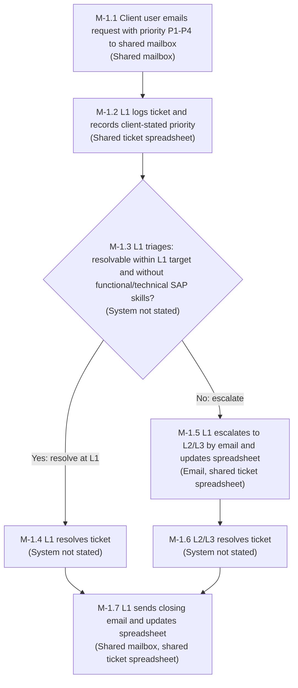
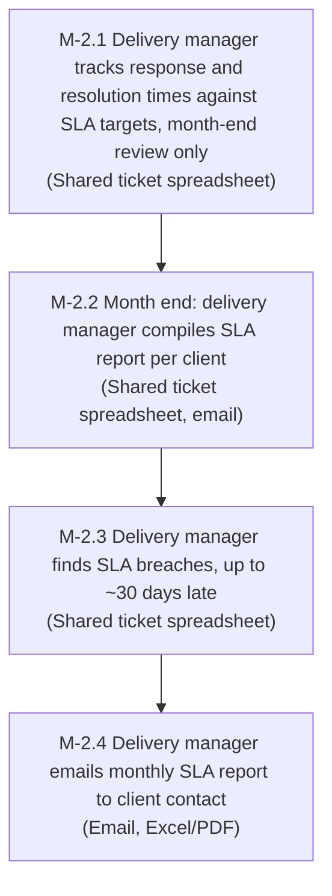
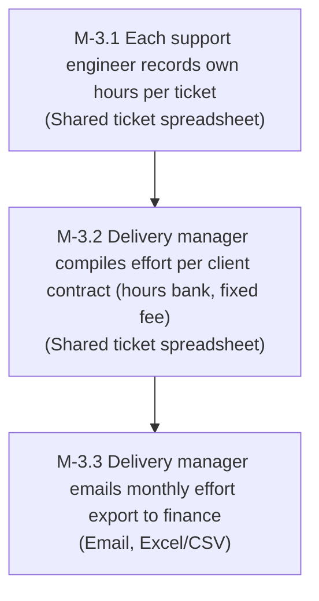

# As-is process maps

> **Collection file.** All as-is process maps for this project live in this one file. Add one `## Process M-N` section per process; never create a separate PRC-NNN file for an additional process. Downstream artifacts reference a specific process as `PRC M-N` (e.g. `PRC M-2`).

> **Evidence basis.** These maps rest on INT-001 v0.1 (answers by Mohanasunder, 2026-10-17) plus the as-is answers Mohanasunder (Business owner / BA) gave in chat on 2026-10-17 to OQ-004, OQ-005, OQ-008, OQ-015, OQ-016, OQ-017, OQ-018 and OQ-025 to OQ-032 (recorded as Answered in `docs/logs/open-questions-log.md`). No SOP documents or sample spreadsheets exist (OQ-004 answer). Each step carries an Evidence value: **Evidenced** (stated in an INT-001 answer or an answered OQ, cited) or **Unconfirmed** (needed to connect evidenced steps, or a step detail no source states). After the OQ-025 to OQ-032 answers, every step in M-1, M-2 and M-3 is Evidenced and every step has a named role; the few step details no source states are marked "Unconfirmed" in the Evidence column. Persona IDs follow the renumbering recorded as DEC-021.

## Input References
<!-- guidance: Exact IDs and versions of the approved artifacts used as input (status: Approved) -->
- PIB-001 v0.1 Phase 1 input brief (`docs/01-discovery/phase-input-brief.md`), Approved 2026-10-17 by Mohanasunder: § User Intent, § Readiness Verdict condition 2.
- INT-001 v0.1 Phase 1 interview (`docs/01-discovery/interview-record.md`), Approved 2026-10-17 by Mohanasunder: Q1, Q2, Q3, Q3a, Q4, Q5, Q6, Q8, Q17.
- Human answers logged in `docs/logs/open-questions-log.md`, all by Mohanasunder, 2026-10-17:
  - OQ-001 (KPI baselines and targets for G-1 to G-3) and OQ-020 (G-4 KPI: % of clients on the dashboard, target 100%).
  - OQ-004 (standard SLA terms and support hours; no SOPs or sample spreadsheets exist).
  - OQ-005 and OQ-017 (ticket flow: shared mailbox, one shared spreadsheet, L1 triage, escalation to L2/L3, close by email).
  - OQ-008 (effort data to finance monthly as Excel/CSV; contract types hours bank and fixed fee).
  - OQ-015 (who does each step: L1, delivery manager, each engineer).
  - OQ-016 (SLA breaches found at month-end report compilation, up to about 30 days late).
  - OQ-018 (L1 and L2/L3 are separate personas: PER-001 P-1 L1 support engineer (triage), P-2 L2/L3 support engineer (resolution), P-3 delivery manager, P-4 client user; persona renumbering recorded as DEC-021).
  - OQ-025 (process owners: L1 lead owns M-1; delivery manager owns M-2 and M-3).
  - OQ-026 (escalation criteria: L1 cannot resolve within its target, or the ticket needs functional/technical SAP skills; hand-off by email plus spreadsheet update).
  - OQ-027 (the client states priority P1 to P4 in the email; L1 records it).
  - OQ-028 (L1 always sends the closing email and updates the spreadsheet at closure).
  - OQ-029 (delivery manager emails the SLA report to the client contact monthly as Excel/PDF).
  - OQ-030 (delivery manager tracks SLA in the same shared spreadsheet, reviewed at month end only).
  - OQ-031 (delivery manager compiles effort per contract and emails the Excel/CSV export to finance).
  - OQ-032 (engineers record effort in the same shared spreadsheet, hours per ticket).
- BRF-001 (`docs/01-discovery/business-brief.md`, same-phase sibling, read-only): goal IDs G-1 to G-4 only, used to label the KPI each pain point affects.
- Raw input `docs/01-discovery/inputs/requirements.txt` (one sentence; no process content).

## Purpose And Scope
<!-- guidance: What this artifact covers and what it does not -->
Covers: how the company's AMS team runs support for its clients today, for SAP applications (INT-001 Q1, Q4, Q17), using a shared mailbox and one shared spreadsheet (INT-001 Q6; OQ-005, OQ-017). Three processes, chosen because they match the three release 1 capabilities in INT-001 Q5:
- M-1 Ticket handling (incidents and service requests).
- M-2 SLA tracking and client reporting.
- M-3 Effort tracking against contracts.

Does not cover: to-be design, requirements, or technology; billing and invoicing (out of scope, INT-001 Q8, OQ-008; M-3 stops at the monthly effort hand-off to finance). Step details still not stated by any source are marked Unconfirmed in the step tables.

---

## Process M-1: Ticket handling

### Process Overview
<!-- guidance: Purpose, owner, trigger, outcome -->
| Field | Value |
| --- | --- |
| Purpose | Receive and resolve client incidents and service requests for SAP applications (INT-001 Q1, Q4, Q5) |
| Owner | L1 lead (OQ-025) |
| Trigger | A client user emails the shared mailbox, stating the priority P1 to P4 (OQ-005, OQ-017, OQ-027) |
| Outcome | Ticket resolved; L1 sends the closing email and updates the shared spreadsheet (OQ-005, OQ-028) |
| Actors | Client user (PER P-4); L1 support engineer (PER P-1: logging, priority recording, triage, L1 resolution, escalation, closure); L2/L3 support engineer (PER P-2: resolution after escalation) (INT-001 Q3; OQ-005, OQ-015, OQ-018, OQ-026, OQ-028) |
| Systems | Shared mailbox (email); one shared ticket spreadsheet (OQ-005, OQ-017, OQ-026, OQ-028) |

### Steps
<!-- guidance: Table: step, actor, system, pain point -->
| Step | Description | Actor | System | Evidence | Pain point |
| --- | --- | --- | --- | --- | --- |
| M-1.1 | Client user emails an incident or service request to the shared mailbox, stating the priority (P1 to P4) | Client user (PER P-4) | Shared mailbox (email) | Evidenced: OQ-005, OQ-017 (mailbox); OQ-027 (client states priority in the email) | PP-1.2, PP-1.3 |
| M-1.2 | L1 logs the ticket in the one shared spreadsheet and records the client-stated priority | L1 support engineer (PER P-1) | Shared ticket spreadsheet | Evidenced: OQ-005, OQ-017 (one spreadsheet), OQ-015 (L1 records tickets), OQ-027 (L1 records priority); INT-001 Q2 (manual tracking) | PP-1.1, PP-1.2, PP-1.3 |
| M-1.3 | L1 triages the ticket and decides: resolve at L1 or escalate. Escalate when L1 cannot resolve within its target, or the ticket needs functional/technical SAP skills | L1 support engineer (PER P-1) | Not stated | Evidenced: OQ-005 (step), OQ-026 (escalation criteria). Unconfirmed: the value of L1's resolution target and the system used for triage (OQ-034) | PP-1.4 |
| M-1.4 | L1 resolves the ticket | L1 support engineer (PER P-1) | Not stated | Evidenced: OQ-005 ("resolves or escalates") | None evidenced |
| M-1.5 | L1 escalates the ticket to L2/L3 by email and updates the shared spreadsheet | L1 support engineer (PER P-1) | Email; shared ticket spreadsheet | Evidenced: OQ-005 (step), OQ-026 (hand-off by email plus spreadsheet update) | PP-1.1, PP-1.4 |
| M-1.6 | L2/L3 resolves the escalated ticket | L2/L3 support engineer (PER P-2) | Not stated | Evidenced: OQ-005, OQ-018 (L2/L3 resolve). Unconfirmed: how L2/L3 tells L1 the ticket is resolved, so L1 can close it (OQ-035) | None evidenced |
| M-1.7 | L1 sends the closing email to the client and updates the shared spreadsheet | L1 support engineer (PER P-1) | Shared mailbox (email); shared ticket spreadsheet | Evidenced: OQ-005 ("closed by email"), OQ-028 (L1 always closes and updates the spreadsheet) | PP-1.1 |

### Diagram
<!-- guidance: Mermaid flowchart block -->
Solid boxes are Evidenced steps; dashed boxes are Unconfirmed steps. All M-1 steps are Evidenced; Unconfirmed details sit in the step table Evidence column.

### Pain Points
<!-- guidance: Ranked, each linked to a step -->
Ranked per A-004 (link to KPIs: G-1, then G-2, then G-3, then G-4).

| Rank | ID | Pain point | Step | Source | KPI affected (BRF-001 goal) |
| --- | --- | --- | --- | --- | --- |
| 1 | PP-1.4 | Escalation waits for L1 to miss its own target: one escalation criterion is "L1 cannot resolve within its target", so tickets reach L2/L3 only after L1 time has run, and the hand-off is a manual email plus spreadsheet update | M-1.3, M-1.5 | OQ-026; OQ-005 | BRF G-2 MTTR (3 days -> 1 day, OQ-001) |
| 2 | PP-1.1 | Tickets logged, escalated, and closed by hand: L1 copies each emailed request into the shared spreadsheet, updates it again at escalation and at closure, and sends the closing email | M-1.2, M-1.5, M-1.7 | INT-001 Q2 (manual effort), Q6; OQ-005, OQ-015, OQ-026, OQ-028 | BRF G-3 Manual admin and reporting hours per month (40 -> 10 h/month, OQ-001) |
| 3 | PP-1.2 | No single view of tickets: ticket data is split between the shared mailbox and the shared spreadsheet (one spreadsheet, so the split is between the two tools, not between spreadsheets) | M-1.1, M-1.2 | INT-001 Q2 (fragmented tools); OQ-017 | BRF G-4 % of clients on the dashboard (target 100%, OQ-020) |
| 4 | PP-1.3 | Priority, which drives the SLA targets, exists only as free text in the client email until L1 copies it into the spreadsheet | M-1.1, M-1.2 | OQ-027; OQ-004 (SLA targets per priority) | BRF G-1 SLA compliance % (80% -> 95%, OQ-001) |

Note on ranking: A-004 ranks by KPI order (G-1 first). PP-1.3 links to G-1 but is ranked 4 because its effect on G-1 is indirect (no source states that priorities are recorded wrongly); PP-1.4 is ranked first because OQ-026 states the delay directly. Mohanasunder chose to keep this ordering within A-004 (DEC-023, `docs/logs/decision-log.md`).

No pain point is evidenced for M-1.4 or M-1.6.

---

## Process M-2: SLA tracking and client reporting

### Process Overview
<!-- guidance: Purpose, owner, trigger, outcome -->
| Field | Value |
| --- | --- |
| Purpose | Track response and resolution times against client SLA targets and report SLA performance per client (INT-001 Q2, Q5) |
| Owner | Delivery manager (OQ-025) |
| Trigger | Month end: SLA data in the shared spreadsheet is reviewed at month end only (OQ-016, OQ-030) |
| Outcome | Monthly SLA report per client, emailed to the client contact as Excel/PDF; SLA breaches identified at month-end compilation (OQ-015, OQ-016, OQ-029) |
| Actors | Delivery manager (PER P-3; OQ-015, OQ-030); client contact (PER P-4 client user) as report recipient (OQ-029) |
| Systems | Shared ticket spreadsheet; email; Excel/PDF report (INT-001 Q2, Q6; OQ-005, OQ-029, OQ-030) |
| SLA terms | Standard SLA (OQ-004): P1 response 1 h / resolution 4 h; P2 4 h / 1 day; P3 1 day / 3 days; P4 2 days / 5 days. Support hours 9x5, business days |

### Steps
<!-- guidance: Table: step, actor, system, pain point -->
| Step | Description | Actor | System | Evidence | Pain point |
| --- | --- | --- | --- | --- | --- |
| M-2.1 | Delivery manager tracks ticket response and resolution times against the standard SLA targets in the shared spreadsheet, reviewing at month end only | Delivery manager (PER P-3) | Shared ticket spreadsheet | Evidenced: OQ-015 (delivery manager tracks SLA), OQ-030 (same shared spreadsheet, month-end review only), OQ-004 (targets) | PP-2.1 |
| M-2.2 | At month end, delivery manager compiles the SLA report per client | Delivery manager (PER P-3) | Shared ticket spreadsheet, email | Evidenced: OQ-015 (compiles SLA reports), OQ-016 (month-end compilation), OQ-005; INT-001 Q2 ("reports in email or spreadsheets") | PP-2.2, PP-2.3 |
| M-2.3 | SLA breaches are found during month-end compilation, up to about 30 days after the target was missed | Delivery manager (PER P-3) | Shared ticket spreadsheet | Evidenced: OQ-016, OQ-030; INT-001 Q2 ("found too late") | PP-2.1 |
| M-2.4 | Delivery manager emails the SLA report to the client contact, monthly, as Excel/PDF | Delivery manager (PER P-3) sends; client contact (PER P-4) receives | Email; Excel/PDF | Evidenced: OQ-029 | PP-2.2 |

### Diagram
<!-- guidance: Mermaid flowchart block -->
Solid boxes are Evidenced steps; dashed boxes are Unconfirmed steps. All M-2 steps are Evidenced.

### Pain Points
<!-- guidance: Ranked, each linked to a step -->
Ranked per A-004 (link to KPIs: G-1, then G-2, then G-3, then G-4).

| Rank | ID | Pain point | Step | Source | KPI affected (BRF-001 goal) |
| --- | --- | --- | --- | --- | --- |
| 1 | PP-2.1 | SLA data is reviewed at month end only, so breaches are found up to about 30 days after the miss; with P1 resolution at 4 h, a breach cannot be acted on before it happens | M-2.3 (detection), M-2.1 (tracking) | INT-001 Q2 (found too late); OQ-016 (month end, up to ~30 days); OQ-030 (month-end review only); OQ-004 (targets) | BRF G-1 SLA compliance % (80% -> 95%, OQ-001); BRF G-2 MTTR (3 days -> 1 day, OQ-001) |
| 2 | PP-2.2 | Delivery manager compiles SLA reports by hand each month from the shared spreadsheet and email, and emails each client contact an Excel/PDF report | M-2.2, M-2.4 | INT-001 Q2 (manual effort), Q6; OQ-015, OQ-016, OQ-029 | BRF G-3 Manual admin and reporting hours per month (40 -> 10 h/month, OQ-001) |
| 3 | PP-2.3 | No single view across clients and applications when reporting: data is split between the shared mailbox and the shared spreadsheet | M-2.2 | INT-001 Q2 (fragmented tools); OQ-017 | BRF G-4 % of clients on the dashboard (target 100%, OQ-020) |

---

## Process M-3: Effort tracking against contracts

### Process Overview
<!-- guidance: Purpose, owner, trigger, outcome -->
| Field | Value |
| --- | --- |
| Purpose | Record time spent on client support and compile it against client contracts, as input to billing (INT-001 Q5) |
| Owner | Delivery manager (OQ-025) |
| Trigger | Engineer works on a ticket (recording, OQ-032); month end (compilation and export to finance, OQ-008, OQ-031) |
| Outcome | Monthly effort data per contract emailed to finance as Excel/CSV; billing and invoicing themselves are out of scope (INT-001 Q8, OQ-008) |
| Actors | Support engineers L1 (PER P-1) and L2/L3 (PER P-2), each recording own effort (OQ-015, OQ-032); delivery manager (PER P-3) compiles and sends (OQ-031); finance as recipient (OQ-008) |
| Systems | Shared ticket spreadsheet (OQ-032); email; Excel/CSV export (OQ-008, OQ-031) |
| Contract types | Hours bank, fixed fee (OQ-008) |

### Steps
<!-- guidance: Table: step, actor, system, pain point -->
| Step | Description | Actor | System | Evidence | Pain point |
| --- | --- | --- | --- | --- | --- |
| M-3.1 | Each engineer records their own effort as hours per ticket in the shared spreadsheet | Support engineer: L1 (PER P-1), L2/L3 (PER P-2) | Shared ticket spreadsheet | Evidenced: OQ-015 (each engineer records own effort), OQ-032 (same shared spreadsheet, hours per ticket); INT-001 Q2, Q6 | PP-3.1, PP-3.2 |
| M-3.2 | Delivery manager compiles effort against each client contract (hours bank or fixed fee) | Delivery manager (PER P-3) | Shared ticket spreadsheet | Evidenced: OQ-031 (delivery manager compiles per contract), OQ-008 (contract types); INT-001 Q5. Unconfirmed: how per-ticket hours are mapped to a contract (OQ-036) | PP-3.1, PP-3.2 |
| M-3.3 | Delivery manager emails the effort export to finance monthly as Excel/CSV | Delivery manager (PER P-3) sends; finance receives | Email; Excel/CSV | Evidenced: OQ-008 (monthly, Excel/CSV, to finance), OQ-031 (delivery manager emails it) | PP-3.1 |

### Diagram
<!-- guidance: Mermaid flowchart block -->
Solid boxes are Evidenced steps; dashed boxes are Unconfirmed steps. All M-3 steps are Evidenced.

### Pain Points
<!-- guidance: Ranked, each linked to a step -->
Ranked per A-004 (link to KPIs: G-1, then G-2, then G-3, then G-4).

| Rank | ID | Pain point | Step | Source | KPI affected (BRF-001 goal) |
| --- | --- | --- | --- | --- | --- |
| 1 | PP-3.1 | Effort recorded, compiled, and exported by hand: each engineer types hours per ticket into the shared spreadsheet, and each month the delivery manager compiles them per contract and emails an Excel/CSV to finance | M-3.1, M-3.2, M-3.3 | INT-001 Q2 (manual effort), Q6; OQ-008, OQ-015, OQ-031, OQ-032 | BRF G-3 Manual admin and reporting hours per month (40 -> 10 h/month, OQ-001) |
| 2 | PP-3.2 | No single view of effort across clients and contracts: effort is held per ticket and seen per contract only after the monthly compilation | M-3.1, M-3.2 | INT-001 Q2 (fragmented tools); OQ-031, OQ-032 | BRF G-4 % of clients on the dashboard (target 100%, OQ-020) |

---

## Assumptions
<!-- guidance: Each labeled A-NNN and logged in docs/logs/assumptions-log.md -->
- A-004 (Confirmed by Mohanasunder, 2026-10-17): pain points are ranked by their link to the BRF-001 goal KPIs (G-1 to G-3 from INT-001 Q7; G-4 from OQ-020): G-1 SLA compliance %, then G-2 MTTR, then G-3 manual admin and reporting hours, then G-4 % of clients on the dashboard, because INT-001 Q2 lists the three problems without an order. Logged in `docs/logs/assumptions-log.md`. The M-1 ranking note explains the one placement (PP-1.3), kept by Mohanasunder's decision DEC-023.
- A-003 (Confirmed, INT-001 Q17): SAP applications only; applies to all three processes.

No other assumptions: details not stated in INT-001 or an answered OQ are marked Unconfirmed in the step tables, not assumed.

## Open Questions
<!-- guidance: Each labeled OQ-NNN and logged in docs/logs/open-questions-log.md -->
Logged in `docs/logs/open-questions-log.md`.

| ID | Priority | Status | Affects |
| --- | --- | --- | --- |
| OQ-001 | High | Answered (Mohanasunder, 2026-10-17) | KPI baselines and targets cited in the pain point tables (G-1 to G-3) |
| OQ-020 | Medium | Answered (Mohanasunder, 2026-10-17) | G-4 KPI cited for PP-1.2, PP-2.3, PP-3.2 |
| OQ-004 | High | Answered (Mohanasunder, 2026-10-17) | Standard SLA terms and 9x5 support hours in M-2 overview, PP-1.3, PP-2.1; no SOPs or sample spreadsheets exist |
| OQ-005 | High | Answered (Mohanasunder, 2026-10-17) | M-1 flow (M-1.1 to M-1.7); monthly SLA report compilation (M-2.2) |
| OQ-008 | Medium | Answered (Mohanasunder, 2026-10-17) | M-3.3 recipient, form, frequency; contract types in M-3 overview |
| OQ-015 | High | Answered (Mohanasunder, 2026-10-17) | Actors: L1 (M-1.2), delivery manager (M-2.1 to M-2.3), each engineer (M-3.1) |
| OQ-016 | High | Answered (Mohanasunder, 2026-10-17) | M-2.3 detection point and delay; PP-2.1 |
| OQ-017 | Medium | Answered (Mohanasunder, 2026-10-17) | M-1.1 trigger (shared mailbox); one shared spreadsheet; PP-1.2, PP-2.3 |
| OQ-018 | Medium | Answered (Mohanasunder, 2026-10-17) | L1 and L2/L3 named as separate roles in M-1 |
| OQ-025 | Medium | Answered (Mohanasunder, 2026-10-17) | Owners: L1 lead (M-1), delivery manager (M-2, M-3) |
| OQ-026 | Medium | Answered (Mohanasunder, 2026-10-17) | Escalation criteria and hand-off: M-1.3, M-1.5; PP-1.4 |
| OQ-027 | Medium | Answered (Mohanasunder, 2026-10-17) | Client states priority, L1 records it: M-1.1, M-1.2; PP-1.3 |
| OQ-028 | Medium | Answered (Mohanasunder, 2026-10-17) | L1 sends closing email and updates spreadsheet: M-1.7 |
| OQ-029 | Medium | Answered (Mohanasunder, 2026-10-17) | M-2.4 evidenced: monthly Excel/PDF report emailed to client contact |
| OQ-030 | Medium | Answered (Mohanasunder, 2026-10-17) | M-2.1 system (shared spreadsheet) and month-end-only review; PP-2.1 |
| OQ-031 | Medium | Answered (Mohanasunder, 2026-10-17) | M-3.2, M-3.3 evidenced: delivery manager compiles and emails to finance |
| OQ-032 | Medium | Answered (Mohanasunder, 2026-10-17) | M-3.1 system (shared spreadsheet) and granularity (hours per ticket) |
| OQ-034 | Low | Open (to be settled in Phase 2) | M-1.3: value of L1's own resolution target and the triage tool |
| OQ-035 | Low | Open (to be settled in Phase 2) | M-1.6: how L2/L3 tells L1 a ticket is resolved, so L1 can close it |
| OQ-036 | Low | Open (to be settled in Phase 2) | M-3.2: how per-ticket hours are mapped to a contract |

## Traceability Links
<!-- guidance: Upstream and downstream IDs, or 'Not applicable - reason'.
     Cite individual processes downstream as PRC M-N (e.g. PRC M-2). -->
- Upstream: PIB-001 v0.1; INT-001 v0.1 (Q1, Q2, Q3, Q3a, Q4, Q5, Q6, Q8, Q17); BRF-001 G-1 to G-4 (KPI labels). As-is step evidence, SLA terms, and KPI baselines and targets come from the answered open questions listed in § Open Questions. Open questions and assumptions this artifact depends on are listed in § Open Questions and § Assumptions (logged in `docs/logs/`).
- Downstream (Phase 1): `docs/01-discovery/business-brief.md` (problem), `personas.md` (pain points), `scope-statement.md`, `risks.md`, Phase 1 `SUMMARY.md` may cite PRC M-1, PRC M-2, PRC M-3.
- Downstream (Phase 2): user stories (REQ) cite the process and pain point they fix: PRC M-1 (incident and service-request management, escalation), PRC M-2 (SLA timers, SLA reporting), PRC M-3 (effort tracking). No REQ IDs exist yet.

## Quality Checklist
- [x] Every template section is filled, or marked "Not applicable - <reason>"
- [x] Inputs referenced are Approved artifacts at the stated versions
- [x] Nothing invented: no requirements, systems, users, endpoints, or libraries without a source
- [x] Every process has a unique M-N ID; IDs are consecutive and never reused
- [x] Every step has an actor
- [x] Pain points ranked and each linked to a step
- [x] Diagram matches the step table for each process
- [x] Assumptions and open questions are logged and linked
- [x] Traceability links are present upstream and downstream
- [x] Terminology follows .ai/standards/glossary.md
- [x] Vague words removed (etc., as needed, appropriate)

## Approval Record
| Field | Value |
| --- | --- |
| Decision | Approve |
| Approver | Mohanasunder |
| Role | Business owner / BA |
| Version | 0.2 |
| Conditions | None |
| Comments | Reviewed after validation run 5; KPI baselines and targets confirmed; OQ-034 to OQ-036 deferred to Phase 2. |
| Timestamp | 2026-10-17 06:05 UTC |
