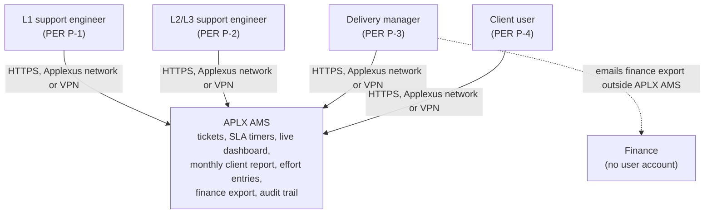
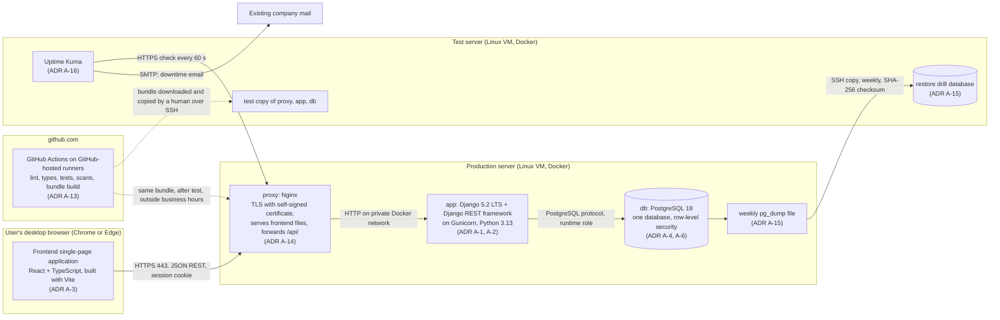
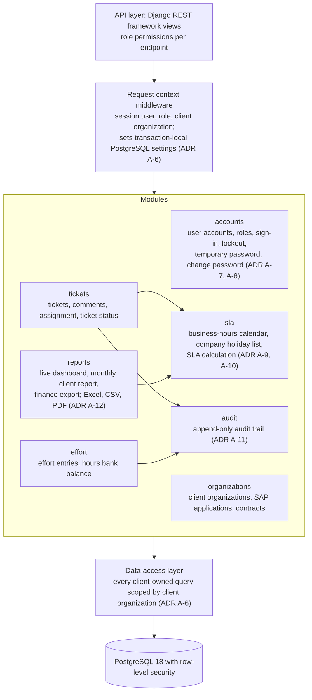

# APLX AMS: Architecture Overview

> **Single file.** There is exactly one architecture overview per project. Always use `--id ARC --out docs/03-architecture/architecture-overview.md` when calling `new_artifact.py`; never auto-name as `ARC-NNN.md`.

## Input References
<!-- guidance: Exact IDs and versions of the approved artifacts used as input (status: Approved) -->
- PIB-003 v0.2 § Interview Answers (Q1 to Q12), § Constraints, § Assumptions (A-026 to A-029), § Open Questions; IRC-004 v0.2.
- INT-003 v0.2 § Questions And Answers (evidence record).
- SUM-002 v0.4 § Decisions, § Constraints Set, § What The Next Phase Needs.
- NFR-001 v0.3 § NFR N-1 to N-9.
- REQ-001 v0.3 § Story S-20, S-21, S-22, S-30, S-31.
- BR-001 v0.3 § Rule B-1 to B-11, § Rule B-2, § Rule B-20, § Rule B-22, § Rule B-23.
- PRS-001 v0.3 § Product Scope (F-1 to F-8), § Non-Goals; GLO-001 v0.3 § Terms.
- RSK-001 v0.2 § Risk R-3, R-6; RSK-002 v0.1 § Risk R-1, R-2; SUM-001 v0.3 § Decisions, § Constraints Set.
- SCR S-4 (Approved 2026-10-17): NFR-001 v0.3 § NFR N-6 (security events), REQ-001 v0.3 § Story S-32, S-33, BR-001 v0.3 § Rule B-24, GLO-001 v0.3 § Terms, EPC-001 v0.3, BKL-001 v0.3, PRS-001 v0.3, SUM-002 v0.4 § Decisions, § Constraints Set.
- Human answers, Mohanasunder, chat, 2026-10-17: OQ-052, OQ-055 to OQ-061, OQ-063, OQ-066; DEC-027 (public repository), DEC-028 (RSK-003 R-1 accepted for the pilot), DEC-029 (self-signed certificate), DEC-030 (session limits), DEC-031 (TLS certificate and key recovery copy).
- This phase (Draft): TEC-001 v0.3 (technology comparison), ADR-001 v0.3 (ADR A-1 to A-17), THR-001 v0.2 (threat model), TOP-001 v0.2 (deployment topology), CST-001 v0.2 (cost estimate), RSK-003 v0.3 (Phase 3 risks).

## Purpose And Scope
<!-- guidance: What this artifact covers and what it does not -->
Covers: the structure of APLX AMS release 1 as C4 context, container and component views; the (absent) external integrations and the operational connections; the architectural answer and verification for every NFR N-1 to N-9; architectural risks; scale assumptions. Decisions are in `adrs.md` (ADR A-1 to A-17); option scores in `technology-comparison.md`.

Does not cover: the OpenAPI contract, schema DDL, screen specifications (Phase 4); threats and controls (THR-001, `threat-model.md`); server sizing, network paths, RTO budget and cost (TOP-001, CST-001).

Scale basis: about 10 internal users and about 20 client users, 30 concurrent users, 1 pilot client organization (Applexus), up to about 10 SAP applications (SUM-001 v0.3 § Decisions; NFR N-2); under 200 tickets per month (INT-003 Q12), so under 12,000 tickets in 5 years; database under 5 GB for 5 years (A-032). Cost basis: no new paid licences; every component is free and open source (TEC-001 § Licence check summary); new spend INR 0, GitHub Actions minutes free on the public repository (CST-001; DEC-027). Servers: 2 existing Ubuntu LTS VMs, each 2 vCPU, 4 GB RAM, 40 GB free disk (OQ-055 answer).

## Context
<!-- guidance: C4 level 1: system, users, external systems (Mermaid) -->
APLX AMS is used by 4 roles (BR B-21) over HTTPS from the Applexus network or VPN (INT-003 Q6). In the pilot, client users are Applexus staff (SUM-001 v0.3 § Decisions). APLX AMS has no system integrations in release 1 (PRS NG-3, NG-5, NG-6; SCP-001 OS-3): no mailbox, no ITSM tool, no email sending. Finance receives the finance export by email from the delivery manager outside APLX AMS (BR B-18).

## Containers
<!-- guidance: C4 level 2: applications, data stores, and their protocols (Mermaid) -->
Production server (Ubuntu LTS VM, Docker Engine and Docker Compose; ADR A-5): 3 containers on a private Docker network; only `proxy` publishes ports 443 and 80 (redirect). The test server runs the same containers for testing plus the restore drill database (ADR A-15) and the uptime checker (ADR A-16). CI on GitHub builds the bundle a human deploys (ADR A-13).

| Container | Technology | Responsibility | Protocol in / out |
| --- | --- | --- | --- |
| Frontend single-page application | React, TypeScript, Vite build (ADR A-3) | Pages for the 4 roles; IST display (ADR A-9) | HTTPS JSON to `/api/` on the same host name |
| proxy | Nginx (ADR A-14) | TLS termination with the self-signed certificate, HTTP to HTTPS redirect, security headers, sign-in rate limit, static frontend files, forward `/api/` | In: HTTPS 443, HTTP 80 (redirect). Out: HTTP to `app` on the private network |
| app | Django 5.2 LTS, Django REST framework, Gunicorn (ADR A-2) | All business logic, data-access layer, SLA calculation, audit trail, file generation | In: HTTP from `proxy`. Out: PostgreSQL to `db` |
| db | PostgreSQL 18 (ADR A-4) | All application state; row-level security; append-only audit table | In: PostgreSQL from `app` only; port not published |
| Uptime Kuma (test server) | Uptime Kuma 2 (ADR A-16) | Availability check, certificate expiry warning, email alert | Out: HTTPS to production `proxy`; SMTP to the existing company mail |
| CI | GitHub Actions (ADR A-13) | Build, test, scan, bundle | No connection to the servers |

## Components
<!-- guidance: C4 level 3 for the main containers -->
Backend `app` container (modular monolith, ADR A-1):

| Component | Responsibility | Rules and stories served |
| --- | --- | --- |
| API layer | REST endpoints from the Phase 4 OpenAPI contract; role checks per endpoint | BR B-21 |
| Request context middleware | Opens the request transaction; sets user kind and client organization for row-level security | BR B-20; NFR N-7 |
| accounts | Sign-in, failed sign-in count and lock, session limits (60 minutes idle, 12 hours maximum), temporary password by the delivery manager, change own password with current password, deactivation | REQ S-20, S-21, S-30, S-31; BR B-23; NFR N-5 |
| organizations | Client organizations, SAP applications, contracts (one active contract) | PRS F-5, F-6 |
| tickets | Raise, comment, acknowledge, priority change, assign, awaiting client, Resolved, Closed | PRS F-1, F-2; BR B-3 to B-11 |
| sla | Pure function: elapsed business time, on track, at risk, breached, met, escalation flag; company holiday list with change times | BR B-1 to B-11; PRS F-3 |
| effort | Effort entries, own edits until month end (IST), delivery manager corrections, hours bank balance | BR B-15 to B-17; PRS F-5 |
| reports | Live dashboard, monthly client report (generate, review, publish), finance export; files generated on request, not stored | BR B-12 to B-14, B-18; PRS F-4, F-5 |
| audit | One audit function called in the same transaction as each status, priority, assignment and effort change, and for the 5 security events; viewing rules per role | BR B-22, B-24; NFR N-6; PRS F-8; REQ S-32, S-33 |
| Data-access layer | The only path to client-owned data; scopes queries; backed by row-level security | BR B-20; NFR N-7 |

Frontend single-page application: role-based page groups (client user pages; L1 and L2/L3 support engineer pages; delivery manager setup and report pages), one API client module that sends the session cookie and CSRF token, and one time-formatting module that shows IST. Screens are specified in the Phase 4 UI specification.

## Integration Architecture
<!-- guidance: Each integration: system, protocol, data, owner -->
Product integrations: Not applicable - release 1 has no integration with any external system: no ITSM tool (PRS NG-3; SCP-001 OS-3), no mailbox intake (PRS NG-5), no email alerts to users (PRS NG-6), no email password reset (BR B-23), no finance system (BR B-18: the delivery manager emails the export outside APLX AMS).

Operational connections (not product integrations; network paths P-1 to P-7 in TOP-001):

| Connection | Protocol | Data | Owner |
| --- | --- | --- | --- |
| Developers and builder agents to the public github.com repository; GitHub Actions CI | HTTPS (git) | Source code, test results, built bundle; no secrets, no production data, no server addresses or host names (ADR A-13) | Architect / tech lead (Mohanasunder); public repository on the personal account for the pilot (DEC-027) |
| Human deploy: workstation to test server, then production server | SSH file copy | Built bundle (image archives, Compose file, checksums) | Release manager / DevOps (Mohanasunder) |
| Weekly backup copy: production server to test server | SSH, write-only backup account | `pg_dump` file with production data (ADR A-15) | Release manager / DevOps (Mohanasunder) |
| Uptime check: test server to production server | HTTPS, every 60 s | Sign-in page response, certificate expiry | Release manager / DevOps (Mohanasunder) |
| Downtime and backup-failure alert: test server to the existing company mail | SMTP email | Alert message to the Release manager / DevOps | Release manager / DevOps (Mohanasunder) |
| Self-signed HTTPS certificate: generated on the production server; installed as trusted on every user's machine; root-only recovery copy of certificate and key on the test server (DEC-031) | Manual; SSH copy | Certificate and key (ADR A-14, A-17) | Release manager / DevOps generates and keeps the recovery copy; Applexus IT installs trust before go-live |
| Firewall rules and DNS record of the APLX AMS host name | Applexus IT change request | Allowed paths; host name moved to the test server within 2 business hours during a recovery | Applexus IT |

## NFR Mapping
<!-- guidance: Table: NFR-ID, architectural answer, verification -->
| NFR | Target | Architectural answer | Verification |
| --- | --- | --- | --- |
| NFR N-1 Availability | 99% of business hours per month (about 1.9 hours allowed) | Containers with restart policy and health checks (ADR A-5); deploys only outside business hours with a kept previous bundle for rollback (ADR A-13); Uptime Kuma checks the sign-in page every 60 s, warns before certificate expiry and emails the Release manager / DevOps (ADR A-16, A-14); recovery from server loss on the test server, worst case 5.75 business hours including up to 2 hours for Applexus IT to move the host name (ADR A-15; TOP-001). Single production server: a host loss breaches N-1 for that month; accepted for the pilot (RSK-003 R-1) | Uptime Kuma check history; monthly business-hours availability per the N-1 formula (Phase 8 monitoring specification, Phase 9 review) |
| NFR N-2 Performance | p95 under 2 s per page at 30 concurrent users | Same-origin single-page application with static files served by Nginx (ADR A-3); 5 Gunicorn workers, PostgreSQL `shared_buffers` 1 GB, about 75% of production RAM at the 5-year ceiling (TOP-001); SLA state computed in memory from under 200 tickets per month (ADR A-10); files generated on request (ADR A-12) | Phase 7 load test on the test server (same size as production): 30 users (10 engineer, 20 client user) for 30 minutes over the N-2 journeys, p95 per page |
| NFR N-3 Backup and recovery | Backup every 7 days; RPO 7 days; RTO 9 business hours | All state in one PostgreSQL database, no files on disk (ADR A-4); weekly `pg_dump` copied to the test server by a write-only backup account, 8 weekly dumps kept; extra dump before each production deploy (ADR A-15, A-13); recovery budget 5.75 business hours worst case (TOP-001) | Timed restore drill on the test server before go-live; drill database dropped after the checks are recorded |
| NFR N-4 Retention | Unlimited; 0 automatic deletions | No purge or deletion job for application data (ADR A-1, A-10: no background worker); user accounts are deactivated, not deleted (REQ S-20); company holiday list entries are marked removed, not deleted (ADR A-10); audit table has no DELETE grant (ADR A-11); user deletions only where a rule allows them (own effort entries, BR B-15), audited; dump rotation deletes only older backup copies (ADR A-15) | Phase 7 review that no deletion job exists; retrieve a seeded ticket Closed 13 or more months earlier |
| NFR N-5 Sign-in and password policy | 8+ characters with upper-case, lower-case, digit; lock 30 min after 5 failures; cleared by a temporary password; no MFA | `accounts` module: Django authentication with a policy validator, per-user-account failed count and lock time, temporary password by the delivery manager clears the lock, change own password with current password; server-side sessions ending after 60 minutes idle and 12 hours after sign-in, HttpOnly Secure SameSite=Strict cookie, CSRF (ADR A-7); Argon2id storage (ADR A-8); HTTPS only with a certificate trusted on every user's machine and a sign-in rate limit (ADR A-14); no second factor (PRS NG-7) | Phase 6 feature tests and Phase 7 security tests for each N-5 verification step and both session limits |
| NFR N-6 Audit trail | 100% of the 4 change types and the 5 security events audited; 0 editable or deletable entries; 0 entries holding a password value (v0.3, SCR S-4) | One audit function writes each change in the same transaction and each security event (refused sign-ins and lockouts in their own transaction); the function takes no password parameter; runtime database role has INSERT and SELECT only on the audit table; viewing: every internal user sees every ticket's audit entries plus their own security events, the delivery manager sees all security events, client users see no audit entries (ADR A-11; BR B-22, B-24) | Phase 6 tests per change type and security event (REQ S-32, S-33); Phase 7 system test comparing every change and event with its audit entry; search of audit entries for the passwords used; update or delete of an audit entry refused by the database |
| NFR N-7 Client data separation | 0 cross-organization records across tests with 2 client organizations | Client organization ID on every client-owned row; one data-access layer; PostgreSQL row-level security with forced policies, a runtime role without `BYPASSRLS`, and transaction-local context (ADR A-6); file downloads use the same path (ADR A-12) | Phase 6 and Phase 7 tests with client organizations A and B (list, open by ticket reference, report view and download, raise against the other organization's SAP application), run in CI against PostgreSQL; re-run before the first external client organization goes live |
| NFR N-8 Browsers | 100% acceptance tests pass on Chrome and Edge, current and previous major, desktop | React TypeScript single-page application built for those 4 browser versions; no mobile layout (ADR A-3; PRS NG-4); self-signed certificate installed as trusted on every user's machine by Applexus IT before go-live, so no browser warning (ADR A-14) | Phase 7 acceptance suite on each of the 4 browser versions with the pilot certificate; sign-in page opens with no certificate warning |
| NFR N-9 Personal data | 2 personal data fields per user account (name, email) | Custom user account model with name and email as the only personal data fields (ADR A-2); no other personal fields in client organizations, contracts or effort entries (Phase 4 database design); passwords stored only as Argon2id hashes (ADR A-8); security events hold the user account, not extra personal data (ADR A-11) | Phase 4 design review of every field; Phase 7 review of the user account setup form |

Coverage: 9 of 9 NFRs mapped.

## Risks
<!-- guidance: Architectural risks and mitigations -->
Phase 3 risks are in RSK-003 (`risks.md`, R-1 to R-11) with rows in `docs/logs/risk-register.md`; threats in THR-001.

| Risk | Mitigation | Reference |
| --- | --- | --- |
| Single production server: a host loss breaches N-1 for that month | Container restarts; recovery on the test server within 5.75 business hours; accepted for the pilot by the Architect / tech lead | RSK-003 R-1 |
| Manual deploy by one person; public repository on a personal account | Runbook with checksums, pre-deploy dump, rollback; workflow and secret-scanning rules (ADR A-13) | RSK-003 R-2, R-6 |
| Delivery manager knows temporary passwords | Own password change; security events recorded (ADR A-11); accepted by the Architect / tech lead (DEC-033) | RSK-003 R-3 |
| Test server holds production data and the TLS key recovery copy, readable by Mohanasunder and Applexus IT administrators | Write-only backup account, dumps encrypted at rest with age or GnuPG (DEC-034), root-only key copy, drill database dropped (ADR A-14, A-15) | RSK-003 R-4 |
| Self-signed certificate: warnings clicked through, or expiry | Trust installed by Applexus IT on every machine; renewal reminder and expiry warning (ADR A-14, A-16) | RSK-003 R-5 |
| Test server disk about 77% used at the 5-year ceiling | Monthly disk check; fewer dumps or more disk | RSK-003 R-7 |
| Production RAM about 75% used on the minimum server size | Phase 7 load test; tune workers or ask Applexus IT for more RAM | RSK-003 R-8 |
| One person holds the offline key that decrypts every dump and the TLS key copy | Sealed second copy in an Applexus IT safe, checked by the restore drill once a year (DEC-037) | RSK-003 R-11 |
| Django 5.2 LTS security support ends April 2028 | Upgrade to the next LTS before then | RSK-003 R-9 |
| Passwords typed as account names kept in the audit trail (not covered by the NFR N-6 target) | Delivery manager-only view; user guidance; accepted by the Architect / tech lead (DEC-032) | RSK-003 R-10 |
| A missed filter exposes another client organization's data | Data-access layer plus row-level security plus A/B tests in CI (ADR A-6) | RSK R-6 |
| Up to 7 days of data lost on a restore; no MFA | As decided by the human; options recorded (ADR A-15, A-7) | RSK-002 R-1, R-2 |

## Assumptions
<!-- guidance: Each labeled A-NNN and logged in docs/logs/assumptions-log.md -->
- A-026 (Open): cost estimate in INR with new spend expected 0 (CST-001).
- A-027 (Open): UTC storage, IST display, SLA on the IST calendar (ADR A-9).
- A-028 (Open): Argon2id or bcrypt; Argon2id chosen (ADR A-8).
- A-029 (Open): open-source Excel, CSV and PDF libraries (ADR A-12).
- A-030 (Confirmed by the OQ-055 answer): each server has 2 vCPU, 4 GB RAM, 40 GB free disk, Ubuntu LTS with Docker Engine, SSH from production to test.
- A-031 (Open): the weekly dump goes to the test server, which then holds production data (ADR A-15).
- A-032 (Open): database under 5 GB for 5 years; no file attachments in release 1.
- A-033, A-034 (Open, infra-cost-analyst): dump count and size; peak load 15 API requests per second (TOP-001).
- A-038 (Open, security-architect): no secret manager; secrets as root-only files (ADR A-17).

## Open Questions
<!-- guidance: Each labeled OQ-NNN and logged in docs/logs/open-questions-log.md -->
- Answered by Mohanasunder, 2026-10-17, chat: OQ-052, OQ-055 to OQ-061, OQ-063, OQ-066 (applied in ADR A-5, A-7, A-13 to A-17 and this overview); OQ-062, OQ-064, OQ-065 through SCR S-4 (ADR A-11).
- No open question remains for this overview.

## Traceability Links
<!-- guidance: Upstream and downstream IDs, or 'Not applicable - reason' -->
- Upstream: PIB-003; INT-003; SUM-002; NFR-001 (N-1 to N-9); REQ-001 (S-20, S-21, S-22, S-30, S-31, S-32, S-33); BR-001 (B-1 to B-24); PRS-001 (F-1 to F-8, NG-3 to NG-7); GLO-001; RSK-001 (R-3, R-6); RSK-002 (R-1, R-2); SUM-001.
- Same phase: ADR-001 (ADR A-1 to A-17); TEC-001; THR-001; TOP-001; CST-001; RSK-003 (R-1 to R-11).
- Downstream: Phase 4 OpenAPI contract, database design, backend design, UI specification, coding standards; Phase 7 NFR test report; Phase 8 runbooks and monitoring specification.

## Quality Checklist
- [x] Every template section is filled, or marked "Not applicable - <reason>"
- [x] Inputs referenced are Approved artifacts at the stated versions (exception: same-phase Drafts TEC-001, ADR-001, THR-001, TOP-001, CST-001, RSK-003 are cited as context, not as approved input)
- [x] Nothing invented: no requirements, systems, users, endpoints, or libraries without a source
- [x] Assumptions and open questions are logged and linked
- [x] Traceability links are present upstream and downstream
- [x] Terminology follows .ai/standards/glossary.md
- [x] Vague words removed (etc., as needed, appropriate)

## Approval Record
| Field | Value |
| --- | --- |
| Decision | Approve |
| Approver | Mohanasunder |
| Role | Architect / tech lead |
| Version | 0.3 |
| Conditions | None |
| Comments | Reviewed after validation run 6; gate decisions DEC-027 to DEC-038 applied; THR-001 envelope-opening log proposal adopted as DEC-039. |
| Timestamp | 2026-10-17 11:25 UTC |
