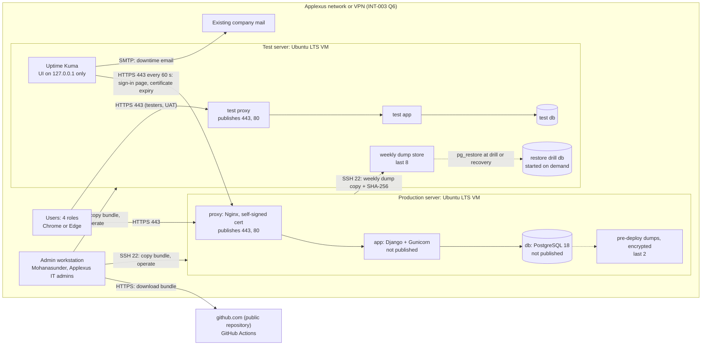

# APLX AMS: Deployment Topology

> **Single file.** There is exactly one deployment topology per project. Always use `--id TOP --out docs/03-architecture/deployment-topology.md` when calling `new_artifact.py`; never auto-name as `TOP-NNN.md`.

## Input References
<!-- guidance: Exact IDs and versions of the approved artifacts used as input (status: Approved) -->
- PIB-003 v0.2 (Approved) and INT-003 v0.2 (Approved) § Interview Answers Q1 (Linux VMs, Docker allowed), Q2 (1 production server, 1 test server; restore drill on test), Q3 (PostgreSQL), Q5 (GitHub-hosted CI, manual deploy), Q6 (Applexus network or VPN only, HTTPS), Q7 (weekly native dump to another server), Q10 (self-hosted uptime checker on the test server, every minute), Q12 (under 200 tickets per month); § Constraints; § Assumptions A-026.
- NFR-001 v0.3 (Approved) § NFR N-1 (99% of business hours, checked every minute), N-2 (p95 under 2 s at 30 concurrent users), N-3 (backup every 7 days, RPO 7 days, RTO 9 business hours, restore drill on a separate environment), N-4 (retention unlimited), N-8 (Chrome and Edge).
- SUM-002 v0.4 (Approved) § Constraints Set; BR-001 v0.3 (Approved) § Rule B-2 (business hours 09:00 to 18:00 IST, Monday to Friday, minus the company holiday list); REQ-001 v0.3 (Approved) § Story S-20 (user accounts of the 4 roles).
- Human answers, Mohanasunder, chat 2026-10-17: OQ-055 (servers at the A-030 minimum, current Ubuntu LTS, Docker Engine, SSH production to test allowed), OQ-056 (alerts by email to the Release manager / DevOps via existing company mail), OQ-057 and DEC-029 (self-signed TLS certificate for the pilot), OQ-058 and DEC-027 (public repository), OQ-059 (Applexus IT owns firewall and DNS; moves the host name within 2 business hours on request), OQ-060 (Docker Engine in WSL 2 on workstations), OQ-063 (OS access: Mohanasunder and Applexus IT admins), OQ-066 (Applexus IT installs the self-signed certificate as trusted on every user's machine, client users included, before go-live), DEC-028 (RSK-003 R-1 accepted for the pilot); DEC-031 (restore the production TLS certificate and key from a protected root-only recovery copy on the test server); DEC-034 (weekly dumps encrypted at rest with a free open-source tool, age or gpg; RPO stays 7 days); DEC-036 (weekly dumps, pre-deploy dumps and the TLS certificate and key recovery copy all encrypted at rest; the private decryption key is held offline by the Release manager / DevOps, brought to a server only for a restore or drill, then removed); DEC-037 (a sealed second copy of the offline decryption key held by Applexus IT in a locked safe, used only if the Release manager / DevOps is unavailable, checked by the restore drill once a year); DEC-038 (Applexus IT hands over the sealed key copy within 2 business hours of a request).
- `project.md` capacity settings (`max_test_runtime_minutes: 10`).
- Same phase, Draft (structure this topology hosts, not used as approved input): ARC-001 v0.3 § Containers; ADR-001 v0.3 ADR A-4, A-5, A-13, A-14, A-15, A-16, A-17; TEC-001 v0.3 § Licence check summary; RSK-003 v0.3 R-1, R-2; THR-001 v0.2 (T-27, T-30).

## Purpose And Scope
<!-- guidance: What this artifact covers and what it does not -->
Covers: where APLX AMS release 1 runs: the 4 environments, the 2 existing on-prem Ubuntu LTS VMs and what each hosts, network paths and ports, the deploy flow (ADR A-13), the backup and restore flow (ADR A-15), monitoring placement (ADR A-16), CPU, memory and disk sizing against the confirmed server size (A-030, OQ-055) and the A-032 database ceiling, and how availability (NFR N-1), performance (NFR N-2) and recovery (NFR N-3) are met.

Does not cover: Compose files, scheduler entries, firewall rule syntax or runbooks (Phase 8 infrastructure as code and runbooks); threats, certificate key handling and controls (`threat-model.md`); money (`cost-estimate.md`). No Applexus infrastructure facts beyond INT-003 and the answers listed above are stated; remaining unknowns are labelled assumptions.

## Environments
<!-- guidance: Dev, test, staging, production -->
| Environment | Where | Runs | Data | Users | Purpose |
| --- | --- | --- | --- | --- | --- |
| Local developer | Developer workstation or builder agent session | Same Compose project as the servers (`proxy`, `app`, `db` PostgreSQL 18), built locally; Docker Engine in WSL 2, no Docker Desktop (OQ-060 answer) | Synthetic data only | Developers, builder agents (Phase 6) | Build and run feature tests |
| CI | GitHub-hosted `ubuntu-latest` runner on the public repository (ADR A-13; DEC-027) | Lint, type checks, tests with a PostgreSQL 18 service container (client data boundary tests, NFR N-7), security and licence scans, bundle build | Synthetic data only; no secrets, no server addresses (the repository and its CI logs are public) | Automated | Prove each change; produce the deploy bundle |
| Test | Existing test server (Ubuntu LTS VM, INT-003 Q2; OQ-055) | (a) Test copy of `proxy`, `app`, `db`; (b) restore drill database: a separate PostgreSQL 18 container started only for a drill or a recovery; (c) Uptime Kuma container (ADR A-16); (d) weekly dump store, dumps encrypted at rest (ADR A-15; DEC-034); (e) root-only recovery copy of the production TLS certificate and key, encrypted at rest (DEC-031, DEC-036) | (a) Test data; (b) production data once restored; (d) production data, encrypted (A-031; DEC-034, DEC-036); (e) production certificate and key, encrypted (DEC-036); no private decryption key is stored on the server (DEC-036): same access control as production | QA lead, testers, UAT users (Phase 7); Release manager / DevOps | Pre-production test of every bundle; restore drill (NFR N-3); availability check (NFR N-1); stand-in production during a recovery |
| Production | Existing production server (Ubuntu LTS VM, INT-003 Q2; OQ-055) | `proxy` (Nginx), `app` (Django, Gunicorn), `db` (PostgreSQL 18) in one Compose project (ADR A-5) | Production data | The 4 roles (BR B-21), about 30 concurrent users | Live service |
| Staging | Not applicable - INT-003 Q2 sets exactly 2 servers; the test server is the pre-production stage | - | - | - | - |

OS-level access (SSH, sudo, Docker) on both servers: Mohanasunder and Applexus IT admins only (OQ-063 answer).

## Network And Hosting
<!-- guidance: Diagram and notes -->
Hosting: 2 existing on-prem VMs, each at the A-030 minimum (2 vCPU, 4 GB RAM, 40 GB free disk), current Ubuntu LTS with Docker Engine (OQ-055 answer); Docker Compose (ADR A-5). Not internet-facing; reachable only from the Applexus network or VPN (INT-003 Q6). Applexus IT owns the firewall rules and the DNS record of the APLX AMS host name (OQ-059 answer). No connection between github.com and either server (ADR A-13).

TLS: a self-signed certificate for the pilot (DEC-029), terminated at Nginx (ADR A-14). Applexus IT installs the certificate as trusted on every user's machine, client users included, before go-live, so Chrome and Edge show no warning (OQ-066 answer); Uptime Kuma trusts the same certificate and warns before it expires (ADR A-16). A protected root-only recovery copy of the production certificate and key, encrypted at rest (DEC-036), is kept on the test server and restored during a recovery, so the certificate users already trust stays in use (DEC-031); key protection follows THR-001.



Required network paths (Applexus IT sets the rules, OQ-059 answer):

| # | From | To | Port and protocol | Purpose | Source |
| --- | --- | --- | --- | --- | --- |
| P-1 | Applexus network and VPN clients | Production server | TCP 443 HTTPS; TCP 80 (redirect to 443 only) | Users | INT-003 Q6; ADR A-14 |
| P-2 | Applexus network and VPN clients | Test server | TCP 443 HTTPS; TCP 80 (redirect) | Testers and UAT | INT-003 Q2 |
| P-3 | Admin workstations of Mohanasunder and Applexus IT admins | Both servers | TCP 22 SSH | Bundle copy, operation, Uptime Kuma UI by SSH tunnel | ADR A-13; OQ-063 answer |
| P-4 | Production server | Test server | TCP 22 SSH | Weekly dump copy | INT-003 Q7; ADR A-15; OQ-055 answer |
| P-5 | Test server (Uptime Kuma) | Production server | TCP 443 HTTPS | Availability check every 60 s | INT-003 Q10; ADR A-16 |
| P-6 | Test server (Uptime Kuma) | Existing company mail server | SMTP (port set by the company mail configuration in Phase 8) | Downtime email to the Release manager / DevOps (Mohanasunder) | OQ-056 answer |
| P-7 | Internet | Either server | Blocked | Not internet-facing | INT-003 Q6 |

Not published on any interface: `app` and `db` ports (private Docker network only); Uptime Kuma web UI (bound to 127.0.0.1 on the test server, reached only through an SSH tunnel over P-3, admin password meeting NFR N-5; ADR A-16, THR T-27). Server outbound internet access is not needed at runtime: images arrive as archives in the bundle (ADR A-13).

Deploy flow (ADR A-13; Q5: a human deploys a built package):

```mermaid
sequenceDiagram
    participant CI as GitHub Actions
    participant H as Release manager (admin workstation)
    participant T as Test server
    participant P as Production server
    CI->>CI: lint, types, tests, scans, build bundle (image archives, Compose file, config templates, SHA-256)
    H->>CI: download bundle over HTTPS
    H->>T: copy bundle over SSH, verify SHA-256
    T->>T: docker load, migrate (one-off container, owner role), compose up
    Note over T: Phase 7 tests pass on the test server
    Note over H,P: Window outside 09:00-18:00 IST Mon-Fri and company holidays excluded from N-1
    H->>P: pg_dump before deploy, encrypted with the public key (DEC-036; kept: last 2)
    H->>P: copy same bundle, verify SHA-256
    P->>P: docker load, migrate, compose up, health checks
    H->>P: sign-in page check; Uptime Kuma green
    Note over P: Rollback: previous bundle kept on server; if a migration cannot be reversed, bring the offline key, decrypt and restore the pre-deploy dump, then remove the key
```

Backup and restore flow (ADR A-15; NFR N-3):
1. Weekly, outside business hours, a scheduled job on the production server runs `pg_dump` (custom format) from the `db` container, encrypts the file with the public key of a free open-source tool (age, BSD-3-Clause, or GnuPG, GPL-3.0; choice in Phase 8) so it is stored only encrypted (DEC-034, DEC-036); encryption needs no private key on either server, computes SHA-256 of the encrypted file, copies it to the test server over P-4, verifies the checksum there, and keeps the last 8 weekly dumps (A-033). A failed dump or copy alerts by email (Phase 8 runbook). RPO: 7 days or less.
2. Restore drill before go-live (Phase 7 or 8), after each PostgreSQL major upgrade, and once a year using the sealed second key copy from the Applexus IT safe, which is then resealed and returned (DEC-037): start the restore drill database container on the test server, the Release manager / DevOps brings the offline private decryption key to the test server (DEC-036), decrypts the latest dump to a temporary file (up to 2 GB, deleted after the restore), `pg_restore` it, removes the key, record the elapsed time, check ticket, effort and audit data up to the dump time (NFR N-3 verification), then stop and remove the drill database.
3. Recovery after loss of the production server: see the RTO budget under Scaling And Availability.

Capacity sizing against the confirmed server size (2 vCPU, 4 GB RAM, 40 GB free disk each; A-030 confirmed by the OQ-055 answer) at the 5-year ceiling (database 5 GB, A-032; dump 2 GB, A-033; load per A-034):

| Resource | Production server use | Test server use |
| --- | --- | --- |
| vCPU | Peak 15 API requests/s (A-034); at about 50 ms CPU per request this is about 0.75 vCPU, 38% of 2 vCPU; PDF generation (ADR A-12) adds short peaks | Test stack light; restore drill `pg_restore` uses up to 2 vCPU for its duration |
| RAM | OS and Docker Engine 0.6 GB; `proxy` 0.05 GB; `app` 5 Gunicorn workers x 0.15 GB + 0.3 GB PDF peak = 1.05 GB; `db` `shared_buffers` 1 GB + 0.3 GB connections = 1.3 GB; total 3.0 GB of 4 GB (75%) | OS and Docker Engine 0.6 GB; test stack 0.85 GB (2 workers, `shared_buffers` 256 MB); Uptime Kuma 0.25 GB; restore drill db during a drill 0.8 GB; total 2.5 GB of 4 GB (63%) during a drill, 1.7 GB otherwise |
| Disk | Images current + previous 2.4 GB; bundle archives current + previous 2 GB; database 5 GB + WAL 1 GB; pre-deploy dumps 2 x 2 GB; weekly dump before copy 2 GB; rotated container logs 1 GB; total 17.4 GB of 40 GB (44%) | Images (incl. Uptime Kuma) 2.9 GB; bundle archives 2 GB; test database 2 GB; restore drill database 6 GB; 8 weekly dumps 16 GB; Uptime Kuma history 1 GB; logs 1 GB; total 30.9 GB of 40 GB (77%) |

Result: both servers fit at the 5-year ceiling; the test server disk (77%, 9.1 GB free) is the binding resource: if dumps exceed 2 GB or more than 8 are kept, reduce the dump count or ask Applexus IT for more disk. Year-1 use is far lower (database under 1 GB at under 2,400 tickets).

## Scaling And Availability
<!-- guidance: Targets and mechanisms -->
| NFR | Target | Mechanism | Verification |
| --- | --- | --- | --- |
| NFR N-1 | 99% of business hours per month: 189 h x 1% = 1.89 h (113 min) of unavailability allowed | Restart policy `unless-stopped` and health checks on all 3 containers (ADR A-5): a crashed container is back in about 1 min; all deploys, migrations, VM patching and reboots outside business hours, so planned work uses 0 min of the allowance (ADR A-13); Uptime Kuma checks the production sign-in page every 60 s from the test server, warns before the self-signed certificate expires, and emails the Release manager / DevOps (ADR A-16, A-14; OQ-056 answer) | Uptime Kuma history; monthly availability = available minutes / business-hours minutes x 100 (Phase 8 monitoring specification, Phase 9 review) |
| NFR N-2 | p95 under 2 s per page at 30 concurrent users | One production instance: peak about 15 API requests/s (A-034) against 5 Gunicorn workers; static frontend served by Nginx; database under 5 GB with `shared_buffers` 1 GB holds the working set in memory | Phase 7 load test, 30 users for 30 min, on the test server (same size as production) |
| NFR N-3 | Backup every 7 days; RPO 7 days; RTO 9 business hours | Weekly dump to the test server; pre-deploy dump; recovery on the test server as stand-in (budget below) | Timed restore drill on the test server before go-live |
| NFR N-4 | 0 automatic deletions | No purge job in any container; dump rotation deletes only older copies of the backup files, never application data (A-033) | Phase 7 review |
| NFR N-8 | Chrome and Edge accept the site | Self-signed certificate (DEC-029) installed as trusted on every user's machine by Applexus IT before go-live (OQ-066 answer) | Phase 7 acceptance suite on the 4 browser versions with the pilot certificate |

Single instance justification: 30 concurrent users at about 15 API requests/s (A-034) use under half of the confirmed CPU and 75% of the RAM. A second production instance would need a load balancer and shared sessions on a third server, which INT-003 Q2 does not provide, and would not remove the single database. Scaling path if the Phase 7 load test or Phase 9 monitoring shows p95 at or above 1.5 s: (1) raise Gunicorn workers and PostgreSQL memory settings; (2) ask Applexus IT for more vCPU and RAM on the existing VM; horizontal scaling is not applicable in release 1.

RTO budget, production server lost during business hours (stand-in on the test server, ADR A-15). The host name request to Applexus IT is raised at step 1:

| Step | Who | Budget | Elapsed (worst case, all in sequence) |
| --- | --- | --- | --- |
| 1. Decide to restore; tell users; request the host name move and firewall rule P-1 for the test server | Release manager / DevOps | 0.5 h | 0.5 h |
| 2. Stop the test stack (Uptime Kuma keeps running) | Release manager / DevOps | 0.25 h | 0.75 h |
| 3. Load the production bundle already on the test server (deploys reach test first; last 2 bundles kept) | Release manager / DevOps | 0.25 h | 1.0 h |
| 4. Bring the offline private decryption key to the test server (Release manager / DevOps holds it, DEC-036; if unavailable, the sealed copy from the Applexus IT safe, DEC-037, see below) | Release manager / DevOps | 0.25 h | 1.25 h |
| 5. Apply production configuration and secrets from the locations named in the Phase 8 runbook; decrypt and restore the production TLS certificate and key from the protected root-only recovery copy on the test server, so users' machines keep trusting it (DEC-031, DEC-036) | Release manager / DevOps | 0.5 h | 1.75 h |
| 6. Decrypt the latest weekly dump (DEC-034; a few minutes for up to 2 GB, inside this budget) and `pg_restore` it (at most 5 GB database) | Release manager / DevOps | 1.5 h | 3.25 h |
| 7. Check data up to the dump time; sign-in check on the test server address; remove the private key from the server (DEC-036) | Release manager / DevOps | 0.5 h | 3.75 h |
| 8. Move the APLX AMS host name and rule P-1 to the test server | Applexus IT (OQ-059 answer) | Up to 2 h | 5.75 h |

RTO result: worst case 5.75 business hours (3.75 h recovery plus up to 2 h for the host name move if Applexus IT starts only after step 7), within the 9-business-hour target with a 3.25 h margin. If Applexus IT moves the host name in parallel from step 1 (done by 2.5 h elapsed), users can sign in at 3.75 h. Step 4 takes 0.25 h when the Release manager / DevOps brings the key. If that person is unavailable, Applexus IT hands over the sealed copy from its safe within 2 business hours of a request (DEC-037, DEC-038), so step 4 takes up to 2 h. Worst-case RTO, all steps in sequence: 5.75 business hours with the key holder present; 7.5 business hours with the key holder unavailable (1.0 h + 2 h handover + 2.5 h for steps 5 to 7 + 2 h host name move). Both are inside the 9-business-hour target (margins 3.25 h and 1.5 h). The yearly drill with the sealed copy (DEC-037) records the actual handover time. The timed restore drill replaces the steps 2 to 7 estimates with measured values.

Availability consequence: a container or VM restart stays inside the 113-minute monthly allowance; loss of the production server (3.75 to 5.75 h) does not, so NFR N-1 is breached for that month. This is RSK-003 R-1, accepted for the pilot by the Architect / tech lead (DEC-028); VM-level snapshots or failover remain the alternative. Up to 7 days of data are lost on such a recovery (RSK-002 R-2). While the test server is the stand-in, testing stops and Uptime Kuma checks a service on its own host.

## Assumptions
<!-- guidance: Each labeled A-NNN and logged in docs/logs/assumptions-log.md -->
- A-030 (solution-architect): each server has at least 2 vCPU, 4 GB RAM, 40 GB free disk, and production can copy to test over SSH. Confirmed (Mohanasunder, 2026-10-17, OQ-055). Basis of the sizing table.
- A-031 (Open, solution-architect): the weekly dump goes to the test server, which then holds production data.
- A-032 (Open, solution-architect): database under 5 GB for 5 years; no file attachments.
- A-033 (Open): a weekly dump is at most 2 GB at the 5 GB ceiling; last 8 weekly dumps kept on the test server, last 2 pre-deploy dumps on production.
- A-034 (Open): peak load at most 15 API requests/s from 30 concurrent users; 5 Gunicorn workers and `shared_buffers` 1 GB meet NFR N-2 on the confirmed server size.
- A-035 (Open): CI uses at most 1,500 runner minutes and 4 GB artifact storage per month (bundles kept 14 days); with the public repository (DEC-027) the minutes carry no cost.
- Label: the per-component memory and image-size figures in the sizing table and the RTO step budgets are producer estimates, to be replaced by measured values in Phase 7 (load test, restore drill) and Phase 8 (first deploy).

## Open Questions
<!-- guidance: Each labeled OQ-NNN and logged in docs/logs/open-questions-log.md -->
Answered by Mohanasunder, 2026-10-17:
- OQ-055: servers at the A-030 minimum, current Ubuntu LTS, Docker Engine, SSH production to test allowed.
- OQ-056: downtime alerts by email to the Release manager / DevOps via existing company mail.
- OQ-057: self-signed TLS certificate for the pilot (DEC-029).
- OQ-058: repository made public; GitHub Actions minutes free (DEC-027).
- OQ-059: Applexus IT owns firewall and DNS; moves the host name within 2 business hours on request.
- OQ-060: Docker Engine in WSL 2 on developer workstations.
- OQ-063: OS access is Mohanasunder and Applexus IT admins.
- OQ-066: Applexus IT installs the self-signed certificate as trusted on every user's machine, client users included, before go-live.

No open questions remain for this artifact.

## Traceability Links
<!-- guidance: Upstream and downstream IDs, or 'Not applicable - reason' -->
- Upstream: PIB-003 (Q1, Q2, Q3, Q5, Q6, Q7, Q10, Q12); INT-003; NFR-001 (N-1, N-2, N-3, N-4, N-5, N-7, N-8); REQ-001 (S-20); BR-001 (B-2, B-21); SUM-002; SUM-001; RSK-002 (R-2).
- Same phase: ARC-001; ADR-001 (ADR A-4, A-5, A-12, A-13, A-14, A-15, A-16, A-17); TEC-001 (T-8, T-9); RSK-003 (R-1, R-2); CST-001 (`cost-estimate.md`); THR-001 (`threat-model.md`, T-27, T-30).
- Downstream: Phase 5 environment setup; Phase 7 load test and restore drill (NFR N-2, N-3); Phase 8 infrastructure as code, deployment runbook, rollback plan, monitoring specification, operational runbook; Phase 9 availability review.

## Quality Checklist
- [x] Every template section is filled, or marked "Not applicable - <reason>"
- [x] Inputs referenced are Approved artifacts at the stated versions (justified exception: same-phase Draft ARC-001, ADR-001, TEC-001, RSK-003, THR-001 cited only as the structure being hosted, labelled Draft)
- [x] Nothing invented: no requirements, systems, users, endpoints, or libraries without a source
- [x] Assumptions and open questions are logged and linked
- [x] Traceability links are present upstream and downstream
- [x] Terminology follows .ai/standards/glossary.md
- [x] Vague words removed (etc., as needed, appropriate)

## Approval Record
| Field | Value |
| --- | --- |
| Decision | Approve |
| Approver | Mohanasunder |
| Role | Architect / tech lead |
| Version | 0.2 |
| Conditions | None |
| Comments | Reviewed after validation run 6; gate decisions DEC-027 to DEC-038 applied; THR-001 envelope-opening log proposal adopted as DEC-039. |
| Timestamp | 2026-10-17 11:25 UTC |
