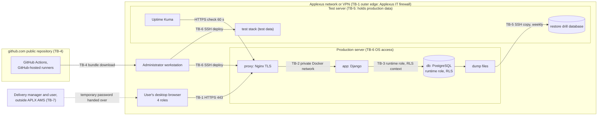

# APLX AMS threat model

> **Single file.** There is exactly one threat model per project. Always use `--id THR --out docs/03-architecture/threat-model.md` when calling `new_artifact.py`; never auto-name as `THR-NNN.md`. Threats within the file use row IDs T-1, T-2, … and are cited elsewhere as `THR T-n`.

## Input References
<!-- guidance: Exact IDs and versions of the approved artifacts used as input (status: Approved) -->
- PIB-003 v0.2 (Approved) § Interview Answers Q1 to Q12 (security-relevant: Q5, Q6, Q8, Q9, Q11), § Constraints (producer pointers), § Assumptions A-026 to A-029, § Open Questions.
- INT-003 v0.2 (Approved, evidence record); IRC-004 v0.2 (Approved, Phase 3 readiness).
- NFR-001 v0.3 (Approved) § NFR N-1, N-3, N-4, N-5 (password policy; lockout cleared by a temporary password), N-6 (audit, including the 5 security events and 0 audit entries holding a password value), N-7 (client data separation), N-8, N-9 (personal data).
- REQ-001 v0.3 (Approved) § Story S-20, S-21, S-22, S-30, S-31, S-32 (security events recorded), S-33 (security events viewed).
- BR-001 v0.3 (Approved) § Rule B-14, B-18, B-20, B-21, B-22, B-23, B-24 (security events).
- GLO-001 v0.3 (Approved) § Terms (preferred terms used throughout); EPC-001 v0.3, BKL-001 v0.3, PRS-001 v0.3 (Approved) for scope only; SUM-002 v0.4 (Approved).
- RSK-002 v0.1 (Approved) § Risk R-1 (no MFA), R-2 (RPO 7 days); RSK-001 v0.2 § Risk R-6 and rating method.
- Decisions: DEC-022 (two client organizations in tests); DEC-027 (public GitHub repository on the personal account for the pilot); DEC-029 (self-signed TLS certificate for the pilot); DEC-030 (session limits). DEC-031 (Mohanasunder, 2026-10-17; validation run 4 finding C-3): a protected recovery copy of the production TLS certificate and key is kept root-only on the test server and restored on recovery.
- Human answers, Mohanasunder, chat, 2026-10-17: OQ-055 (servers at the A-030 minimum, Ubuntu LTS with Docker Engine, SSH from production to test allowed), OQ-056 (downtime alerts by email to the Release manager / DevOps), OQ-063 (OS-level server access), OQ-066 (Applexus IT installs the self-signed certificate as trusted on every user's machine before go-live).
- This phase, Draft (read only, owned by other producers): ARC-001 v0.3, TEC-001 v0.3, ADR-001 v0.3 (ADR A-1 to A-17), RSK-003 v0.3 (R-1 to R-10), TOP-001 v0.2, CST-001 v0.2.

## Purpose And Scope
<!-- guidance: What this artifact covers and what it does not -->
Covers: the security approach of APLX AMS release 1: assets and data classification, trust boundaries, threats (STRIDE: Spoofing, Tampering, Repudiation, Information disclosure, Denial of service, Elevation of privilege) with likelihood and impact, a control and a Phase 7 verification method per threat, the authentication and authorization model, secrets handling (references only), and residual risk for human decision.

Does not cover: firewall rules and server sizing (`deployment-topology.md`, `infra-cost-analyst`); endpoint-level permissions and the schema (Phase 4 OpenAPI contract and database design); scanner tool choice (Phase 4 coding standards); runbooks (Phase 8).

Human decisions recorded as stated and not overridden: no MFA (NFR N-5; RSK-002 R-1); weekly backup, RPO 7 days (NFR N-3; RSK-002 R-2); the delivery manager sets temporary passwords and no user is asked or forced to change them (BR B-23; INT-003 Q8); internal network or VPN only (INT-003 Q6); github.com with GitHub-hosted CI and a manual deploy (INT-003 Q5); the repository is public and stays on the personal github.com account for the pilot (DEC-027); a self-signed TLS certificate for the pilot instead of an internal CA certificate (DEC-029), installed as trusted on every user's machine by Applexus IT before go-live (OQ-066), with a root-only recovery copy of the production certificate and key on the test server (DEC-031); sessions end after 60 minutes without activity and at most 12 hours after sign-in (DEC-030); security events go to the audit trail, and a refused sign-in with an account name that matches no user account is recorded with the account name as typed (BR B-24; OQ-065).

Rating method (RSK-001 v0.2): likelihood and impact are each Low, Medium or High; rating High if either is High and the other at least Medium; Medium if both are Medium, or one is High and the other Low; otherwise Low. Ratings below are before controls.

## Assets
<!-- guidance: Data and functions worth protecting -->
Data classification (Applexus has no written IT security policy, INT-003 Q9; this scheme is proposed for approval with this threat model):

| Class | Meaning | Handling rule |
| --- | --- | --- |
| Secret | Credentials and keys | Never in GitHub, the deploy bundle, images, logs, API responses or any artifact; root-only files on the server (§ Secrets handling) |
| Confidential: personal data | Names and email addresses (NFR N-9) | Only in PostgreSQL and its dumps; scoped by client organization (NFR N-7) |
| Confidential: client business data | Data owned by one client organization | Scoped by client organization (ADR A-6); HTTPS in transit |
| Internal | Applexus-wide data with no client owner | Signed-in users only |
| Public | Source code, CI workflows and every artifact in the repository, public by DEC-027 | Holds no secret, no production data, no real personal data beyond the approver's name, no server address or host name (T-31, T-32) |

| ID | Asset | Class | Where it lives |
| --- | --- | --- | --- |
| AS-1 | Passwords and temporary passwords (in transit only) and their Argon2id hashes | Secret | Browser to `proxy` over HTTPS; hashes in PostgreSQL (ADR A-8) |
| AS-2 | Session identifiers and CSRF tokens | Secret | Browser cookie; session rows in PostgreSQL (ADR A-7) |
| AS-3 | Tickets, comments, SAP applications, contracts, effort entries, hours bank balances, monthly client reports | Confidential: client business data | PostgreSQL, one database, client organization ID per row (ADR A-6) |
| AS-4 | User account names and emails | Confidential: personal data | PostgreSQL (NFR N-9) |
| AS-5 | Audit trail, including the 5 security events (BR B-24) and account names typed in refused sign-ins | Confidential: client business data; integrity critical | PostgreSQL append-only table (ADR A-11) |
| AS-6 | Delivery manager functions: user accounts, roles, temporary passwords, client organizations, contracts, company holiday list | Function | `accounts` and `organizations` modules (BR B-21) |
| AS-7 | Finance export and downloaded report files (Excel, CSV, PDF) | Confidential: client business data | Generated on request, not stored on the server (ADR A-12); then on user desktops and in email outside APLX AMS |
| AS-8 | Weekly and pre-deploy `pg_dump` files; restore drill database | Confidential (contains AS-1 hashes, AS-3, AS-4, AS-5) | Production server and test server (ADR A-13, A-15) |
| AS-9 | Server secrets: PostgreSQL owner and runtime role passwords, Django secret key, TLS private key, SSH key for the backup copy, Uptime Kuma admin credential | Secret | Root-only files on each server (§ Secrets handling) |
| AS-10 | Source code, CI workflows, deploy bundle, project documents | Public (DEC-027); integrity critical | Public repository on the personal github.com account, human workstation, both servers (ADR A-13) |
| AS-11 | Service availability in business hours (NFR N-1) | - | Production server (ADR A-5) |
| AS-12 | Company holiday list and SLA timer data | Internal | PostgreSQL (ADR A-10) |
| AS-13 | Self-signed TLS certificate and its private key; users' trust in it (DEC-029) | Key: Secret; certificate: Internal | Key on the production server and in the root-only recovery copy on the test server (T-36); certificate installed as trusted on every user's machine by Applexus IT (OQ-066) |

## Trust Boundaries
<!-- guidance: Where trust changes (Mermaid or table) -->

| TB | Boundary | From (less trusted) | To (more trusted) | What crosses | Threats |
| --- | --- | --- | --- | --- | --- |
| TB-1 | Network edge and TLS entry | Any device on the Applexus network or VPN; the internet is blocked by Applexus IT firewall (ADR A-14) | `proxy` on the production server | Passwords, session cookie, JSON API calls, file downloads | T-1, T-2, T-6, T-9, T-10, T-18, T-19, T-25, T-26, T-30, T-34, T-35 |
| TB-2 | Authenticated user to role and client organization | A signed-in user of one role and, for a client user, one client organization | Data and functions of other roles and client organizations (BR B-20, B-21) | API requests to `app` | T-5, T-8, T-11, T-13, T-14 |
| TB-3 | Application to database | `app` container (runtime role, no table ownership, no `BYPASSRLS`) | PostgreSQL tables, RLS policies, audit table (ADR A-6, A-11) | SQL with transaction-local user kind and client organization | T-11, T-12, T-14, T-15 |
| TB-4 | Build to deploy | GitHub-hosted runners, the public repository on the personal github.com account (DEC-027), and anyone on the internet who reads it, forks it or opens a pull request | Administrator workstation, then servers | Deploy bundle (image archives, Compose file, checksums); no secrets, no production data (ADR A-13); repository contents readable by anyone | T-17, T-23, T-24, T-31, T-32, T-33 |
| TB-5 | Production data to test server | Production server | Test server, also used for testing and monitoring | Weekly `pg_dump` over SSH; restore drill database (ADR A-15); recovery copy of the production TLS certificate and key | T-20, T-21, T-22, T-27, T-36 |
| TB-6 | Server administration | Administrator workstation | OS, Docker and secret files on both servers | SSH sessions, Docker commands, migrations with the owner role | T-15, T-17, T-19, T-22 |
| TB-7 | Out-of-band password hand-over | A person who contacts the delivery manager outside APLX AMS | A user account's temporary password (BR B-23) | Identity claim; temporary password | T-3, T-4 |
| TB-8 | Files leaving APLX AMS | Downloaded file on a desktop; finance export emailed to Finance outside APLX AMS (BR B-18) | - | Excel, CSV, PDF files | T-28 |

## Threats
<!-- guidance: STRIDE-style table: ID, threat, asset, likelihood, impact. The ID column holds T-1, T-2, ... and is cited elsewhere as THR T-n (Phase 7 Threat Model Coverage, checked by scripts/traceability.py), so never renumber after approval: add new threats at the end and mark a dropped one 'Removed - SCR S-N' -->
| ID | STRIDE | Threat | Asset | Boundary | Likelihood | Impact | Rating |
| --- | --- | --- | --- | --- | --- | --- | --- |
| T-1 | S | Password guessing or reuse of a password leaked elsewhere signs in as a user; no second factor exists (NFR N-5; RSK-002 R-1) | AS-1, AS-3, AS-4 | TB-1 | Low | High | Medium |
| T-2 | D | Someone enters 5 wrong passwords on a known user account to lock it for 30 minutes (lockout per user account, NFR N-5) | AS-11 | TB-1 | Low | Low | Low |
| T-3 | S, R | The delivery manager knows every temporary password they set and no user is asked or forced to change it (BR B-23), so the delivery manager (or anyone who sees the hand-over) can sign in as that user while it stays valid; changes are then recorded in the audit trail under the user's name; the sign-in is recorded as a successful sign-in of that user (BR B-24), which only the delivery manager and, for an internal user, that user can view (client users cannot view their own security events, REQ S-33 AC-4) | AS-1, AS-3, AS-5 | TB-7 | Medium | Medium | Medium |
| T-4 | S | A person contacts the delivery manager outside APLX AMS posing as user X who "forgot the password"; the delivery manager sets a temporary password (which also clears a lockout, S-30 AC-3) and hands it to that person | AS-1, AS-3, AS-4 | TB-7 | Low | High | Medium |
| T-5 | E | A delivery manager user account is taken over (T-1, T-4, T-6); the holder can create user accounts, set temporary passwords on any user account and read every client organization's data | AS-3, AS-4, AS-6 | TB-2 | Low | High | Medium |
| T-6 | S | A session cookie is stolen (script injection in the page, an unencrypted request, a shared machine) and replayed | AS-2, AS-3 | TB-1 | Low | High | Medium |
| T-7 | S | A signed-in session stays usable on an unattended desktop; sessions end after 60 minutes without activity and at most 12 hours after sign-in (DEC-030), so the exposure window is up to 60 minutes | AS-2, AS-3 | TB-1 | Low | Medium | Low |
| T-8 | E | A deactivated user, or a user whose temporary password was just set, keeps acting through a session opened earlier | AS-3, AS-6 | TB-2 | Low | Medium | Low |
| T-9 | T | Cross-site request forgery or clickjacking makes a signed-in user's browser change ticket status, priority, assignment, effort or user accounts | AS-3, AS-6 | TB-1 | Low | Medium | Low |
| T-10 | I | Sign-in responses or timing reveal whether a user account exists, is locked or is deactivated (REQ S-21 AC-2); the audit trail now records each refused sign-in (BR B-24), visible only per REQ S-33 | AS-4 | TB-1 | Medium | Low | Low |
| T-11 | I, T | A client user lists, opens by ticket reference, downloads or acts on another client organization's tickets, monthly client reports, SAP applications, names or emails through a missed filter or a guessed identifier (BR B-20; NFR N-7; RSK R-6) | AS-3, AS-4, AS-7 | TB-2, TB-3 | Medium | High | High |
| T-12 | I, E | Row-level security is bypassed: the runtime role owns tables or has `BYPASSRLS`, or a reused database connection carries the previous request's user kind or client organization | AS-3, AS-4 | TB-3 | Low | High | Medium |
| T-13 | E | A missing role check or a writable field the role should not set lets a client user or support engineer do a delivery manager task (create user accounts, set temporary passwords, change a role or client organization) or an internal task (change priority, set Resolved, view the audit trail) (BR B-21; REQ S-20 AC-4, S-30 AC-4, S-31 AC-3) | AS-3, AS-5, AS-6 | TB-2 | Medium | High | High |
| T-14 | T, E | Injection: SQL built from input outside the ORM; script stored in a ticket description or comment by a client user runs in an internal user's browser (taking an all-organization session); spreadsheet formula injection in Excel or CSV exports; HTML injection in the PDF template | AS-2, AS-3 | TB-2, TB-3 | Medium | High | High |
| T-15 | T, R | Audit entries are edited, deleted or never written (a change path without the audit call), or a user disputes a change; the same applies to security events (NFR N-6; BR B-22, B-24) | AS-5 | TB-3, TB-6 | Low | Medium | Low |
| T-16 | I | Passwords, temporary passwords, hashes, session identifiers or stack traces appear in logs, error pages, API responses or security event audit entries (debug mode on in production; BR B-24 forbids password values in audit entries) | AS-1, AS-2, AS-9 | TB-1 | Medium | Medium | Medium |
| T-17 | I | A secret (database role password, Django secret key, TLS private key, SSH key) is committed to GitHub, baked into an image or the bundle, printed in CI logs, or reused between test and production | AS-9 | TB-4, TB-6 | Low | High | Medium |
| T-18 | I, S | Traffic is read or altered inside the Applexus network through plain HTTP or weak TLS settings (certificate warnings: T-30) | AS-1, AS-2, AS-3 | TB-1 | Low | High | Medium |
| T-19 | E | `app` or `db` ports, the Docker API or SSH on either server are reachable from the Applexus network, bypassing `proxy`, sign-in and RLS | AS-3, AS-9 | TB-1, TB-6 | Low | High | Medium |
| T-20 | I | A `pg_dump` file (weekly or pre-deploy) is copied off a server or read by another OS user, exposing names, emails, client business data and password hashes | AS-8 | TB-5 | Low | High | Medium |
| T-21 | I | The test server holds production data (weekly dump and restore drill database, ADR A-15; A-031) under the weaker habits of a test machine: more people with access (Mohanasunder and Applexus IT administrators, OQ-063), test stacks pointed at production data, a restored database left running | AS-8, AS-3, AS-4 | TB-5 | Medium | High | High |
| T-22 | T, D | Ransomware, an administrator error or a compromised production server deletes the database and the dumps; with one SSH key that can also delete the copies on the test server, every backup is lost | AS-8, AS-11 | TB-5, TB-6 | Low | High | Medium |
| T-23 | T | The deploy bundle is altered: the personal github.com account holding the public repository is taken over (RSK-003 R-2; DEC-027), a workflow is changed to add code, or the bundle is swapped on the workstation | AS-10, AS-11 | TB-4 | Low | High | Medium |
| T-24 | T, E | A malicious or vulnerable third-party package (Python, npm) or base image is pulled into the build | AS-10, AS-3 | TB-4 | Medium | High | High |
| T-25 | D | Request floods from inside the network, or repeated PDF and Excel generation and Argon2id hashing, exhaust the production server's CPU or memory in business hours | AS-11 | TB-1 | Low | Medium | Low |
| T-26 | D | The self-signed certificate (DEC-029) expires, or its private key is lost and a new certificate must be made; browsers refuse or warn on every page and Uptime Kuma checks fail, so no one can sign in until the certificate is replaced and trusted again (NFR N-1) | AS-11, AS-13 | TB-1 | Low | High | Medium |
| T-27 | I, T | The Uptime Kuma web UI on the test server is reached with a default or weak credential and its checks or alert routes are changed or switched off | AS-11 | TB-5 | Low | Low | Low |
| T-28 | I | The finance export and downloaded monthly client reports leave APLX AMS (desktops, email to Finance) where APLX AMS controls no longer apply | AS-7 | TB-8 | Medium | Low | Low |
| T-29 | I | Users type personal data beyond names and emails into ticket descriptions or comments (outside NFR N-9's target) | AS-3 | TB-2 | Medium | Low | Low |
| T-30 | S, I | With a self-signed certificate (DEC-029), Chrome and Edge show a certificate warning that users learn to click through; a person on the Applexus network or VPN (address or name spoofing) presents their own certificate, users accept the same-looking warning, and passwords and session cookies are captured or changed in transit | AS-1, AS-2, AS-3, AS-13 | TB-1 | Medium | High | High |
| T-31 | I | The public repository (DEC-027) shows attackers the architecture, this threat model with its open residual risks, the role model, endpoint names, scanner gaps and the logs, which shortens their planning; any server address, host name or user name committed later becomes public | AS-10 | TB-4 | Medium | Medium | Medium |
| T-32 | I | A secret, real personal data or a production configuration value committed once (in any branch, commit, CI log or workflow artifact) is public at once and harvested by automated scanners; removing it from history does not undo the exposure | AS-9, AS-10, AS-4 | TB-4 | Medium | High | High |
| T-33 | T, E | On a public repository anyone can fork and open a pull request: a workflow that runs fork code with write permissions (`pull_request_target`, `workflow_run`), writes a pull request title or branch name into a shell script, or uses an unpinned third-party action lets outside code change the repository, poison caches, use the runner minutes, or alter the bundle a human then deploys | AS-10, AS-11 | TB-4 | Medium | High | High |
| T-34 | I | A user types their password into the account-name field (or both into one field); the refused sign-in is recorded with the account name as typed (BR B-24; OQ-065, human decision), so the password is stored in the audit trail, shown to the delivery manager with the time of the attempt (enough to guess whose it is), and copied into every dump, including those on the test server | AS-1, AS-5, AS-8 | TB-1 | Medium | Medium | Medium |
| T-35 | D | Scripted sign-ins with many made-up account names each add a failed sign-in audit entry that is never deleted (NFR N-4), growing the database and every dump beyond the 5 GB estimate (A-032) | AS-5, AS-8, AS-11 | TB-1 | Low | Medium | Low |
| T-36 | I, S | The recovery copy of the production TLS certificate and private key on the test server (DEC-031) is read by a server administrator, a test container or an attacker on the test server; with the key, a person on the Applexus network can impersonate APLX AMS with a certificate every user's machine trusts, so no warning appears | AS-13, AS-1, AS-2 | TB-5, TB-6 | Low | High | Medium |

Count: 36 threats; High 8 (T-11, T-13, T-14, T-21, T-24, T-30, T-32, T-33), Medium 17, Low 11 (ratings before controls). v0.1 revisions after human answers: T-7 Medium to Low (DEC-030), T-26 High to Medium (DEC-029), T-18 narrowed (certificate warnings moved to T-30); T-30 to T-35 added. v0.2: T-36 added (TLS key recovery copy).

## Mitigations
<!-- guidance: Table: threat ID (T-n), control, how Phase 7 will verify it (test, scan, or review), residual risk -->
| Threat | Control | Source | Phase 7 verification | Residual risk |
| --- | --- | --- | --- | --- |
| T-1 | Password policy validator (8 characters, upper-case, lower-case, digit); lockout 30 minutes after 5 failed sign-ins per user account; Argon2id hashes; HTTPS only; internal network or VPN only; one refusal message | NFR N-5; ADR A-7, A-8, A-14 | Test: every NFR N-5 verification step (Phase 6 and Phase 7 security tests) | Medium: no MFA; accepted by human decision (RSK-002 R-1); re-decide before external client users sign in from outside the network |
| T-2 | Lockout as required; the delivery manager clears it at once by setting a temporary password (REQ S-30 AC-3); `proxy` rate limit on the sign-in endpoint per client IP address (value set in Phase 4 coding standards) | NFR N-5; BR B-23 | Test: REQ S-30 AC-3; review of the `proxy` rate-limit setting | Low: a known user account can be locked for 30 minutes; accepted as part of NFR N-5 |
| T-3 | Users can change their own password at any time (REQ S-31, current password required); the temporary password is typed by the delivery manager, never shown again, never logged, never returned by the API; setting it ends the user's other sessions (ADR A-7); Phase 8 user documentation states that a user can change a temporary password (information only, not a prompt in APLX AMS, BR B-23); every successful sign-in, temporary password set and own password change is a security event in the audit trail with user, user account and time (BR B-24), so an internal user sees sign-ins they did not make in their own security events (REQ S-33 AC-2) | REQ S-30, S-31, S-32, S-33; BR B-23, B-24; ADR A-7, A-8, A-11 | Test: REQ S-30 AC-1, AC-3, S-31 AC-1, AC-4, S-32 AC-1, AC-4, S-33 AC-2; test that no API response contains a password or hash; review of the user documentation | Medium: the delivery manager can keep knowing a user's password and act as that user; misuse of a client user's account is recorded but visible only to the delivery manager (client users cannot view their own security events, REQ S-33 AC-4); accepted by DEC-033 (RSK-003 R-3) |
| T-4 | Phase 8 operational runbook procedure (proposed): before setting a temporary password, the delivery manager confirms the request through a channel already on record for that user (the email address on the user account or a call to a known number) and hands the temporary password over on that channel, not on the request channel | BR B-23; REQ S-30 | Review: runbook procedure; walkthrough in Phase 7 UAT | Medium once external client users exist; Low for the internal pilot; accepted by DEC-033 (RSK-003 R-3) |
| T-5 | As T-1 and T-4; delivery manager role given to the named delivery managers only; role checks per endpoint (T-13); sessions end on deactivation; sign-ins and temporary passwords set are security events (BR B-24) the delivery manager can review in their own security events | BR B-21, B-24; ADR A-7 | Test: REQ S-20 AC-4, S-30 AC-4, S-32 AC-4; review of the user account list at go-live | Medium: one taken-over delivery manager user account controls every user account and can read every security event; there is no alerting on security events (BR B-24); part of RSK-002 R-1 |
| T-6 | Session cookie HttpOnly, Secure, SameSite=Strict, host-only; new session identifier at sign-in; HTTPS only with HSTS; Content-Security-Policy `script-src 'self'` with no inline script; React output escaping; sign-out ends the server-side session | ADR A-3, A-7, A-14 | Scan: dynamic security scan of the test deployment (tool set in Phase 4 coding standards); test: cookie flags and session rotation; review of `proxy` headers | Low |
| T-7 | Sign-out on every page; server-side session ends after 60 minutes without a request and 12 hours after sign-in whatever the activity (DEC-030); the frontend returns to the sign-in page when the API refuses an ended session | ADR A-7; DEC-030 | Test: a request after 60 minutes without activity is refused; a session kept active is refused 12 hours after sign-in | Low: up to 60 minutes of exposure on an unattended desktop |
| T-8 | Deactivation and setting a temporary password end all of that user account's sessions; every request checks the user account is active | REQ S-20 AC-3; ADR A-7 | Test: request with an earlier session after deactivation and after a temporary password is refused | Low |
| T-9 | Django CSRF token on every state-changing request; same origin, no CORS headers; SameSite=Strict; `frame-ancestors 'none'` and `X-Frame-Options: DENY` | ADR A-3, A-7, A-14 | Test: state-changing request without a CSRF token is refused; scan: header check | Low |
| T-10 | One refusal message and status for wrong password, unknown user account, locked and deactivated user account; password hash computed for unknown user accounts as well | REQ S-21 AC-2, S-33; ADR A-7 | Test: the 4 refusal cases return identical responses; REQ S-33 AC-3, AC-4 (no other user's and no client user's view of security events) | Low: timing differences under 1 lockout window are not exploitable at this scale |
| T-11 | Client organization ID on every client-owned row; one data-access layer scopes every query; RLS with `FORCE ROW LEVEL SECURITY` and no row without context; downloads use the same path; ticket references give no access by themselves; refused access shows no ticket detail (REQ S-22 AC-2) | ADR A-6, A-12; NFR N-7; BR B-20 | Test: client organizations A and B suite (list, open by ticket reference, report view and download, raise against the other organization's SAP application) in CI against PostgreSQL 18 and in Phase 7; re-run before the first external client organization goes live; review of RLS policies in Phase 4 | Low with both barriers tested (RSK R-6 stays Open until the external re-run) |
| T-12 | Runtime role: not owner, not superuser, no `BYPASSRLS`; migrations only in a one-off container with the owner role; user kind and client organization set with transaction-local settings inside the request transaction (`ATOMIC_REQUESTS`) | ADR A-6, A-13 | Test: same worker serves organization A then B, then a request with no context returns 0 rows; review: role attributes queried from `pg_roles` on the test deployment | Low |
| T-13 | Deny by default: every endpoint names its allowed roles in the Phase 4 OpenAPI contract; serializers list writable fields explicitly (role, client organization and password fields writable only on delivery manager endpoints); object-level checks for "own client organization" and "own password" | BR B-21, B-23; REQ S-20, S-30, S-31 | Test: role x endpoint matrix generated from the OpenAPI contract, every disallowed pair refused; REQ S-20 AC-4, S-30 AC-4, S-31 AC-3 | Low |
| T-14 | ORM queries only; raw SQL allowed only inside the data-access layer with bound parameters and reviewer sign-off; React default escaping, no raw HTML rendering; CSP (T-6); Django template auto-escaping in the PDF template; export cells starting with `=`, `+`, `-`, `@` written as text | ADR A-2, A-3, A-6, A-12 | Scan: static analysis in CI; test: stored script in a comment shown as text to an internal user; formula text in an export opens as text; review: raw SQL list | Low |
| T-15 | Audit entry written by one audit function in the same transaction as the change; runtime role has INSERT and SELECT only on the audit table; owner role used only for migrations; audit entries show user and time to the second; security events written by the same audit function (BR B-24) | ADR A-11; NFR N-6; BR B-22, B-24 | Test: each of the 4 change types and each of the 5 security events produces an entry (REQ S-32); UPDATE and DELETE on the audit table refused for the runtime role | Low: a server administrator (Mohanasunder or an Applexus IT administrator, OQ-063) with root or the owner role can still alter entries; accepted by DEC-035 |
| T-16 | `DEBUG` off in production; generic error pages; no password, temporary password, hash, session identifier or cookie in logs or API responses; `proxy` access log excludes cookies and request bodies; security event audit entries hold no password value (BR B-24) | ADR A-8 follow-up; BR B-24 | Review: production settings and log format; test: error response with no stack trace; test: no password field in any API response; test: REQ S-32 AC-4 search of all audit entries for the passwords used | Low (passwords typed into the account-name field: T-34) |
| T-17 | No secrets in GitHub, images or the bundle (ADR A-13); secret scanning in CI on every push; secrets as root-only files on each server, mounted into only the container that needs them; different values on test and production; in-container owner and mode of each Compose file secret verified in Phase 4 and Phase 8 (§ Secrets handling) | ADR A-13, A-17 | Scan: CI secret scan report; review: image layers and bundle contents list no secret file; review: test and production values differ (compared by checksum, not by value) | Low |
| T-18 | TLS 1.2 and 1.3 only; HTTP redirects to HTTPS; HSTS header sent (browsers apply it only once they trust the certificate, T-30) | ADR A-14; INT-003 Q6 | Scan: TLS configuration check of `proxy`; test: HTTP redirect | Low |
| T-19 | Only `proxy` publishes ports (443, 80 redirect); `app` and `db` not published; Docker API not exposed over TCP; SSH key-only, no password sign-in, no root sign-in; Uptime Kuma UI bound to 127.0.0.1 on the test server (T-27); firewall rules by Applexus IT recorded in TOP-001 | ADR A-5, A-14, A-16 | Review: port scan of both servers from a workstation on the Applexus network shows only 22, 80, 443 (Uptime Kuma UI not reachable) | Low |
| T-20 | Weekly and pre-deploy dumps encrypted at rest with age or gpg (DEC-034, DEC-036); the private decryption key held offline by the Release manager / DevOps, brought to the test server only for a restore or drill and removed afterwards (DEC-036); a sealed second copy held by Applexus IT in a locked safe, used only if the Release manager / DevOps is unavailable (DEC-037); dump directory root-only (files mode 0600) and outside any served path; copy over SSH with a dedicated backup account; checksum verified; password hashes are Argon2id | ADR A-8, A-15 | Review: file modes and backup account on both servers | Low: dump files are unreadable without the offline key; Applexus IT administrators hold both root on the test server and the sealed key copy, so a broken seal is the only sign of misuse (DEC-037) |
| T-21 | Test server has the same OS access control as production: OS-level access only for Mohanasunder and Applexus IT administrators (OQ-063), each with a named account, no shared account; dumps on the test server are encrypted at rest and the private key is on the test server only during a restore or drill (DEC-034, DEC-036; T-20); test stacks use generated test data only, never a production dump; the restore drill database publishes no port, is run by the Release manager / DevOps only, and is dropped after the drill once its timing and checks are recorded; Uptime Kuma kept as in T-27 | ADR A-15; NFR N-3; A-031 | Review: test server user list, published ports, list of databases after the drill | Low: outside a restore or drill the test server holds only encrypted dumps; during one, the key and the restored database are readable by Mohanasunder and Applexus IT administrators until the key is removed and the drill database dropped; Applexus IT also holds the sealed key copy (DEC-037) (RSK-003 R-4, mitigated by DEC-034, DEC-036) |
| T-22 | Backup account on the test server can only write new files into the backup directory (no delete or overwrite from production); test server keeps at least 2 weekly dumps (count set in `deployment-topology.md`); pre-deploy dump (ADR A-13); restore drill before go-live | ADR A-13, A-15; NFR N-3 | Test: from production, delete of a dump on the test server is refused; review: restore drill record | Medium: up to 7 days of data lost (RSK-002 R-2); the same administrators hold both servers; accepted by DEC-035 |
| T-23 | Two-factor sign-in on the GitHub account; branch protection on `main` with required PR review and CI pass; workflows per T-33; bundle named by commit SHA; the human compares bundle checksums with the CI run summary before deploying; test server first | ADR A-13; RSK-003 R-2 | Review: repository settings and workflow permissions; review: deploy record shows checksum check | Medium: the repository location on a personal account is accepted by DEC-027 (RSK-003 R-2) |
| T-24 | Lock files with hashes for Python and npm; base images pinned by digest; dependency vulnerability scan, licence scan and image scan in CI fail the build on a known critical vulnerability; new packages only as named in each plan's New Packages section (CLAUDE.md rule 3) | ADR A-13; TEC-001 | Scan: CI dependency, licence and image scan reports for the release bundle | Medium: a package compromised before it is known to scanners passes; accepted by DEC-035 |
| T-25 | `proxy` request rate and body size limits; Gunicorn worker timeout; report and export queries bounded to one client organization and one calendar month | ADR A-5, A-12, A-14 | Test: Phase 7 load test (NFR N-2) includes sign-in and file downloads; review of limits | Low |
| T-26 | Certificate validity and renewal date recorded in the Phase 8 runbook (owner: Release manager / DevOps); Uptime Kuma trusts this certificate (does not ignore certificate errors), warns before expiry and alerts by email to the Release manager / DevOps (ADR A-16; OQ-056); on renewal a new certificate is made, installed as trusted on every user's machine by Applexus IT, then switched outside business hours; on recovery the protected copy of the current certificate and key is restored (T-36), so users' trust survives and recovery stays within the RTO (ADR A-14, A-17; TOP-001 recovery steps) | ADR A-14, A-16, A-17; DEC-029; NFR N-1, N-3 | Review: certificate expiry date, host name in the certificate, Uptime Kuma setting and email alert at go-live; review: restore drill uses the recovery copy and users see no warning | Low |
| T-27 | Uptime Kuma admin user with a password meeting NFR N-5; UI bound to 127.0.0.1 on the test server and reached only through an SSH tunnel from an administrator workstation (TOP-001 path P-3) | ADR A-16 | Review: sign-in required; UI port not reachable from the network (T-19 port scan) | Low |
| T-28 | Finance export only for the delivery manager; monthly client reports only for internal users and the client users of that client organization once published; files not stored on the server | BR B-14, B-18, B-20; ADR A-12 | Test: role x endpoint matrix (T-13) and A/B suite (T-11) cover the download endpoints | Low: handling after download is outside APLX AMS; accepted |
| T-29 | Not applicable in APLX AMS: free text is outside NFR N-9; data is scoped like any ticket (T-11) | NFR N-9 | Review: Phase 7 confirms N-9 field list only | Low; accepted by NFR N-9 wording |
| T-30 | Applexus IT installs the self-signed certificate as trusted on every user's machine before go-live (OQ-066 answer), so Chrome and Edge show no warning and HSTS then blocks any click-through; users are told that any certificate warning means stop and report to the Release manager / DevOps; the same installation is repeated before each certificate renewal (T-26) | DEC-029; OQ-066; ADR A-14; NFR N-8 | Review: on each of the 4 browser versions (NFR N-8) the sign-in page opens with no certificate warning; review of the user instructions | Low: a machine missing the installed trust (a new or rebuilt machine) shows a warning its user could click through (RSK-003 R-5) |
| T-31 | No server address, host name, IP address, server user name, firewall rule detail or real personal data (beyond the approver's name already in the logs) in the repository; those values live only on the servers and in Phase 8 production configuration kept outside GitHub; security does not depend on the documents being secret (the T-1 to T-36 controls hold when known); GitHub private vulnerability reporting on, and a security defect is described in public only after its fix is deployed | DEC-027; ADR A-13, A-14 | Review: repository search for IP addresses and host names before each release; review of repository security settings | Medium: the design and its residual risks are public; exposure accepted by DEC-027 |
| T-32 | GitHub secret scanning with push protection on (free for public repositories); full-history secret scan before the repository is made public and in CI on every push; no secret is ever needed in GitHub (§ Secrets handling); any secret ever committed is treated as exposed and rotated, not only deleted from history; test data is generated, never copied from production; `.gitignore` covers the server secret file names | DEC-027; ADR A-13 | Scan: full-history secret scan report and push protection setting; review: test data sources | Low |
| T-33 | No `pull_request_target` or `workflow_run` job that checks out or runs pull request code; default `GITHUB_TOKEN` permission read-only, raised per job only where needed; Actions setting requiring approval before workflows run for pull requests from outside collaborators; pull request titles, branch names and other user-controlled values passed through environment variables, never written into `run:` scripts; third-party actions pinned by full commit SHA; the deploy bundle built only on pushes to protected `main`, never from a pull request; `.github/workflows/` changes reviewed by the Architect / tech lead | DEC-027; ADR A-13; RSK-003 R-2 | Review: workflow files and repository Actions settings; test: a pull request from a fork runs only after approval and with a read-only token | Low |
| T-34 | Within the human decision (OQ-065), not overriding it: failed sign-in entries with an unknown account name are visible only to the delivery manager (REQ S-33 AC-1; they belong to no user account, so no internal user's own view shows them); the account-name field is not echoed on screen after a refused sign-in; Phase 8 user documentation asks users who typed a password into the account-name field to change it (REQ S-31) | BR B-24; REQ S-31, S-33 | Test: REQ S-33 AC-1, AC-3, AC-4 cover unknown-name entries; review of the sign-in page | Medium: passwords typed by mistake are kept with no end date (NFR N-4) in the audit trail and dumps, such entries are not covered by the NFR N-6 target (NFR-001 v0.3); accepted by DEC-032 (RSK-003 R-10) |
| T-35 | `proxy` rate limit on the sign-in endpoint (T-2); account-name maximum length set in the Phase 4 OpenAPI contract; database size checked in the monthly Phase 9 review against A-032 | NFR N-4; A-032 | Test: a Phase 7 sign-in burst is rate limited; review: database size report | Low |
| T-36 | Recovery copy root-owned, mode 0400, in its own directory on the test server, apart from the dump directory and never mounted into any container; the test deployment uses its own, different certificate and key; the copy is used only in a recovery or restore drill; certificate and key replaced (and trust re-installed by Applexus IT) on suspected exposure or when an administrator with access leaves; checksum recorded to detect change; the copy is encrypted at rest with age or gpg and decrypted only during a recovery or drill with the offline key or, if the Release manager / DevOps is unavailable, the sealed copy held by Applexus IT (DEC-036, DEC-037) | ADR A-14, A-17; TOP-001; DEC-031, DEC-036, DEC-037 | Review: owner, mode and location of the copy; review: no container mount references it; test: test deployment certificate differs from production | Medium: every administrator with root on the test server (Mohanasunder and Applexus IT administrators, OQ-063) can read the TLS key only while the offline decryption key is on the test server during a recovery or drill, or by opening the sealed key copy Applexus IT holds (DEC-037); part of RSK-003 R-4 |

### Authentication and authorization model
- Authentication: user account plus password only, no MFA (NFR N-5). Django server-side sessions in PostgreSQL; session cookie HttpOnly, Secure, SameSite=Strict; new session identifier at sign-in; CSRF token on state-changing requests (ADR A-7). Lockout: per user account, 30 minutes after 5 failed sign-ins; cleared at once when the delivery manager sets a temporary password (NFR N-5; REQ S-30 AC-3). Storage: Argon2id (ADR A-8).
- Passwords (BR B-23): the delivery manager sets a temporary password when creating a user account and when a user reports a forgotten password outside APLX AMS; it meets the password policy, replaces the previous password, clears a lockout and ends the user's other sessions. Any signed-in user changes only their own password after entering the current one (REQ S-31). No forced or prompted change, no email, no self-service password reset (human decision; T-3 residual).
- Session lifetime: ends after 60 minutes without activity and at most 12 hours after sign-in (DEC-030; ADR A-7).
- Security events (BR B-24; REQ S-32, S-33): successful sign-in, failed sign-in (wrong password, unknown account name recorded as typed, deactivated or locked user account), user account lockout, temporary password set, own password change; written by the audit function (ADR A-11) with no password value; viewed by the delivery manager for every user account, by each L1 and L2/L3 support engineer for their own user account only, by no client user; no alerting. Other audit entries (status, priority, assignment, effort) are viewed by every internal user for every ticket (BR B-22), by no client user.
- First delivery manager user account (proposed for Phase 4): created by an administrator command run on the production server, password typed interactively and meeting NFR N-5; never stored in the bundle or GitHub.
- Authorization (BR B-21), checked on every endpoint and enforced for client-owned data by RLS (ADR A-6):

| Role | Kind | Can | Cannot |
| --- | --- | --- | --- |
| Client user | Client user, one client organization | Raise tickets for own client organization's SAP applications; view own client organization's tickets and statuses; comment on them; view own client organization's published monthly client reports; change own password | Any other client organization's data; any audit entry, including their own security events; internal tasks; delivery manager tasks |
| L1 support engineer | Internal user | Ticket tasks of L1 per REQ-001 (acknowledge, change priority with reason, assign, set Resolved, close Resolved tickets); effort entries as assigned support engineer; comments; every ticket's audit entries plus their own security events; change own password | Delivery manager tasks; other users' security events |
| L2/L3 support engineer | Internal user | Ticket tasks on tickets assigned to them per REQ-001; effort entries; comments; every ticket's audit entries plus their own security events; change own password | Delivery manager tasks; other users' security events |
| Delivery manager | Internal user | All internal user views; user accounts, roles, temporary passwords; client organizations, SAP applications, contracts; company holiday list; monthly client report generate and publish; finance export; every ticket's audit entries and every user account's security events; change own password | Edit or delete audit entries (no user can, NFR N-6) |

The per-endpoint list is fixed in the Phase 4 OpenAPI contract; this table sets the boundary, not the endpoints.

### Secrets handling
- No secret value appears in GitHub, CI variables, images, the deploy bundle or any artifact (ADR A-13). The bundle carries configuration templates that name each secret file, never its value.
- No secret manager is known to be available (A-038). Each server holds its secrets as root-owned files (mode 0400) in one directory outside the bundle, passed to containers as Docker Compose file secrets (mounted under `/run/secrets/`), not as environment variables (visible through `docker inspect`). Each container gets only its own: `proxy` the self-signed TLS certificate and key (DEC-029; key generated on the production server; its only other copy is the recovery copy, T-36); `app` the runtime role password and Django secret key; the migration container the owner role password; `db` the role passwords at first start.
- Values are generated on each server by the Release manager / DevOps from the operating system random source at install; test and production values differ. Rotation: on suspected exposure and when an administrator leaves; a new Django secret key only ends sessions.
- Compose file secrets from local files are bind mounts: the `uid`, `gid` and `mode` options may not apply, so each file keeps its host owner and mode inside the container. Phase 4 (coding standards) and Phase 8 (infrastructure as code) verify the in-container owner and mode, and that each container's non-root process can read only its own secret files (ADR A-17).
- Recovery: database roles are recreated with new passwords before `pg_restore` (role passwords are not in a `pg_dump` file); the production TLS certificate and key are restored from the protected recovery copy on the test server (DEC-031; ADR A-14, A-17; TOP-001), so users' installed trust still applies and no re-installation is needed within the RTO (T-26, T-36); other secrets are generated anew.
- Backup encryption (DEC-034, DEC-036): weekly dumps, pre-deploy dumps and the TLS certificate and key recovery copy are encrypted at rest with age or gpg; the private decryption key is held offline by the Release manager / DevOps (Mohanasunder), never on either server or in GitHub, brought to the test server only for a restore or drill and removed afterwards; only the public encryption key is on the production server.
- Second key copy (DEC-037): a sealed copy of the private decryption key is held by Applexus IT in a locked safe and used only if the Release manager / DevOps is unavailable; the yearly restore drill checks it can decrypt a dump, then it is resealed. This makes Applexus IT a second trust holder: its administrators also have root on both servers (OQ-063), so the seal (checked at each yearly drill, any opening recorded) is the control against them decrypting dumps without the Release manager / DevOps.
- The SSH key for the weekly copy is a dedicated key per T-22, usable only by the backup account.

### Residual risk and gate decisions
Phase 3 gate decisions by the Architect / tech lead (Mohanasunder), 2026-10-17:
1. Delivery manager knows temporary passwords, no forced change; misuse is recorded as security events but, for client user accounts, visible only to the delivery manager (T-3, T-4; RSK-003 R-3): accepted, DEC-033.
2. Production data and the TLS key recovery copy on the test server, readable by Mohanasunder and Applexus IT administrators (T-20, T-21, T-36; RSK-003 R-4): mitigated, DEC-034 and DEC-036 (weekly dumps, pre-deploy dumps and the DEC-031 recovery copy encrypted at rest with age or gpg; private key held offline by the Release manager / DevOps, on the test server only during a restore or drill; sealed second copy with Applexus IT in a locked safe, used only if the Release manager / DevOps is unavailable and checked at the yearly restore drill, DEC-037). Remaining: during a restore or drill the key and a restored database are on the test server until removed and dropped; Applexus IT holds both root on the servers and the sealed key copy, so its administrators could decrypt dumps by breaking the seal (a broken seal shows at the next yearly check).
3. No MFA (T-1, T-5; RSK-002 R-1): accepted by human decision INT-002 Q7, recorded in NFR N-5; re-decide before external client users sign in.
4. Self-signed certificate: a machine without the installed trust shows a warning a user could click through; renewal needs Applexus IT to install the new certificate again (T-26, T-30; RSK-003 R-5): accepted, DEC-029, with Applexus IT installing the trust per the OQ-066 answer.
5. Public repository on a personal account (T-31 to T-33; RSK-003 R-6): accepted, DEC-027; secret leakage and workflow abuse mitigated by T-32 and T-33.
6. Passwords typed into the account-name field kept in the audit trail and dumps, not covered by the NFR N-6 target (T-34; RSK-003 R-10): accepted, DEC-032.
7. Server administrators (Mohanasunder and Applexus IT administrators) can read all data and alter the audit trail (T-15, T-22): accepted, DEC-035.
8. Supply chain packages not yet known as malicious (T-24): accepted, DEC-035 (pinned versions and dependency scanning stay as controls).

## Assumptions
<!-- guidance: Each labeled A-NNN and logged in docs/logs/assumptions-log.md -->
- A-028 (Open): adaptive password hashing; ADR A-8 chooses Argon2id (used by T-1, T-20).
- A-030 (answered by OQ-055, Mohanasunder, 2026-10-17): servers at the stated minimum, Ubuntu LTS with Docker Engine, SSH from production to test allowed (T-19, T-22).
- A-031 (Open): the weekly dump goes to the test server, which then holds production data (T-20, T-21).
- A-037 (Rejected by the OQ-063 answer, Mohanasunder, 2026-10-17): OS-level access is held by Mohanasunder and Applexus IT administrators, not one person (T-15, T-21, T-22).
- A-038 (Open): Applexus provides no secret manager to the project; secrets are root-only files on each server passed as Docker Compose file secrets (§ Secrets handling; T-17).

## Open Questions
<!-- guidance: Each labeled OQ-NNN and logged in docs/logs/open-questions-log.md -->
- OQ-052, OQ-058 (Answered by DEC-027): public repository on the personal github.com account for the pilot (T-23, T-31 to T-33).
- OQ-055 (Answered): server capacity, Ubuntu LTS, Docker Engine, SSH (A-030).
- OQ-056 (Answered): downtime alerts by email to the Release manager / DevOps (T-26).
- OQ-057 (Answered by DEC-029): self-signed certificate for the pilot (T-26, T-30).
- OQ-061 (Answered; DEC-030): 60 minutes idle, 12 hours maximum (T-7).
- OQ-062, OQ-064, OQ-065 (Answered, applied through SCR S-4): security events, who views them, refused sign-ins with unknown account names (T-3, T-5, T-34, T-35).
- OQ-063 (Answered): OS-level access by Mohanasunder and Applexus IT administrators (T-21).
- OQ-066 (Answered): Applexus IT installs the self-signed certificate as trusted on every user's machine before go-live (T-30).
- No new open question in v0.2.

## Traceability Links
<!-- guidance: Upstream and downstream IDs, or 'Not applicable - reason' -->
- Upstream: PIB-003; INT-003; NFR-001 (N-1, N-3, N-5, N-6, N-7, N-9); REQ-001 (S-20, S-21, S-22, S-30, S-31, S-32, S-33); BR-001 (B-14, B-18, B-20, B-21, B-22, B-23, B-24); GLO-001; RSK-001 (R-6); RSK-002 (R-1, R-2).
- Same phase: ARC-001; ADR-001 (ADR A-3, A-5 to A-8, A-11 to A-17); TEC-001; RSK-003 (R-2 to R-6, R-10); TOP-001 (firewall rules, Uptime Kuma binding, dump retention count, recovery steps); CST-001.
- Downstream: Phase 4 OpenAPI contract (role per endpoint), database design (RLS policies, roles), backend design, coding standards (scanners, rate limits, logging rules); Phase 6 feature tests; Phase 7 security test report (Threat Model Coverage cites THR T-1 to T-36); Phase 8 deployment runbook, operational runbook, user documentation.

## Quality Checklist
- [x] Every template section is filled, or marked "Not applicable - <reason>"
- [x] Inputs referenced are Approved artifacts at the stated versions (same-phase Drafts ARC-001, TEC-001, ADR-001, RSK-003 read as context only, as the PIB-003 producer order requires)
- [x] Nothing invented: no requirements, systems, users, endpoints, or libraries without a source
- [x] Assumptions and open questions are logged and linked
- [x] Traceability links are present upstream and downstream
- [x] Terminology follows .ai/standards/glossary.md
- [x] Vague words removed (etc., as needed, appropriate)

## Approval Record
| Field | Value |
| --- | --- |
| Decision | Approve |
| Approver | Mohanasunder |
| Role | Architect / tech lead |
| Version | 0.2 |
| Conditions | None |
| Comments | Reviewed after validation run 6; gate decisions DEC-027 to DEC-038 applied; THR-001 envelope-opening log proposal adopted as DEC-039. |
| Timestamp | 2026-10-17 11:25 UTC |
