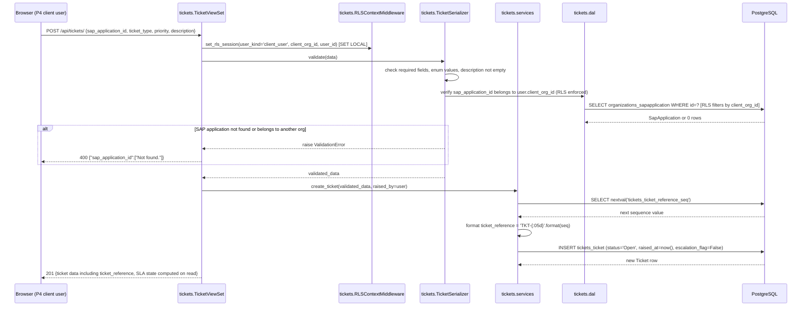
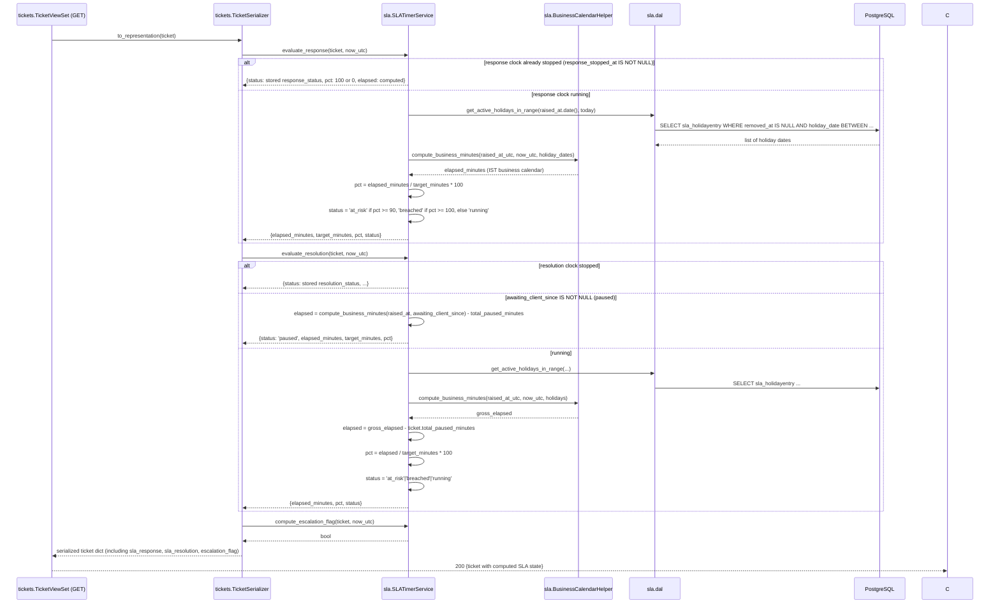
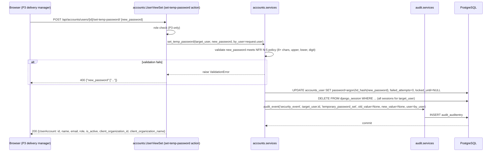
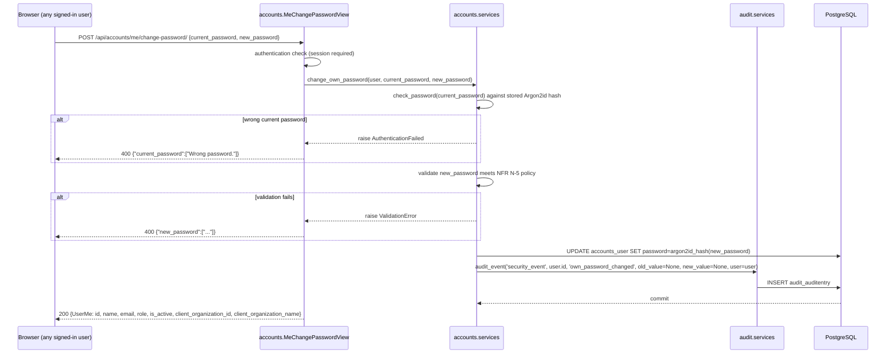

# APLX AMS: Backend Design

> **Single file.** There is exactly one backend design per project. Always use `--id BED --out docs/04-design/backend-design.md` when calling `new_artifact.py`; never auto-name as `BED-NNN.md`.

## Input References

- PIB-004 v0.1 — Phase 4 Input Brief (Approved 2026-10-17)
- SUM-003 v0.2 — Phase 3 Summary (Approved 2026-10-17)
- DBD-001 v0.1 — APLX AMS: Database Design (In review 2026-10-17)
- API-001 v0.1 — APLX AMS: API Specification (In review 2026-10-17)
- ADR-001 v0.3 § ADR A-1, A-6, A-7, A-8, A-9, A-10, A-11, A-12, A-15, A-17 (Approved 2026-10-17)
- ARC-001 v0.3 § Components, § NFR Mapping (Approved 2026-10-17)
- THR-001 v0.2 § Mitigations, § Authentication and authorization model (Approved 2026-10-17)
- BR-001 v0.3 § B-1 to B-24 (Approved 2026-10-17)
- NFR-001 v0.3 § N-1 to N-9 (Approved 2026-10-17)
- REQ-001 v0.3 § S-1 to S-33 (Approved 2026-10-17)
- GLO-001 v0.3 — APLX AMS: Domain Glossary (Approved 2026-10-17)

## Purpose And Scope

Covers: the internal structure of the APLX AMS Django modular monolith, including module responsibilities, domain model design (fields, methods, invariants, relationships), sequence diagrams for eight key flows, validation placement per layer, the data access layer (DAL) pattern, the service layer interface for SLA timers, audit, and reports, capacity notes, Django-layer security controls, and inherited open assumptions that affect the design.

Does not cover: Django model code, migration Python files, or any runnable code (Phase 6); the OpenAPI spec or database DDL (separate Phase 4 artifacts DBD-001 and API-001); frontend design or React components (Phase 4 UI spec); infrastructure, deployment, or CI pipeline (Phase 8); the permission matrix (PRM-001, the companion artifact).

## Module Structure

The backend is a single Django 5.2 LTS project with seven Django apps, each owning one bounded domain. The project root is `src/aplx_ams_django/`.

```
src/
  aplx_ams_django/       # Django project package (settings, urls, wsgi, middleware)
    settings/
      base.py            # Shared settings; reads secrets from /run/secrets/ (A-038)
      production.py      # Imports base; DEBUG=False; no secrets in file
    urls.py              # Root URL conf; mounts each app's router under /api/
    middleware.py        # RLSContextMiddleware; AbsoluteSessionTimeoutMiddleware;
                         # SecurityHeadersMiddleware (CSP, X-Frame-Options)
    dal/                 # Shared DAL utilities: rls_context(), set_rls_session()
    permissions.py       # HasRolePermission DRF permission class (deny by default)

  accounts/              # User accounts, roles, sign-in, lockout, password management
    models.py            # User (AbstractBaseUser)
    serializers.py       # UserSerializer, SignInSerializer, ChangePasswordSerializer
    services.py          # sign_in(), set_temp_password(), change_own_password()
    dal.py               # get_user_by_username(), get_user_by_id()
    views.py             # AuthLoginView, AuthLogoutView, MeView, UserViewSet
    urls.py

  organizations/         # Client organizations, SAP applications, contracts
    models.py            # ClientOrg, SapApplication, Contract
    serializers.py
    services.py          # create_contract(), end_contract(), hours_bank_balance()
    dal.py               # get_active_contract(), get_org_by_id()
    views.py             # OrganizationViewSet, SapApplicationViewSet, ContractViewSet
    urls.py

  tickets/               # Tickets, comments, ticket lifecycle state machine
    models.py            # Ticket, Comment
    serializers.py
    services.py          # acknowledge_ticket(), assign_ticket(), change_priority(),
                         # set_awaiting_client(), clear_awaiting_client(),
                         # resolve_ticket(), close_ticket()
    dal.py               # get_ticket(), list_tickets_for_user()
    views.py             # TicketViewSet, CommentViewSet
    urls.py

  sla/                   # Business calendar, holiday list, SLA timer computation
    models.py            # HolidayEntry
    services.py          # SLATimerService, BusinessCalendarHelper
    dal.py               # get_active_holidays_in_range()
    views.py             # HolidayViewSet
    urls.py

  effort/                # Effort entries, hours bank deduction
    models.py            # EffortEntry
    serializers.py
    services.py          # record_effort(), edit_effort(), soft_delete_effort()
    dal.py               # get_effort_for_ticket(), get_effort_for_contract_period()
    views.py             # EffortViewSet
    urls.py

  reports/               # Monthly client reports, live dashboard, finance export
    models.py            # MonthlyClientReport
    serializers.py
    services.py          # ReportDataService, ReportRenderService, FinanceExportService
    dal.py               # get_tickets_for_report(), get_effort_for_export()
    views.py             # DashboardView, ClientReportViewSet, FinanceExportView
    urls.py

  audit/                 # Append-only audit trail, 5 security event types
    models.py            # AuditEntry
    services.py          # audit_event() — the only write path to audit_auditentry
    dal.py               # list_audit_for_ticket(), list_security_events_for_user()
    views.py             # TicketAuditView, SecurityEventView
    urls.py
```

### App responsibilities

| App | Owns | Does not own |
| --- | --- | --- |
| `accounts` | User model; role enum; sign-in and sign-out; lockout; Argon2id hashing; temp-password and own-password flows; session revocation | Session storage (Django `django_session`); audit writes (delegates to `audit`) |
| `organizations` | ClientOrg; SapApplication; Contract; active-contract lookup; hours bank balance computation; contract lifecycle | Effort deduction from balance (read-time computation); ticket scoping |
| `tickets` | Ticket; Comment; ticket lifecycle state machine (Open → Awaiting client ↔ Open → Resolved → Closed); priority change logic; response clock stop on first L1 action | SLA timer computation (delegates to `sla`); audit writes (delegates to `audit`) |
| `sla` | HolidayEntry; SLA business calendar (09:00–18:00 IST Mon–Fri minus active holidays); on-read SLA timer computation; escalation flag logic | Storing computed SLA state (stored columns are on `tickets_ticket`) |
| `effort` | EffortEntry (soft-delete); per-engineer per-month editing window enforcement | Contract balance computation (derives from `organizations`) |
| `reports` | MonthlyClientReport metadata; ReportDataService; ReportRenderService (XlsxWriter, WeasyPrint); FinanceExportService (Python csv); live dashboard query | Generating data that belongs to another module |
| `audit` | AuditEntry (append-only); `audit_event()` helper; 5 security event type constants | Triggering audit writes (callers do that in their transactions) |

## Domain Models

### accounts.User

Custom `AbstractBaseUser`. The Django `auth` framework's `authenticate()` and session functions are used; the default `AbstractUser` is not used (custom fields required: `role`, `client_org_id`, `failed_attempts`, `locked_until`).

**Fields** (all in `accounts_user` table; see DBD-001 § Module: accounts):

| Field | Type | Notes |
| --- | --- | --- |
| id | bigint PK | Auto |
| username | varchar(150), unique | Account name used at sign-in (GLO-001) |
| name | varchar(150) | Personal data (NFR N-9) |
| email | varchar(254), unique | Personal data (NFR N-9) |
| password | varchar(256) | Argon2id hash only; never plain text (ADR A-8) |
| role | role_enum | l1_support, l2l3_support, delivery_manager, client_user |
| client_org_id | bigint FK → ClientOrg, nullable | Non-null for client_user only |
| is_active | bool | Inactive users cannot sign in |
| failed_attempts | smallint | 0 to 5; resets on successful sign-in or temp password set |
| locked_until | timestamptz, nullable | Non-null while account is locked |
| date_joined | timestamptz | Set at account creation |
| last_login | timestamptz, nullable | Updated by Django auth framework |

**Invariants:**
- `role = client_user` requires `client_org_id IS NOT NULL` (DB CHECK constraint)
- `role != client_user` requires `client_org_id IS NULL` (DB CHECK constraint)
- `failed_attempts >= 0` (DB CHECK constraint)
- `password` is an Argon2id hash string; no application path writes a plain-text value
- At most one active session is created at sign-in; all prior sessions revoked when temp password is set or user is deactivated

**Key methods (service functions in `accounts/services.py`):**
- `sign_in(username, password)` → session or raises; increments failed_attempts on failure; at 5 failures sets `locked_until = now() + 30 min`; writes SIGN_IN_OK or SIGN_IN_FAIL audit event; always returns the generic error for all refusal cases (A-019 Confirmed)
- `record_failed_attempt(user)` → increments `failed_attempts`; at 5 triggers lockout and writes ACCOUNT_LOCKOUT event
- `set_temp_password(user, new_password, by_user)` → no current password required; hashes with Argon2id; clears `locked_until` and `failed_attempts`; revokes all sessions for the user; writes TEMP_PASSWORD_SET event (BR B-23; REQ S-30)
- `change_own_password(user, current_password, new_password)` → verifies current password first; hashes with Argon2id; writes OWN_PASSWORD_CHANGED event (REQ S-31)
- `deactivate(user, by_user)` → sets `is_active = False`; revokes all sessions for the user

### organizations.ClientOrg

**Fields:** id, name (varchar 255, unique), created_at.

**Invariants:** `name` is globally unique.

### organizations.SapApplication

**Fields:** id, client_org_id (FK, mandatory), name (varchar 255), created_at.

**Invariants:** `(client_org_id, name)` is unique (one org cannot have two applications with the same name).

### organizations.Contract

**Fields:** id, client_org_id (FK, mandatory), contract_type (hours_bank | fixed_fee), contracted_hours (numeric 10,2, nullable), is_active (bool), monthly_close_at (timestamptz, nullable), started_at, ended_at (nullable), created_at.

**Invariants:**
- `contract_type = hours_bank` requires `contracted_hours IS NOT NULL` (DB CHECK)
- `contracted_hours > 0` when set (DB CHECK)
- `ended_at > started_at` when set (DB CHECK)
- At most one active contract per org (partial unique index on `client_org_id` where `is_active = TRUE`)

**Key method:** `hours_bank_balance(period_end)` — computed on read from `contracted_hours` minus the sum of non-deleted `effort_effortentry.hours` for this contract up to `period_end`. Not stored as a column (DBD-001 § organizations_contract).

### sla.HolidayEntry

**Fields:** id, holiday_date (date), added_at, added_by_id (FK User), removed_at (nullable), removed_by_id (FK User, nullable).

**Invariants:**
- `(removed_at IS NULL) = (removed_by_id IS NULL)` (DB CHECK)
- Rows are never hard-deleted; removal is `SET removed_at = now(), removed_by_id = <user>` (ADR A-10)
- A date is active as a holiday only while `added_at <= evaluation_moment AND (removed_at IS NULL OR removed_at > evaluation_moment)`

### sla.SLATimerService (service, not a model)

SLA targets (BR B-1): P1 = 1 h response / 4 h resolution; P2 = 4 h response / 9 h (1 business day) resolution; P3 = 1 business day response / 3 business days resolution; P4 = 2 business days response / 5 business days resolution. All in business minutes (1 business day = 9 h = 540 min; A-010 Confirmed).

**Methods:**
- `compute_business_minutes(start_utc, end_utc, holiday_dates)` → integer of business minutes in the window, applying the 09:00–18:00 IST Mon–Fri calendar (A-027 Open; times converted to IST)
- `evaluate_response(ticket, now_utc)` → dict with keys `elapsed_minutes`, `target_minutes`, `pct`, `status` ('running' | 'at_risk' | 'breached' | 'met' | 'breached_stopped'); if `response_stopped_at` is set, reads stored `response_status` instead of computing
- `evaluate_resolution(ticket, now_utc)` → same shape; paused while `awaiting_client_since IS NOT NULL`; reads `total_paused_minutes` to subtract; at-risk at 90% elapsed (BR B-5); breached at 100%; if `resolution_stopped_at` is set, reads stored `resolution_status`
- `compute_escalation_flag(ticket, now_utc)` → bool; True when resolution clock reaches 50% of resolution target (BR B-9); False once resolution clock is stopped

### sla.BusinessCalendarHelper

**Methods:**
- `is_business_moment(moment_ist)` → bool (Monday–Friday, 09:00–18:00, not a holiday at that moment)
- `holidays_in_range(start_date, end_date, evaluation_moment)` → list of holiday dates active at `evaluation_moment`

### tickets.Ticket

**Fields** (see DBD-001 § Module: tickets): id, ticket_reference (varchar 20, unique), client_org_id (FK, mandatory), sap_application_id (FK), ticket_type, priority, status, description, raised_by_id (FK), raised_at, assigned_to_id (FK, nullable), escalation_flag, response_stopped_at, response_status, resolution_stopped_at, resolution_status, awaiting_client_since, total_paused_minutes.

**Invariants:**
- `(response_stopped_at IS NULL) = (response_status IS NULL)` (DB CHECK)
- `(resolution_stopped_at IS NULL) = (resolution_status IS NULL)` (DB CHECK)
- `total_paused_minutes >= 0` (DB CHECK)
- `awaiting_client_since IS NOT NULL → status = 'Awaiting client'` (DB CHECK)
- `response_stopped_at <= resolution_stopped_at` when both set (DB CHECK)

**Ticket lifecycle state machine** (ADR A-1; BR B-3 to B-8; REQ S-1 to S-8):

```
Open ──[L1/L2: set awaiting client]──> Awaiting client
Awaiting client ──[L1/L2: clear awaiting client]──> Open
Open or Awaiting client ──[L1 or L2: resolve]──> Resolved
Resolved ──[L1: close]──> Closed
```
Transitions not in the diagram are forbidden; the service layer enforces them and returns HTTP 409 on violation.

**Service functions in `tickets/services.py`:**
- `acknowledge_ticket(ticket, by_user)` — stops response clock in the same transaction: sets `response_stopped_at = now()`, `response_status = 'met' or 'breached'` (computed by SLATimerService); writes ticket audit entry for status change; called on the first L1 action (explicit acknowledge, priority change, assignment, status change, effort entry, or comment by L1; A-017 Confirmed)
- `change_priority(ticket, new_priority, reason, by_user)` — updates `priority`; recalculates and updates `escalation_flag` via SLATimerService; writes audit entry with `reason` (BR B-7; REQ S-4)
- `assign_ticket(ticket, to_user, by_user)` — sets `assigned_to_id`; writes audit entry; if response clock not yet stopped, also acknowledges
- `set_awaiting_client(ticket, by_user)` — requires `assigned_to_id = by_user.id` or `by_user.role = l1_support`; sets `awaiting_client_since = now()`, `status = 'Awaiting client'`; writes audit entry (REQ S-8)
- `clear_awaiting_client(ticket, by_user)` — computes paused business minutes from `awaiting_client_since` to now(); adds to `total_paused_minutes`; clears `awaiting_client_since`; sets `status = 'Open'`; writes audit entry
- `resolve_ticket(ticket, by_user)` — sets `status = 'Resolved'`; stops resolution clock: `resolution_stopped_at = now()`, `resolution_status = 'met' or 'breached'`; clears escalation_flag (resolution complete); writes audit entry (REQ S-6)
- `close_ticket(ticket, by_user)` — requires `status = 'Resolved'`; returns HTTP 409 otherwise; sets `status = 'Closed'`; writes audit entry (REQ S-7)

### tickets.Comment

**Fields:** id, ticket_id (FK), client_org_id (FK, mandatory), author_id (FK User), body (text), created_at.

**Invariants:** Comments are permanent; no story requires editing or deleting a comment. A comment by a client user clears awaiting client if the ticket is in that state (DEC-026; A-013 Confirmed).

### effort.EffortEntry

**Fields:** id, ticket_id (FK), client_org_id (FK, mandatory), contract_id (FK), engineer_id (FK User), effort_date (date), hours (numeric 6,2), is_deleted (bool), created_at, updated_at.

**Invariants:**
- `hours > 0` (DB CHECK; A-020 Open)
- `is_deleted = TRUE` → entry excluded from contract balance and all active summaries; retained for data retention (NFR N-4; A-039 Open)
- Editing allowed within the calendar month of `effort_date` for engineers (P1, P2); delivery manager (P3) may edit at any time (REQ S-25, S-26; A-025 Confirmed)

**Service functions in `effort/services.py`:**
- `record_effort(ticket, engineer, hours, effort_date, contract, by_user)` — creates entry; writes effort_entry audit entry (field_name='hours')
- `edit_effort(entry, new_hours, by_user)` — checks editing window; updates `hours`; writes audit entry with old and new hours
- `soft_delete_effort(entry, by_user)` — checks window (engineers only); sets `is_deleted = True`; writes audit entry (field_name='deleted')

### reports.MonthlyClientReport

**Fields:** id, client_org_id (FK, mandatory), period_year (int), period_month (int 1–12), generated_at, generated_by_id (FK User), published_at (nullable).

**Invariants:** `(client_org_id, period_year, period_month)` is unique (DB UNIQUE constraint). `published_at IS NOT NULL` means published and visible to client users (BR B-14).

**Service classes in `reports/services.py`:**

`ReportDataService`:
- `generate_client_report_data(client_org_id, year, month)` → dict: SLA summary per priority (response met%, resolution met%, MTTR), ticket counts raised/resolved/closed, open ticket list. Period is calendar month in IST (A-015 Open). MTTR formula: mean business-time from raised_at to resolution_stopped_at minus total_paused_minutes, for tickets resolved in the month (A-009 Confirmed).

`ReportRenderService`:
- `render_xlsx(report_data, client_org_name)` → BytesIO; XlsxWriter writes each cell; any cell value starting with `=`, `+`, `-`, `@` is prefixed with `'` before writing (THR T-14 control; A-029 Open)
- `render_pdf(report_data, client_org_name)` → BytesIO; WeasyPrint renders HTML template to PDF; Django template auto-escaping applies (A-029 Open)

`FinanceExportService`:
- `generate_finance_export(year, month)` → BytesIO; Python csv module writes rows with exactly these 8 columns in order: period ("YYYY-MM"), client_org, contract_type (hours_bank | fixed_fee), ticket_ref, ticket_title, engineer (full name), hours (decimal > 0), remaining_hours_bank_balance (decimal nullable; null for fixed_fee contracts); any cell value starting with `=`, `+`, `-`, `@` is prefixed with `'`; no file stored on disk (ADR A-12; A-029 Open)

### audit.AuditEntry

**Fields:** id, entity_type (varchar 50), entity_id (bigint, nullable), field_name (varchar 100), old_value (text, nullable), new_value (text, nullable), changed_by (FK User, nullable), account_name_typed (varchar 150, nullable), reason (text, nullable), client_org_id (FK ClientOrg, nullable), changed_at.

**Invariants:**
- `entity_type IN ('ticket', 'effort_entry', 'security_event')` (DB CHECK)
- No UPDATE or DELETE granted to `aplx_ams_app` (ADR A-11; DB grants in DBD-001)
- No password value in `old_value` or `new_value` (`audit_event()` validates before writing; NFR N-6)
- For `security_event`: at least one of `changed_by`, `account_name_typed`, `entity_id` is non-null (DB CHECK)
- `account_name_typed IS NOT NULL → entity_id IS NULL` (DB CHECK; failed sign-in with unknown account name)
- `security_event → client_org_id IS NULL` (DB CHECK)

**Security event field_name constants** (BR B-24; REQ S-32):

| Constant | Value (field_name stored in DB) | When written |
| --- | --- | --- |
| `SIGN_IN_OK` | `successful_sign_in` | Successful sign-in |
| `SIGN_IN_FAIL` | `failed_sign_in` | Failed sign-in (wrong password, unknown account, locked, deactivated) |
| `ACCOUNT_LOCKOUT` | `account_lockout` | 5th failed attempt triggers lockout |
| `TEMP_PASSWORD_SET` | `temporary_password_set` | Delivery manager sets a temporary password |
| `OWN_PASSWORD_CHANGED` | `own_password_changed` | User changes their own password |

**`audit_event(entity_type, entity_id, field_name, old_value, new_value, user, reason=None)`** (in `audit/services.py`):
1. Validates `old_value` and `new_value` do not contain password values (checked by pattern; if violated, raises `ValueError` before any write — this is the guard required by NFR N-6).
2. Constructs and INSERTs an `AuditEntry` in the current database transaction (the same transaction as the domain change; guaranteed by `ATOMIC_REQUESTS = True`).
3. Raises `IntegrityError` on DB failure; no silent failure.
4. Returns `None`.

## Sequence Diagrams

All sequence diagrams show logical message flows between layers. The database transaction wraps from the DRF view call to the final commit (ATOMIC_REQUESTS = True).

### Flow 1: Sign-in with lockout

```mermaid
sequenceDiagram
    participant C as Browser client
    participant N as Nginx proxy
    participant V as accounts.AuthLoginView
    participant S as accounts.services
    participant D as accounts.dal
    participant AU as audit.services
    participant DB as PostgreSQL

    C->>N: POST /api/auth/login/ {username, password}
    N->>N: rate-limit check (10 req/min per IP)
    alt rate limit exceeded
        N-->>C: 429 Too Many Requests
    end
    N->>V: forward request
    V->>S: sign_in(username, password)
    S->>D: get_user_by_username(username)
    DB-->>D: User row or None
    alt unknown username
        S->>AU: audit_event('security_event', None, 'failed_sign_in', account_name_typed=username)
        AU->>DB: INSERT audit_auditentry
        S-->>V: raise AuthenticationFailed
        V-->>C: 401 {"detail":"Invalid credentials.","code":"authentication_failed"}
    end
    S->>S: check is_locked() → locked_until > now()?
    alt account locked
        S->>AU: audit_event('security_event', user.id, 'failed_sign_in')
        AU->>DB: INSERT audit_auditentry
        S-->>V: raise AuthenticationFailed
        V-->>C: 401 {"detail":"Invalid credentials.","code":"authentication_failed"}
    end
    S->>S: check_password(password) against Argon2id hash
    alt wrong password
        S->>S: record_failed_attempt(user) → failed_attempts += 1
        DB->>DB: UPDATE accounts_user SET failed_attempts=...
        alt failed_attempts = 5
            S->>S: set locked_until = now() + 30 min
            DB->>DB: UPDATE accounts_user SET locked_until=...
            S->>AU: audit_event('security_event', user.id, 'account_lockout')
            AU->>DB: INSERT audit_auditentry
        end
        S->>AU: audit_event('security_event', user.id, 'failed_sign_in')
        AU->>DB: INSERT audit_auditentry
        S-->>V: raise AuthenticationFailed
        V-->>C: 401 {"detail":"Invalid credentials.","code":"authentication_failed"}
    end
    alt user deactivated (is_active=False)
        S->>AU: audit_event('security_event', user.id, 'failed_sign_in')
        AU->>DB: INSERT audit_auditentry
        S-->>V: raise AuthenticationFailed
        V-->>C: 401 {"detail":"Invalid credentials.","code":"authentication_failed"}
    end
    S->>S: reset failed_attempts = 0, locked_until = NULL
    DB->>DB: UPDATE accounts_user SET failed_attempts=0, locked_until=NULL
    S->>AU: audit_event('security_event', user.id, 'successful_sign_in')
    AU->>DB: INSERT audit_auditentry
    S->>V: return user
    V->>V: create new session (Django session rotate); set RLS context
    V-->>C: 200 {user data} + Set-Cookie: sessionid (HttpOnly; Secure; SameSite=Strict)
```

### Flow 2: Raise ticket



### Flow 3: SLA timer evaluation on read



### Flow 4: Log effort

```mermaid
sequenceDiagram
    participant C as Browser (P1/P2 engineer)
    participant V as effort.EffortViewSet
    participant SER as effort.EffortSerializer
    participant S as effort.services
    participant OD as organizations.dal
    participant AU as audit.services
    participant DB as PostgreSQL

    C->>V: POST /api/tickets/{id}/effort/ {hours, effort_date}
    V->>V: check user is assigned to ticket (object-level permission)
    V->>SER: validate({hours, effort_date})
    SER->>SER: hours > 0; effort_date is a valid date
    SER-->>V: validated_data
    V->>OD: get_active_contract(ticket.client_org_id)
    DB-->>OD: Contract row
    alt no active contract
        V-->>C: 409 {"detail":"No active contract.","code":"conflict"}
    end
    V->>S: record_effort(ticket, engineer=user, hours, effort_date, contract)
    S->>DB: INSERT effort_effortentry
    DB-->>S: new EffortEntry
    S->>AU: audit_event('effort_entry', entry.id, 'hours', old_value=None, new_value=str(hours), user)
    AU->>DB: INSERT audit_auditentry
    DB-->>S: commit
    V-->>C: 201 {effort entry data}
```

### Flow 5: Generate client report

```mermaid
sequenceDiagram
    participant C as Browser (P3 delivery manager)
    participant V as reports.ClientReportViewSet
    participant RDS as reports.ReportDataService
    participant RRS as reports.ReportRenderService
    participant D as reports.dal
    participant SLA as sla.SLATimerService
    participant DB as PostgreSQL

    C->>V: POST /api/reports/client-reports/{org_id}/{year}/{month}/generate/
    V->>V: role check (P3 only)
    V->>DB: UPSERT reports_monthlyclientreport (generated_at=now(), generated_by=user)
    DB-->>V: MonthlyClientReport row
    V->>RDS: generate_client_report_data(client_org_id, year, month)
    RDS->>D: get_tickets_for_report(org_id, year, month)
    D->>DB: SELECT tickets_ticket WHERE client_org_id=? AND period falls in month (IST, A-015 Open)
    DB-->>D: ticket rows
    RDS->>SLA: evaluate_resolution(ticket) for each resolved ticket (to compute MTTR)
    RDS->>RDS: compute SLA summary per priority (met%, breached%, MTTR)
    RDS-->>V: report_data dict
    V-->>C: 201 {report metadata; report_data embedded in response}
```

Note: file download (XLSX or PDF) is a separate GET to `/download/`; `ReportRenderService.render_xlsx()` or `render_pdf()` is called in that request, generating the file in memory and streaming it. No file is stored on disk (ADR A-12).

### Flow 6: Set temporary password



### Flow 7: Change own password



### Flow 8: Audit event write

```mermaid
sequenceDiagram
    participant CALLER as Any service function
    participant AU as audit.audit_event()
    participant DB as PostgreSQL

    CALLER->>AU: audit_event(entity_type, entity_id, field_name, old_value, new_value, user, reason)
    AU->>AU: validate: old_value and new_value do not contain a password value
    alt validation fails (password detected)
        AU-->>CALLER: raise ValueError("Audit entry must not contain a password value")
        Note over CALLER,DB: Transaction rolls back — the domain change is also undone
    end
    AU->>DB: INSERT INTO audit_auditentry (...) VALUES (...)
    DB-->>AU: new AuditEntry id
    AU-->>CALLER: None (success; entry committed with the enclosing transaction)
```

## Validation And Error Handling

### Validation layers

| Layer | What is validated | Where in code |
| --- | --- | --- |
| Nginx | Rate limit: 10 req/min per IP on POST /api/auth/login/ | `proxy` container, Nginx `limit_req_zone` |
| DRF permission class | Role check per endpoint (deny by default); `HasRolePermission` in `permissions.py` | Called before any view code |
| DRF serializer | Field presence, type, format (e.g. enum values, date format, positive hours); simple field-level rules | `accounts/`, `organizations/`, `tickets/`, `effort/` serializers |
| Service function | Cross-model business rules: lockout enforcement, editing window, state machine transitions, one-active-contract check, password policy (NFR N-5) | `accounts/`, `organizations/`, `tickets/`, `effort/`, `reports/` services |
| DAL | Client org scoping (defense in depth, in addition to RLS) | All DAL modules |
| Database | CHECK constraints, UNIQUE constraints, RLS policies | PostgreSQL (DBD-001) |
| `audit_event()` | Absence of password values in audit fields | `audit/services.py` |

### Error response shapes

All error responses follow the API-001 error model:

**Simple error (HTTP 401, 403, 404, 409, 500):**
```json
{"detail": "Human-readable message.", "code": "machine_code"}
```

**Validation error (HTTP 400):**
```json
{"field_name": ["Error message."], "non_field_errors": ["..."]}
```

### Status code mapping

| Code | Trigger | Example |
| --- | --- | --- |
| 400 | Serializer or service validation failure | Missing required field; hours = 0; password too short |
| 401 | Session missing, expired, or sign-in refused | Any sign-in refusal → generic "Invalid credentials." (A-019 Confirmed) |
| 403 | Role not permitted; client user accessing another org's resource | P4 calling POST /api/tickets/{id}/assign/ |
| 404 | Resource not found or not visible (RLS filters it out) | Ticket ID from another org (client user) |
| 409 | Business rule violation | Second active contract; closing a non-Resolved ticket |
| 429 | Nginx rate limit on sign-in | Exceeded 10 req/min per IP |
| 500 | Unhandled exception | DB connection error (no stack trace in response; `DEBUG=False`) |

### Lockout handling

- `sign_in()` calls `record_failed_attempt(user)` on every wrong password or deactivated user attempt.
- At `failed_attempts = 5`: set `locked_until = now() + 30 min`; write `ACCOUNT_LOCKOUT` security event; return generic 401.
- Locked user attempting sign-in: return generic 401 immediately without checking password (avoids extra hash timing leak).
- Delivery manager sets temp password: `failed_attempts` reset to 0, `locked_until` cleared in the same transaction (BR B-23; REQ S-30 AC-3).

### Rate limit handling

Nginx enforces 10 req/min per IP on `POST /api/auth/login/` at the proxy layer. If Nginx forwards a request that exceeds the limit (unlikely with `limit_req` in nodelay mode), the Django view returns HTTP 429 with `{"detail": "Too many requests.", "code": "throttled"}`.

### Password policy (NFR N-5)

Policy: minimum 8 characters, at least one upper-case letter, at least one lower-case letter, at least one digit. Enforced in `set_temp_password()` and `change_own_password()` in `accounts/services.py` before any DB write. A custom Django password validator is registered in `AUTH_PASSWORD_VALIDATORS` in `settings/base.py`.

## Data Access Layer

### DAL pattern

Each app has a `dal.py` module. Service functions and views call only DAL functions for DB reads; they do not construct querysets directly. This single-layer pattern enforces:
1. RLS context is always set before any query in the request transaction.
2. Client-user queries apply application-level filtering on `client_org_id` in addition to RLS (defense in depth; THR T-11 control).
3. Raw SQL is allowed only inside DAL functions, with bound parameters only; no string concatenation (THR T-14 control).

### RLS context setup

`RLSContextMiddleware` (in `aplx_ams_django/middleware.py`) runs at the start of each request, inside the `ATOMIC_REQUESTS` transaction:

1. Reads `request.user` (populated by `SessionMiddleware` and `AuthenticationMiddleware`).
2. Executes `SET LOCAL app.user_id = '<user.id>'` (always).
3. If `request.user.role = 'client_user'`: executes `SET LOCAL app.user_kind = 'client_user'` and `SET LOCAL app.client_org_id = '<user.client_org_id>'`.
4. Else: executes `SET LOCAL app.user_kind = 'internal'`.

`SET LOCAL` is transaction-local: cleared automatically on transaction commit or rollback. With `ATOMIC_REQUESTS = True`, each request is one transaction, so the RLS context can never leak to the next request on the same DB connection.

### DAL method variants

| Table group | Internal-user DAL method | Client-user DAL method |
| --- | --- | --- |
| `tickets_ticket` | `get_ticket_for_internal(ticket_id)` — no org filter; RLS passes all | `get_ticket_for_client(ticket_id, client_org_id)` — explicit `WHERE client_org_id = ?` |
| `tickets_comment` | `list_comments_for_ticket(ticket_id)` — RLS allows all internal users | `list_comments_for_ticket_client(ticket_id, client_org_id)` — explicit org filter |
| `effort_effortentry` | `list_effort_for_ticket(ticket_id)` | `list_effort_for_ticket_client(ticket_id, client_org_id)` |
| `reports_monthlyclientreport` | `get_report(org_id, year, month)` | `get_published_report(org_id, year, month, client_org_id)` — also checks `published_at IS NOT NULL` |
| `audit_auditentry` | Two methods: `list_audit_for_ticket(ticket_id)` and `list_security_events(filter_by_user_id=None)` | Not applicable — client users cannot read audit entries (RLS blocks; DBD-001 policy) |
| `accounts_user` | `get_user_by_id(id)` | `get_own_user(user_id)` — only own row; RLS enforces it |

## Service Layer

### SLA timer service (`sla/services.py`)

Interface:

```
SLATimerService.evaluate_response(ticket: Ticket, now_utc: datetime) -> dict
  Returns: {
    "elapsed_minutes": int,
    "target_minutes": int,
    "pct": float,        # 0.0 to n.n (can exceed 100)
    "status": str        # "running" | "at_risk" | "breached" | "met" | "breached_stopped"
  }
  Note: reads ticket.response_stopped_at; if set, returns stored status without computing

SLATimerService.evaluate_resolution(ticket: Ticket, now_utc: datetime) -> dict
  Returns: same shape + status can be "paused"
  Note: subtracts ticket.total_paused_minutes; pauses while awaiting_client_since IS NOT NULL

SLATimerService.compute_escalation_flag(ticket: Ticket, now_utc: datetime) -> bool
  Returns: True if resolution pct >= 50 and resolution not stopped

SLATimerService.escalate_ticket(ticket: Ticket, now_utc: datetime) -> None
  Calls compute_escalation_flag(ticket, now_utc); if result is True and
  ticket.escalation_flag is False, sets ticket.escalation_flag = True (UPDATE
  tickets_ticket SET escalation_flag = TRUE WHERE id = ticket.id) and calls
  audit_event('ticket', ticket.id, 'escalation_flag', old_value='False',
  new_value='True', user=None); no-op if ticket.escalation_flag is already True
  or the resolution clock is stopped (resolution_stopped_at IS NOT NULL).
  Called by the SLA evaluation pipeline — the same pipeline that evaluates at-risk
  and breached states — so that the flag is persisted at the point the 50% resolution
  threshold is crossed (BR B-9; REQ S-11; BL-11).

BusinessCalendarHelper.compute_business_minutes(start_utc, end_utc, holiday_dates) -> int
  Converts start and end to IST; counts minutes within Mon–Fri 09:00–18:00 IST minus holidays
```

### Audit service (`audit/services.py`)

```
audit_event(
  entity_type: str,      # 'ticket' | 'effort_entry' | 'security_event'
  entity_id: int | None,
  field_name: str,       # one of the documented field_name values (DBD-001 § audit_auditentry)
  old_value: str | None,
  new_value: str | None,
  user: User | None,     # None for ACCOUNT_LOCKOUT (system-generated)
  reason: str | None = None,
  account_name_typed: str | None = None  # for SIGN_IN_FAIL with unknown account
) -> None
```

Called inside the enclosing DB transaction. Raises `ValueError` if `old_value` or `new_value` appears to contain a password value. Raises `IntegrityError` if the DB INSERT fails (propagates; transaction rolls back).

### Report service (`reports/services.py`)

```
ReportDataService.generate_client_report_data(client_org_id, year, month) -> dict
  # Queries tickets, effort, SLA computations for the calendar month in IST (A-015 Open)
  # Returns structured report data: {priorities: [{priority, sla_response_met_pct, ...}], mttr_minutes, ...}

ReportRenderService.render_xlsx(report_data, client_org_name) -> BytesIO
  # Writes XLSX in memory via XlsxWriter; formula-escape cells starting with =, +, -, @

ReportRenderService.render_pdf(report_data, client_org_name) -> BytesIO
  # Renders HTML template with WeasyPrint; auto-escaped in Django template

FinanceExportService.generate_finance_export(year, month, format: 'xlsx'|'csv') -> BytesIO
  # Queries effort_effortentry joined with tickets and contracts
  # Columns (8, in order): period ("YYYY-MM"), client_org, contract_type (hours_bank|fixed_fee),
  #   ticket_ref, ticket_title, engineer (full name), hours (decimal >0),
  #   remaining_hours_bank_balance (decimal nullable; null for fixed_fee)
  # Formula-escape cells starting with =, +, -, @
```

## Capacity Notes

**[A-034 Open]** The following values depend on A-034 (peak load assumption) and must be verified by the Phase 7 load test (NFR N-2).

| Parameter | Value | Source |
| --- | --- | --- |
| Expected peak concurrent users | 30 | NFR N-2 |
| Expected peak API requests/second | 15 (30 users × 1 action/10 s × 5 req/action) | A-034 Open |
| Gunicorn worker count | 5 (formula: 2 × vCPU + 1 on a 2-vCPU host) | A-034 Open; ADR A-5 |
| Request timeout (Gunicorn) | 30 s | A-034 Open; prevents runaway PDF/XLSX generation |
| `ATOMIC_REQUESTS` | True | ADR A-1 (one transaction per state change) |
| PostgreSQL `shared_buffers` | 1 GB (quarter of 4 GB RAM) | A-034 Open; ADR A-4 |
| App containers | 1 (`app` on the production server) | ADR A-5 |

NFR N-2 target: p95 page load under 2 s at 30 concurrent users. The Phase 7 load test measures this at the browser for the dashboard and ticket list pages.

## Security Controls

All controls are required (THR-001 v0.2 § Mitigations). The Django layer is responsible for controls marked "Django" below; controls marked "Nginx" are outside Django but listed for completeness.

| Control | THR threat | Django implementation |
| --- | --- | --- |
| Role check per endpoint | T-13 | `HasRolePermission` DRF permission class in `permissions.py`; deny by default (any role not in the `x-roles` list → HTTP 403); applied as the first permission in every view |
| CSP and framing headers | T-6, T-9 | `SecurityHeadersMiddleware` adds `Content-Security-Policy: default-src 'self'; script-src 'self'; frame-ancestors 'none'` and `X-Frame-Options: DENY` on every response |
| CSRF | T-9 | DRF `SessionAuthentication` enforces CSRF on POST, PUT, PATCH, DELETE; client sends `X-CSRFToken` header; GET exempt; `CSRF_COOKIE_HTTPONLY = False` so JS can read the token |
| Session cookie flags | T-6, T-7 | `SESSION_COOKIE_HTTPONLY = True`, `SESSION_COOKIE_SECURE = True`, `SESSION_COOKIE_SAMESITE = 'Strict'`, `SESSION_COOKIE_AGE = 3600` (60-minute idle), host-only (no `SESSION_COOKIE_DOMAIN`) |
| 12-hour absolute session timeout | T-7 | `AbsoluteSessionTimeoutMiddleware` stores `session_created_at` in session data at first request; invalidates sessions where `now() - session_created_at > 43200 s` (DEC-030) |
| Session rotation at sign-in | T-6 | `request.session.cycle_key()` called in `AuthLoginView` after authentication |
| Session revocation on deactivation or temp password | T-8 | `deactivate()` and `set_temp_password()` flush all sessions for the target user from `django_session` |
| Active user check per request | T-8 | `SessionAuthentication.authenticate_credentials()` rejects inactive users |
| Rate limiting (sign-in) | T-2, T-35 | Nginx `limit_req_zone` (10 req/min per IP); Django view returns 429 as fallback |
| Argon2id password hashing | T-1, T-20 | `Argon2PasswordHasher` first in `PASSWORD_HASHERS` setting (ADR A-8; A-028 Open) |
| Generic sign-in error | T-10 | `sign_in()` returns the same HTTP 401 `{"detail":"Invalid credentials.","code":"authentication_failed"}` for all four refusal cases (A-019 Confirmed) |
| Client data separation (RLS) | T-11, T-12 | `RLSContextMiddleware` sets transaction-local `app.user_kind`, `app.client_org_id`, `app.user_id` via `SET LOCAL`; `ATOMIC_REQUESTS = True` ensures context clears at transaction end; runtime role has no `BYPASSRLS` (DBD-001) |
| DAL application-level filter | T-11 | Client-user DAL methods add `WHERE client_org_id = ?` in addition to RLS (defense in depth) |
| ORM queries only; raw SQL with bound parameters | T-14 | Service and view code uses Django ORM; raw SQL only in DAL functions with `cursor.execute(sql, [params])`; no string interpolation |
| Export formula escaping | T-14 | `ReportRenderService` and `FinanceExportService` prefix cells starting with `=`, `+`, `-`, `@` with `'` before writing to XlsxWriter or Python csv |
| No password in API responses | T-16 | `UserSerializer` excludes `password` field; `audit_event()` validates no password in audit entries; `AuthLoginView` returns only session cookie, no credentials |
| `DEBUG = False` in production | T-16 | `settings/production.py`; generic error page (Django custom 500 view) |
| Secrets from `/run/secrets/` | T-17 | `settings/base.py` `read_secret(name)` helper reads `Path('/run/secrets/' + name).read_text().strip()` (A-038 Open; ADR A-17) |
| Append-only audit trail | T-15 | `aplx_ams_app` role has `INSERT + SELECT` only on `audit_auditentry` (DBD-001 grants); no application path calls UPDATE or DELETE on that table |
| Audit entries contain no password values | T-16, NFR N-6 | `audit_event()` validates `old_value` and `new_value` before INSERT; raises `ValueError` if password pattern detected |

## Inherited Open Assumptions

The following open assumptions from Phase 3 affect this design. Each is labeled where relevant in the sections above.

| ID | Assumption | Impact on this design |
| --- | --- | --- |
| A-027 (Open) | All timestamps stored in UTC; displayed in IST. SLA business time computed on the IST calendar. | SLATimerService and BusinessCalendarHelper convert UTC timestamps to IST (Asia/Kolkata, UTC+05:30) before applying business-hour logic. API responses use UTC ISO 8601; frontend converts to IST. If IST timestamps are needed in API responses, an SCR is required. |
| A-028 (Open) | Passwords stored with Argon2id (ADR A-8). | `Argon2PasswordHasher` first in `PASSWORD_HASHERS`. If the recommendation changes, an SCR is required and existing hashes must be migrated. |
| A-029 (Open) | Excel, CSV and PDF generated with XlsxWriter, Python csv, WeasyPrint (ADR A-12). | Report and export services depend on these three libraries. If a library is replaced, an SCR is required; API response shape (MIME type, format) stays unchanged. |
| A-031 (Open) | The weekly dump goes to the test server, which then holds production data. | No impact on backend code design. Affects Phase 8 operational procedures. |
| A-034 (Open) | Peak load is 30 concurrent users at 15 API req/s; 5 Gunicorn workers on a 2-vCPU host handles this within NFR N-2. | Gunicorn worker count (5) and PostgreSQL `shared_buffers` (1 GB) are set by this assumption. The Phase 7 load test must verify NFR N-2 (p95 < 2 s). If the test fails, the worker count or server sizing must be revisited via SCR or ADR. |
| A-038 (Open) | No secret manager available; secrets as root-only files on each server passed as Docker Compose file secrets. | `settings/base.py` reads each secret from `/run/secrets/<name>`. No secret appears in committed code, environment variables, or CI logs. |

## Assumptions

- A-027 (Open): UTC storage, IST display, IST business calendar — logged in `docs/logs/assumptions-log.md`; affects SLATimerService and BusinessCalendarHelper.
- A-028 (Open): Argon2id password hashing — logged; affects `PASSWORD_HASHERS` setting.
- A-029 (Open): XlsxWriter, Python csv, WeasyPrint library choice — logged; affects report and export services.
- A-031 (Open): Test server holds production dumps — logged; no backend code impact.
- A-034 (Open): 5 Gunicorn workers on 2-vCPU host, 15 API req/s peak — logged; affects capacity settings in this artifact.
- A-038 (Open): No secret manager; `/run/secrets/` file reading — logged; affects `settings/base.py` design.
- A-039 (Open): Soft-delete on `effort_effortentry` reconciles engineer-delete right with NFR N-4 unlimited retention — logged; affects `EffortEntry` model design.

## Open Questions

No new open questions are raised by this artifact. All design decisions are traceable to PIB-004 v0.1 interview answers, approved upstream artifacts, or labeled open assumptions (A-027, A-028, A-029, A-031, A-034, A-038, A-039) that do not block this design but must be confirmed or resolved before Phase 5.

## Traceability Links

- Upstream: PIB-004 v0.1; SUM-003 v0.2; DBD-001 v0.1; API-001 v0.1; ADR-001 v0.3 (A-1, A-6, A-7, A-8, A-9, A-10, A-11, A-12, A-15, A-17); ARC-001 v0.3; THR-001 v0.2; BR-001 v0.3 (B-1 to B-24); NFR-001 v0.3 (N-1 to N-9); REQ-001 v0.3 (S-1 to S-33); GLO-001 v0.3.
- Downstream: PRM-001 (companion permission matrix); Phase 5 feature breakdown (FBD); Phase 5 wave plan (WAV); Phase 5 feature plans (each feature cites the module files they touch from this design); Phase 6 builder context packs.

## Quality Checklist

- [x] Every template section is filled, or marked "Not applicable - reason"
- [x] Inputs referenced are Approved artifacts at the stated versions
- [x] Nothing invented: no requirements, systems, users, endpoints, or libraries without a source
- [x] Assumptions and open questions are logged and linked
- [x] Traceability links are present upstream and downstream
- [x] Terminology follows .ai/standards/glossary.md
- [x] Vague words removed (etc., as needed, appropriate)
- [x] Permission matrix covers every endpoint — covered in companion PRM-001
- [x] Flows match the API spec — sequence diagrams aligned with API-001 endpoint list

## Approval Record
| Field | Value |
| --- | --- |
| Decision | Approve |
| Approver | Mohanasunder |
| Role | Architect / tech lead + UX |
| Version | 0.1 |
| Conditions | None |
| Comments | Phase 4 design package approved. |
| Timestamp | 2026-10-17 14:04 UTC |
