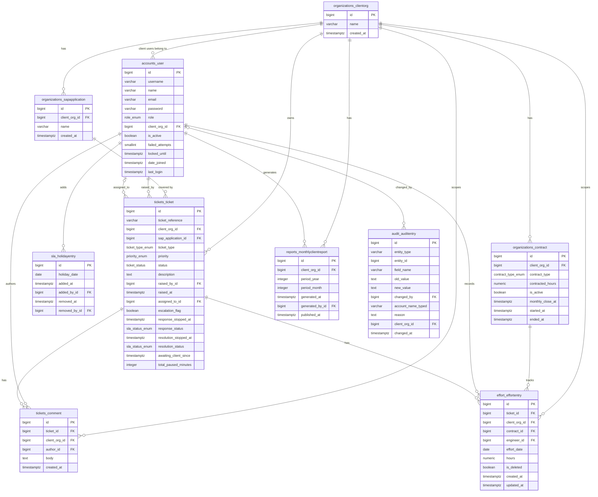

# APLX AMS: Database Design

> **Single file.** There is exactly one database design per project. Always use `--id DBD --out docs/04-design/database-design.md` when calling `new_artifact.py`; never auto-name as `DBD-NNN.md`.

## Input References

- PIB-004 v0.1 - Phase 4 input brief - docs/04-design/phase-input-brief.md (Approved 2026-10-17)
- SUM-003 v0.2 - Phase 3 summary - docs/03-architecture/SUMMARY.md (Approved 2026-10-17)
- REQ-001 v0.3 - APLX AMS: User Stories S-1 to S-33 - docs/02-requirements/user-stories.md (Approved 2026-10-17)
- BR-001 v0.3 - APLX AMS: Business Rules B-1 to B-24 - docs/02-requirements/business-rules.md (Approved 2026-10-17)
- GLO-001 v0.3 - APLX AMS: Domain Glossary - docs/02-requirements/domain-glossary.md (Approved 2026-10-17)
- NFR-001 v0.3 - APLX AMS: Non-Functional Requirements N-1 to N-9 - docs/02-requirements/nfrs.md (Approved 2026-10-17)
- ADR-001 v0.3 § ADR A-4, A-6, A-7, A-8, A-9, A-10, A-11 - docs/03-architecture/adrs.md (Approved 2026-10-17)
- ARC-001 v0.3 § Components - docs/03-architecture/architecture-overview.md (Approved 2026-10-17)

## Purpose And Scope

Covers: the complete PostgreSQL 18 database schema for APLX AMS release 1, including all tables, ENUM types, CHECK constraints, primary and foreign keys, row-level security (RLS) policies, database role grants, and the indexing strategy for the 33 user stories. Modules covered: accounts, organizations, tickets, sla, effort, reports, audit. Migration approach: initial Django migration from an empty schema, no data backfill (greenfield system).

Does not cover: Django model code, migration Python files, or application-layer business logic (Phase 6); OpenAPI endpoints or UI specification (separate Phase 4 artifacts); report content (generated on request, not stored - ADR A-12, BR B-14); session data (managed by Django's `django_session` table, excluded by ADR A-7).

Sizing notes: the database is expected to stay under 5 GB for 5 years at pilot scale (A-032, labeled below); weekly `pg_dump` files expected under 2 GB with 8 weekly dumps retained (A-033, labeled below).

## Entity Model



## Schema DDL

All timestamps use `TIMESTAMPTZ` (UTC storage; ADR A-9). All ENUM label strings follow GLO-001 v0.3 terminology exactly. The runtime role `aplx_ams_app` has no `BYPASSRLS` and no table ownership (ADR A-6). The owner role `aplx_ams_owner` runs migrations and bypasses RLS.

### ENUM Types

```sql
-- ticket_status: exactly 4 values (A-022 Confirmed; PIB-004 § Ticket statuses)
CREATE TYPE ticket_status AS ENUM (
    'Open',
    'Awaiting client',
    'Resolved',
    'Closed'
);

CREATE TYPE ticket_type_enum AS ENUM (
    'incident',
    'service_request'
);

-- priority_enum: P1 highest urgency, P4 lowest (BR B-1)
CREATE TYPE priority_enum AS ENUM (
    'P1',
    'P2',
    'P3',
    'P4'
);

-- role_enum: four roles in release 1 (BR B-21; GLO-001 Role)
CREATE TYPE role_enum AS ENUM (
    'l1_support',
    'l2l3_support',
    'delivery_manager',
    'client_user'
);

CREATE TYPE contract_type_enum AS ENUM (
    'hours_bank',
    'fixed_fee'
);

-- sla_status_enum: stopped-timer result only; running states are computed on read (ADR A-10)
CREATE TYPE sla_status_enum AS ENUM (
    'met',
    'breached'
);
```

### Module: organizations

```sql
-- Client organizations. Not client-owned (no client_org_id self-reference);
-- RLS restricts client users to their own org row only (ADR A-6).
CREATE TABLE organizations_clientorg (
    id          BIGSERIAL     PRIMARY KEY,
    name        VARCHAR(255)  NOT NULL UNIQUE,
    created_at  TIMESTAMPTZ   NOT NULL DEFAULT NOW()
);

-- SAP applications. Client-owned: client_org_id is mandatory (ADR A-6; BR B-19).
CREATE TABLE organizations_sapapplication (
    id             BIGSERIAL    PRIMARY KEY,
    client_org_id  BIGINT       NOT NULL REFERENCES organizations_clientorg(id),
    name           VARCHAR(255) NOT NULL,
    created_at     TIMESTAMPTZ  NOT NULL DEFAULT NOW(),
    UNIQUE (client_org_id, name)
);

-- Contracts. Client-owned: client_org_id is mandatory (ADR A-6; BR B-15).
-- contracted_hours: populated for hours_bank contracts only (BR B-16).
-- monthly_close_at: marks the end of the current editable period; when set,
--   the application layer uses it instead of the calendar month end (PIB-004
--   § Effort; BR B-15; A-025 Confirmed).
-- is_active: only one active contract per org enforced by partial unique index.
-- ended_at: set when the delivery manager ends the contract (BR B-15; REQ S-27).
CREATE TABLE organizations_contract (
    id                BIGSERIAL           PRIMARY KEY,
    client_org_id     BIGINT              NOT NULL REFERENCES organizations_clientorg(id),
    contract_type     contract_type_enum  NOT NULL,
    contracted_hours  NUMERIC(10, 2),
    is_active         BOOLEAN             NOT NULL DEFAULT TRUE,
    monthly_close_at  TIMESTAMPTZ,
    started_at        TIMESTAMPTZ         NOT NULL DEFAULT NOW(),
    ended_at          TIMESTAMPTZ,
    created_at        TIMESTAMPTZ         NOT NULL DEFAULT NOW(),
    CONSTRAINT chk_hours_bank_requires_contracted_hours
        CHECK (contract_type <> 'hours_bank' OR contracted_hours IS NOT NULL),
    CONSTRAINT chk_contracted_hours_positive
        CHECK (contracted_hours IS NULL OR contracted_hours > 0),
    CONSTRAINT chk_ended_at_after_started_at
        CHECK (ended_at IS NULL OR ended_at > started_at)
);

-- Partial unique index: at most one active contract per client organization (BR B-15; REQ S-19 AC-2).
CREATE UNIQUE INDEX organizations_contract_one_active_per_org_idx
    ON organizations_contract (client_org_id)
    WHERE is_active = TRUE;
```

### Module: accounts

```sql
-- User accounts. Custom Django user model (ADR A-2).
-- password: Argon2id hash stored by Django in its "<algorithm>$<params>$<salt>$<hash>"
--   format; never a plain-text or unhashed value (ADR A-8; BR B-24).
-- client_org_id: non-null for client_user role only (BR B-21; NFR N-7).
-- failed_attempts / locked_until: account lockout state (NFR N-5; REQ S-21 AC-4).
-- last_login: maintained by Django's authentication framework.
-- Session data is in Django's django_session table and excluded from this schema (ADR A-7).
-- Personal data per NFR N-9: name and email only.
CREATE TABLE accounts_user (
    id              BIGSERIAL    PRIMARY KEY,
    username        VARCHAR(150) NOT NULL UNIQUE,  -- account name used at sign-in
    name            VARCHAR(150) NOT NULL,          -- personal data (NFR N-9)
    email           VARCHAR(254) NOT NULL UNIQUE,   -- personal data (NFR N-9)
    password        VARCHAR(256) NOT NULL,          -- Argon2id hash (ADR A-8); never plain text
    role            role_enum    NOT NULL,
    client_org_id   BIGINT       REFERENCES organizations_clientorg(id),
    is_active       BOOLEAN      NOT NULL DEFAULT TRUE,
    failed_attempts SMALLINT     NOT NULL DEFAULT 0,
    locked_until    TIMESTAMPTZ,
    date_joined     TIMESTAMPTZ  NOT NULL DEFAULT NOW(),
    last_login      TIMESTAMPTZ,
    CONSTRAINT chk_client_user_has_org
        CHECK (role <> 'client_user' OR client_org_id IS NOT NULL),
    CONSTRAINT chk_internal_user_no_org
        CHECK (role = 'client_user' OR client_org_id IS NULL),
    CONSTRAINT chk_failed_attempts_non_negative
        CHECK (failed_attempts >= 0)
);
```

### Module: sla

```sql
-- Company holiday list entries (BR B-2; REQ S-24).
-- Entries are NEVER hard-deleted (ADR A-10; NFR N-4).
-- A date is excluded from business hours only while its entry's
--   added_at <= moment AND (removed_at IS NULL OR removed_at > moment).
-- removed_at IS NOT NULL means the entry was removed.
CREATE TABLE sla_holidayentry (
    id             BIGSERIAL  PRIMARY KEY,
    holiday_date   DATE       NOT NULL,
    added_at       TIMESTAMPTZ NOT NULL DEFAULT NOW(),
    added_by_id    BIGINT     NOT NULL REFERENCES accounts_user(id),
    removed_at     TIMESTAMPTZ,
    removed_by_id  BIGINT     REFERENCES accounts_user(id),
    CONSTRAINT chk_removed_consistent
        CHECK ((removed_at IS NULL) = (removed_by_id IS NULL))
);
```

### Module: tickets

```sql
-- Sequence for human-readable ticket reference (e.g., TKT-00001).
-- The application layer reads nextval and formats the reference string.
CREATE SEQUENCE tickets_ticket_reference_seq START 1;

-- Tickets. Client-owned: client_org_id is mandatory (ADR A-6; BR B-19; REQ S-1).
-- ticket_reference: unique human-readable identifier (GLO-001 Ticket reference; REQ S-22).
-- raised_at: UTC timestamp; SLA timers start from this value (BR B-3; ADR A-9).
-- assigned_to_id: NULL = ticket is with L1 (L1 queue); non-null = assigned to named L2/L3
--   support engineer (GLO-001 Assignment; BR B-10; A-024 Confirmed).
-- escalation_flag: computed by the SLA calculation component; stored to drive dashboard
--   query without recomputing per row (BR B-10; REQ S-11; ADR A-10).
-- response_stopped_at / response_status: set in the same DB transaction that records the
--   first L1 action; never updated after set (BR B-4; ADR A-10).
-- resolution_stopped_at / resolution_status: set in the same transaction that sets status
--   to Resolved (BR B-5; ADR A-10).
-- awaiting_client_since: set when assigned support engineer marks awaiting client (BR B-6).
-- total_paused_minutes: accumulated paused business minutes; updated when awaiting client
--   is cleared; used by SLA calculation component (BR B-6; ADR A-10).
CREATE TABLE tickets_ticket (
    id                     BIGSERIAL          PRIMARY KEY,
    ticket_reference       VARCHAR(20)        NOT NULL UNIQUE,
    client_org_id          BIGINT             NOT NULL REFERENCES organizations_clientorg(id),
    sap_application_id     BIGINT             NOT NULL REFERENCES organizations_sapapplication(id),
    ticket_type            ticket_type_enum   NOT NULL,
    priority               priority_enum      NOT NULL,
    status                 ticket_status      NOT NULL DEFAULT 'Open',
    description            TEXT               NOT NULL,
    raised_by_id           BIGINT             NOT NULL REFERENCES accounts_user(id),
    raised_at              TIMESTAMPTZ        NOT NULL,
    assigned_to_id         BIGINT             REFERENCES accounts_user(id),
    escalation_flag        BOOLEAN            NOT NULL DEFAULT FALSE,
    -- SLA timer stopped results (ADR A-10; BR B-4, B-5)
    response_stopped_at    TIMESTAMPTZ,
    response_status        sla_status_enum,
    resolution_stopped_at  TIMESTAMPTZ,
    resolution_status      sla_status_enum,
    -- Awaiting-client pause columns (BR B-6; ADR A-10)
    awaiting_client_since  TIMESTAMPTZ,
    total_paused_minutes   INTEGER            NOT NULL DEFAULT 0,
    CONSTRAINT chk_response_stopped_consistent
        CHECK ((response_stopped_at IS NULL) = (response_status IS NULL)),
    CONSTRAINT chk_resolution_stopped_consistent
        CHECK ((resolution_stopped_at IS NULL) = (resolution_status IS NULL)),
    CONSTRAINT chk_total_paused_minutes_non_negative
        CHECK (total_paused_minutes >= 0),
    CONSTRAINT chk_awaiting_client_matches_status
        CHECK (
            awaiting_client_since IS NULL
            OR status = 'Awaiting client'
        ),
    CONSTRAINT chk_response_before_resolution_stopped
        CHECK (
            resolution_stopped_at IS NULL
            OR response_stopped_at IS NULL
            OR response_stopped_at <= resolution_stopped_at
        )
);

-- Comments on tickets. Client-owned: client_org_id is mandatory (ADR A-6; BR B-6; REQ S-28, S-29).
-- author_id: the user who added the comment (client user or internal user).
CREATE TABLE tickets_comment (
    id             BIGSERIAL   PRIMARY KEY,
    ticket_id      BIGINT      NOT NULL REFERENCES tickets_ticket(id),
    client_org_id  BIGINT      NOT NULL REFERENCES organizations_clientorg(id),
    author_id      BIGINT      NOT NULL REFERENCES accounts_user(id),
    body           TEXT        NOT NULL,
    created_at     TIMESTAMPTZ NOT NULL DEFAULT NOW()
);
```

### Module: effort

```sql
-- Effort entries. Client-owned: client_org_id is mandatory (ADR A-6; BR B-15; REQ S-15).
-- hours: must be greater than 0 (BR B-15; A-020 Open; enforced by CHECK).
-- is_deleted: TRUE = soft-deleted by the support engineer within the calendar month
--   of effort_date; the entry no longer counts against the contract balance but is
--   retained for unlimited data retention (NFR N-4; BR B-15; REQ S-25 AC-2).
--   The audit trail records each deletion (BR B-22).
-- contract_id: the active contract at the time the entry was saved (BR B-15; REQ S-15).
-- engineer_id: the support engineer who recorded the effort (BR B-15; OQ-015 answer).
-- effort_date: the IST calendar date of the work; governs which month's editing window
--   applies (A-025 Confirmed; BR B-15).
CREATE TABLE effort_effortentry (
    id             BIGSERIAL     PRIMARY KEY,
    ticket_id      BIGINT        NOT NULL REFERENCES tickets_ticket(id),
    client_org_id  BIGINT        NOT NULL REFERENCES organizations_clientorg(id),
    contract_id    BIGINT        NOT NULL REFERENCES organizations_contract(id),
    engineer_id    BIGINT        NOT NULL REFERENCES accounts_user(id),
    effort_date    DATE          NOT NULL,
    hours          NUMERIC(6, 2) NOT NULL,
    is_deleted     BOOLEAN       NOT NULL DEFAULT FALSE,
    created_at     TIMESTAMPTZ   NOT NULL DEFAULT NOW(),
    updated_at     TIMESTAMPTZ   NOT NULL DEFAULT NOW(),
    CONSTRAINT chk_hours_positive
        CHECK (hours > 0)
);
```

### Module: reports

```sql
-- Monthly client report metadata. Client-owned: client_org_id is mandatory (ADR A-6; BR B-14).
-- Report CONTENT is not stored in this table; it is generated from ticket and SLA data on request
--   (ADR A-12; BR B-14; REQ S-13, S-14).
-- published_at: NULL means not yet published; non-null means published and visible to client users
--   (BR B-14; REQ S-14 AC-4).
-- period_year / period_month: calendar month in IST (A-015 Open; BR B-14; ADR A-9).
CREATE TABLE reports_monthlyclientreport (
    id               BIGSERIAL   PRIMARY KEY,
    client_org_id    BIGINT      NOT NULL REFERENCES organizations_clientorg(id),
    period_year      INTEGER     NOT NULL,
    period_month     INTEGER     NOT NULL,
    generated_at     TIMESTAMPTZ NOT NULL DEFAULT NOW(),
    generated_by_id  BIGINT      NOT NULL REFERENCES accounts_user(id),
    published_at     TIMESTAMPTZ,
    CONSTRAINT chk_period_month_valid
        CHECK (period_month BETWEEN 1 AND 12),
    CONSTRAINT chk_period_year_positive
        CHECK (period_year > 2000),
    UNIQUE (client_org_id, period_year, period_month)
);
```

### Module: audit

```sql
-- Audit trail. Append-only (ADR A-11; BR B-22; NFR N-6).
-- The runtime role aplx_ams_app has INSERT + SELECT only on this table;
--   no UPDATE, no DELETE grant. See GRANT statements below.
--
-- entity_type values:
--   'ticket'         - a ticket's status, priority, assignment, or escalation_flag changed
--   'effort_entry'   - an effort entry was saved, changed, or soft-deleted
--   'security_event' - one of the 5 security event types (BR B-24)
--
-- field_name values for entity_type = 'ticket':
--   'status', 'priority', 'assignment', 'escalation_flag'
--
-- field_name values for entity_type = 'effort_entry':
--   'hours' (save or change), 'deleted' (soft-delete)
--
-- field_name values for entity_type = 'security_event':
--   'successful_sign_in', 'failed_sign_in', 'account_lockout',
--   'temporary_password_set', 'own_password_changed'
--   (BR B-24; REQ S-32; NFR N-6)
--
-- old_value / new_value: text representation of the field's previous and current value;
--   NULL for creates, deletions, or security events (A-016 Open).
--   The audit function accepts no password parameter; no password value reaches
--   this table through it (ADR A-11; BR B-24; NFR N-6).
--
-- changed_by: user who caused the event; NULL for account_lockout (system-generated)
--   and for failed_sign_in with an unknown account name (no user record exists).
--
-- account_name_typed: populated for failed_sign_in where the typed account name matches
--   no user account; NULL otherwise (BR B-24; OQ-065 answered).
--
-- reason: populated for priority-change audit entries (field_name = 'priority');
--   NULL for all other entries (BR B-7; REQ S-4).
--
-- client_org_id: populated for 'ticket' and 'effort_entry' entries (for RLS and reporting);
--   NULL for 'security_event' entries (security events are not scoped to a client org).
--
-- entity_id: for 'ticket' or 'effort_entry' - the id of the ticket or effort entry;
--   for 'security_event' - the accounts_user.id of the target user account (NULL when
--   the account name typed matches no user, i.e., account_name_typed is set).
CREATE TABLE audit_auditentry (
    id                  BIGSERIAL     PRIMARY KEY,
    entity_type         VARCHAR(50)   NOT NULL,
    entity_id           BIGINT,
    field_name          VARCHAR(100)  NOT NULL,
    old_value           TEXT,
    new_value           TEXT,
    changed_by          BIGINT        REFERENCES accounts_user(id),
    account_name_typed  VARCHAR(150),
    reason              TEXT,
    client_org_id       BIGINT        REFERENCES organizations_clientorg(id),
    changed_at          TIMESTAMPTZ   NOT NULL DEFAULT NOW(),
    CONSTRAINT chk_entity_type_valid
        CHECK (entity_type IN ('ticket', 'effort_entry', 'security_event')),
    CONSTRAINT chk_security_event_has_actor
        CHECK (
            entity_type <> 'security_event'
            OR (
                changed_by IS NOT NULL
                OR account_name_typed IS NOT NULL
                OR entity_id IS NOT NULL
            )
        ),
    CONSTRAINT chk_unknown_account_no_entity_id
        CHECK (
            account_name_typed IS NULL OR entity_id IS NULL
        ),
    CONSTRAINT chk_security_event_no_client_org
        CHECK (
            entity_type <> 'security_event' OR client_org_id IS NULL
        )
);
```

### Database Roles and Grants

```sql
-- Owner role: runs Django migrations; owns all tables; BYPASSRLS implicitly
-- (superuser or owner of the table bypasses RLS).
-- Password is set via Docker Compose file secret at first start (ADR A-17).
CREATE ROLE aplx_ams_owner WITH LOGIN;

-- Runtime application role: used by Django in every request.
-- No table ownership. No BYPASSRLS. No superuser.
-- Password is set via Docker Compose file secret (ADR A-17).
CREATE ROLE aplx_ams_app WITH LOGIN;

-- Schema usage
GRANT USAGE ON SCHEMA public TO aplx_ams_app;

-- Sequence usage for BIGSERIAL columns
GRANT USAGE, SELECT ON ALL SEQUENCES IN SCHEMA public TO aplx_ams_app;
GRANT USAGE, SELECT ON tickets_ticket_reference_seq TO aplx_ams_app;

-- Standard DML on all tables except audit_auditentry
GRANT SELECT, INSERT, UPDATE, DELETE ON
    organizations_clientorg,
    organizations_sapapplication,
    organizations_contract,
    accounts_user,
    sla_holidayentry,
    tickets_ticket,
    tickets_comment,
    effort_effortentry,
    reports_monthlyclientreport
TO aplx_ams_app;

-- Audit table: INSERT + SELECT only; no UPDATE, no DELETE (ADR A-11; BR B-22; NFR N-6)
GRANT SELECT, INSERT ON audit_auditentry TO aplx_ams_app;
```

### Row-Level Security Policies

The application sets three transaction-local parameters at the start of every request transaction (ADR A-6):

| Parameter | Type | Set for |
| --- | --- | --- |
| `app.user_kind` | text: `'internal'` or `'client_user'` | every request |
| `app.client_org_id` | bigint as text | client_user requests |
| `app.user_id` | bigint as text | every request |

All client-owned tables use `FORCE ROW LEVEL SECURITY` so the table owner cannot bypass the policy when acting as the runtime role.

```sql
-- ── organizations_clientorg ────────────────────────────────────────────────
-- Client users see only their own org; internal users see all orgs.
ALTER TABLE organizations_clientorg ENABLE ROW LEVEL SECURITY;
ALTER TABLE organizations_clientorg FORCE ROW LEVEL SECURITY;

CREATE POLICY rls_clientorg ON organizations_clientorg
    AS PERMISSIVE FOR ALL TO aplx_ams_app
    USING (
        current_setting('app.user_kind', TRUE) = 'internal'
        OR id = current_setting('app.client_org_id', TRUE)::BIGINT
    );

-- ── organizations_sapapplication ──────────────────────────────────────────
ALTER TABLE organizations_sapapplication ENABLE ROW LEVEL SECURITY;
ALTER TABLE organizations_sapapplication FORCE ROW LEVEL SECURITY;

CREATE POLICY rls_sapapplication ON organizations_sapapplication
    AS PERMISSIVE FOR ALL TO aplx_ams_app
    USING (
        current_setting('app.user_kind', TRUE) = 'internal'
        OR client_org_id = current_setting('app.client_org_id', TRUE)::BIGINT
    );

-- ── organizations_contract ────────────────────────────────────────────────
ALTER TABLE organizations_contract ENABLE ROW LEVEL SECURITY;
ALTER TABLE organizations_contract FORCE ROW LEVEL SECURITY;

CREATE POLICY rls_contract ON organizations_contract
    AS PERMISSIVE FOR ALL TO aplx_ams_app
    USING (
        current_setting('app.user_kind', TRUE) = 'internal'
        OR client_org_id = current_setting('app.client_org_id', TRUE)::BIGINT
    );

-- ── accounts_user ─────────────────────────────────────────────────────────
-- Client users see only their own row (to protect other orgs' names and emails,
-- NFR N-7). Internal users see all rows.
ALTER TABLE accounts_user ENABLE ROW LEVEL SECURITY;
ALTER TABLE accounts_user FORCE ROW LEVEL SECURITY;

CREATE POLICY rls_user ON accounts_user
    AS PERMISSIVE FOR ALL TO aplx_ams_app
    USING (
        current_setting('app.user_kind', TRUE) = 'internal'
        OR id = current_setting('app.user_id', TRUE)::BIGINT
    );

-- ── tickets_ticket ────────────────────────────────────────────────────────
ALTER TABLE tickets_ticket ENABLE ROW LEVEL SECURITY;
ALTER TABLE tickets_ticket FORCE ROW LEVEL SECURITY;

CREATE POLICY rls_ticket ON tickets_ticket
    AS PERMISSIVE FOR ALL TO aplx_ams_app
    USING (
        current_setting('app.user_kind', TRUE) = 'internal'
        OR client_org_id = current_setting('app.client_org_id', TRUE)::BIGINT
    );

-- ── tickets_comment ───────────────────────────────────────────────────────
ALTER TABLE tickets_comment ENABLE ROW LEVEL SECURITY;
ALTER TABLE tickets_comment FORCE ROW LEVEL SECURITY;

CREATE POLICY rls_comment ON tickets_comment
    AS PERMISSIVE FOR ALL TO aplx_ams_app
    USING (
        current_setting('app.user_kind', TRUE) = 'internal'
        OR client_org_id = current_setting('app.client_org_id', TRUE)::BIGINT
    );

-- ── effort_effortentry ────────────────────────────────────────────────────
ALTER TABLE effort_effortentry ENABLE ROW LEVEL SECURITY;
ALTER TABLE effort_effortentry FORCE ROW LEVEL SECURITY;

CREATE POLICY rls_effortentry ON effort_effortentry
    AS PERMISSIVE FOR ALL TO aplx_ams_app
    USING (
        current_setting('app.user_kind', TRUE) = 'internal'
        OR client_org_id = current_setting('app.client_org_id', TRUE)::BIGINT
    );

-- ── reports_monthlyclientreport ───────────────────────────────────────────
-- Client users see only published reports of their own org (BR B-14; REQ S-14 AC-4).
ALTER TABLE reports_monthlyclientreport ENABLE ROW LEVEL SECURITY;
ALTER TABLE reports_monthlyclientreport FORCE ROW LEVEL SECURITY;

CREATE POLICY rls_report ON reports_monthlyclientreport
    AS PERMISSIVE FOR ALL TO aplx_ams_app
    USING (
        current_setting('app.user_kind', TRUE) = 'internal'
        OR (
            client_org_id = current_setting('app.client_org_id', TRUE)::BIGINT
            AND published_at IS NOT NULL
        )
    );

-- ── audit_auditentry ──────────────────────────────────────────────────────
-- Client users see no audit entries (BR B-22, B-24; REQ S-23 AC-3, S-33 AC-4).
-- Internal users see all rows; security event visibility per role (delivery manager
-- sees all security events; each internal user sees own) is enforced by the
-- application layer (BR B-24; REQ S-33).
ALTER TABLE audit_auditentry ENABLE ROW LEVEL SECURITY;
ALTER TABLE audit_auditentry FORCE ROW LEVEL SECURITY;

CREATE POLICY rls_auditentry ON audit_auditentry
    AS PERMISSIVE FOR ALL TO aplx_ams_app
    USING (
        current_setting('app.user_kind', TRUE) = 'internal'
    );
```

## Indexing Strategy

Indexes are grouped by the query patterns they serve. All indexes are on the `aplx_ams` database, `public` schema.

### tickets_ticket indexes

| Index name | Columns | Type | Justification |
| --- | --- | --- | --- |
| `tickets_ticket_pkey` | `(id)` | PK (B-tree) | Auto-created by PRIMARY KEY |
| `tickets_ticket_reference_unique` | `(ticket_reference)` | Unique B-tree (auto on UNIQUE) | Ticket lookup by reference: REQ S-22 AC-2 |
| `tickets_ticket_client_org_status_idx` | `(client_org_id, status)` | B-tree | Client user lists own org's tickets by status: REQ S-2, S-7 |
| `tickets_ticket_client_org_idx` | `(client_org_id)` | B-tree | Live dashboard and report queries across all statuses: REQ S-12, S-13 |
| `tickets_ticket_assigned_to_idx` | `(assigned_to_id)` | B-tree | Engineer's assigned tickets, effort eligibility: REQ S-5, S-10, S-15 |
| `tickets_ticket_escalation_idx` | `(client_org_id, escalation_flag)` WHERE `escalation_flag = TRUE` | Partial B-tree | Live dashboard escalation counts: REQ S-12 |
| `tickets_ticket_status_idx` | `(status)` WHERE `status IN ('Open', 'Awaiting client')` | Partial B-tree | L1 queue and live dashboard open-ticket filter: REQ S-3, S-7, S-12 |
| `tickets_ticket_resolution_stopped_idx` | `(client_org_id, resolution_stopped_at)` WHERE `resolution_stopped_at IS NOT NULL` | Partial B-tree | Monthly report: tickets resolved in a period (A-015 Open): REQ S-13 |
| `tickets_ticket_raised_at_idx` | `(client_org_id, raised_at)` | B-tree | Ticket counts raised in a period: REQ S-13 (BR B-14) |

### tickets_comment indexes

| Index name | Columns | Type | Justification |
| --- | --- | --- | --- |
| `tickets_comment_ticket_idx` | `(ticket_id)` | B-tree | Load comments for a ticket view: REQ S-28, S-29 |
| `tickets_comment_client_org_idx` | `(client_org_id)` | B-tree | RLS filter support: REQ S-28 AC-4 |

### effort_effortentry indexes

| Index name | Columns | Type | Justification |
| --- | --- | --- | --- |
| `effort_effortentry_ticket_idx` | `(ticket_id)` WHERE `is_deleted = FALSE` | Partial B-tree | Effort on a ticket: REQ S-15, S-16 |
| `effort_effortentry_contract_date_idx` | `(contract_id, effort_date)` WHERE `is_deleted = FALSE` | Partial B-tree | Finance export grouping, contract totals: REQ S-16, S-17 |
| `effort_effortentry_engineer_date_idx` | `(engineer_id, effort_date)` WHERE `is_deleted = FALSE` | Partial B-tree | Engineer lists and edits own entries within calendar month: REQ S-25 (A-025 Confirmed) |
| `effort_effortentry_client_org_idx` | `(client_org_id)` WHERE `is_deleted = FALSE` | Partial B-tree | RLS filter and contract balance computation: REQ S-16 |

### organizations_contract indexes

| Index name | Columns | Type | Justification |
| --- | --- | --- | --- |
| `organizations_contract_one_active_per_org_idx` | `(client_org_id)` WHERE `is_active = TRUE` | Unique partial B-tree | One active contract per org; fast active-contract lookup: REQ S-19 AC-2, S-16 |
| `organizations_contract_client_org_idx` | `(client_org_id)` | B-tree | List all contracts (including ended) for an org: REQ S-27 |

### organizations_sapapplication indexes

| Index name | Columns | Type | Justification |
| --- | --- | --- | --- |
| `organizations_sapapplication_org_idx` | `(client_org_id)` | B-tree | SAP application list when raising a ticket: REQ S-1, S-18 |

### reports_monthlyclientreport indexes

| Index name | Columns | Type | Justification |
| --- | --- | --- | --- |
| `reports_report_org_period_idx` | `(client_org_id, period_year, period_month)` | B-tree (auto on UNIQUE constraint) | Report lookup by org and period: REQ S-13, S-14 |
| `reports_report_published_idx` | `(client_org_id, published_at)` WHERE `published_at IS NOT NULL` | Partial B-tree | Client user lists published reports for their org: REQ S-14 |

### audit_auditentry indexes

| Index name | Columns | Type | Justification |
| --- | --- | --- | --- |
| `audit_auditentry_entity_idx` | `(entity_type, entity_id)` | B-tree | Audit trail for a ticket or effort entry: REQ S-23 |
| `audit_auditentry_security_event_entity_idx` | `(entity_id)` WHERE `entity_type = 'security_event'` | Partial B-tree | Internal user views own security events (entity_id = user_id): REQ S-33 |
| `audit_auditentry_security_event_changed_at_idx` | `(changed_at)` WHERE `entity_type = 'security_event'` | Partial B-tree | Delivery manager views all security events in time order: REQ S-33 |
| `audit_auditentry_changed_at_idx` | `(changed_at)` | B-tree | Time-ordered audit trail display: REQ S-23 |

### accounts_user indexes

| Index name | Columns | Type | Justification |
| --- | --- | --- | --- |
| `accounts_user_username_unique` | `(username)` | Unique B-tree (auto on UNIQUE) | Sign-in account name lookup: REQ S-21, S-30, S-31 |
| `accounts_user_email_unique` | `(email)` | Unique B-tree (auto on UNIQUE) | Uniqueness of personal data: NFR N-9 |
| `accounts_user_client_org_idx` | `(client_org_id)` WHERE `role = 'client_user'` | Partial B-tree | List client users of an org (delivery manager): REQ S-20 |

### sla_holidayentry indexes

| Index name | Columns | Type | Justification |
| --- | --- | --- | --- |
| `sla_holidayentry_date_active_idx` | `(holiday_date)` WHERE `removed_at IS NULL` | Partial B-tree | Business-hours calculation: load active entries for a date range: REQ S-9, S-24 (BR B-2; ADR A-10) |
| `sla_holidayentry_date_all_idx` | `(holiday_date, added_at, removed_at)` | B-tree | Historical holiday lookup for on-read SLA computation at a given moment: ADR A-10 |

## Migration Approach

### Overview

APLX AMS is a greenfield system with no prior schema and no existing data to migrate (PIB-004 § Stack). The database starts from an empty PostgreSQL 18 database. Django 5.2 LTS with Django REST framework manages all schema migrations using Django's built-in migration framework (ADR A-2).

### Initial Migration Order

Django migrations are ordered by app dependency. The Phase 6 builders write one `0001_initial.py` migration per app; custom SQL (ENUM types, RLS policies, grants, sequences, partial indexes) is embedded using `migrations.RunSQL` with both forward and reverse SQL.

| Step | App | Objects created | Dependency |
| --- | --- | --- | --- |
| 1 | `organizations` | ENUM types (`contract_type_enum`, `ticket_type_enum`, `priority_enum`, `role_enum`, `ticket_status`, `sla_status_enum`); `organizations_clientorg`; `organizations_sapapplication`; `organizations_contract`; partial unique index | None |
| 2 | `accounts` | `accounts_user`; indexes | `organizations` |
| 3 | `sla` | `sla_holidayentry`; indexes | `accounts` |
| 4 | `tickets` | `tickets_ticket_reference_seq`; `tickets_ticket`; `tickets_comment`; indexes | `organizations`, `accounts` |
| 5 | `effort` | `effort_effortentry`; indexes | `organizations`, `accounts`, `tickets` |
| 6 | `reports` | `reports_monthlyclientreport`; indexes | `organizations`, `accounts` |
| 7 | `audit` | `audit_auditentry`; indexes | `accounts`, `organizations` |
| 8 | Post-migration SQL | Database roles (`aplx_ams_owner`, `aplx_ams_app`); GRANT statements; RLS ENABLE and FORCE; RLS policies | All tables created |

Step 8 is run as a `migrations.RunSQL` in the `audit` app's initial migration (the last to run), or as a separate `0002_roles_and_rls.py` migration in the `audit` app.

### Reversibility

Each migration's reverse operation drops the objects it created. Reversibility rules:

- Tables: `DROP TABLE <name>` (no data exists on first apply; subsequent applies have test data but production reversals will be handled by a new forward migration per CLAUDE.md Rule 8).
- ENUM types: `DROP TYPE <name> CASCADE` (safe before any data exists; after data, a reverse is infeasible and triggers an SCR per living spec rule).
- Partial unique indexes: `DROP INDEX IF EXISTS <name>`.
- RLS policies: `DROP POLICY IF EXISTS <name> ON <table>`.
- Roles: `REVOKE ALL ... FROM aplx_ams_app; DROP ROLE aplx_ams_app;` (only feasible on a fresh database).

### No Data Backfill

Not applicable - greenfield system with no prior schema or existing data. No data transformation or seed SQL is needed before the first migration run.

### Migration Execution

Django's migration framework (`python manage.py migrate`) runs migrations in dependency order. The Phase 8 deployment runbook specifies running migrations using a one-off container with the `aplx_ams_owner` role before starting the application container (ADR A-13; ADR A-17).

## Assumptions

Labeled assumptions from upstream artifacts that apply to this design:

- **A-014 (Open)**: SLA timer states (on track, at risk, breached, met) are evaluated separately for the response clock and the resolution clock. This design stores `response_stopped_at`, `response_status`, `resolution_stopped_at`, `resolution_status` as four independent columns on `tickets_ticket` to support this (BR B-8; REQ S-10).
- **A-015 (Open)**: The reporting period for the monthly client report is the calendar month in IST; a ticket counts in the month its resolution clock stops; ticket counts are tickets raised, Resolved, and Closed per priority. This design stores `raised_at`, `resolution_stopped_at` on `tickets_ticket` to enable grouping by IST calendar month at query time (ADR A-9; BR B-12, B-14; REQ S-13).
- **A-016 (Open)**: Each audit entry holds the old and new value, and no user can edit or delete an audit entry. This design implements `old_value` and `new_value` as nullable TEXT columns on `audit_auditentry`, and the runtime role has no UPDATE or DELETE grant on that table (BR B-22; NFR N-6).
- **A-020 (Open)**: Effort entry hours must be greater than 0. Enforced by `CONSTRAINT chk_hours_positive CHECK (hours > 0)` on `effort_effortentry` (BR B-15; REQ S-15 AC-2).
- **A-022 (Open)**: Ticket statuses are exactly: Open, Awaiting client, Resolved, Closed. Confirmed by PIB-004 § Ticket statuses. Implemented as the `ticket_status` ENUM with these four values (GLO-001 Ticket status).
- **A-032 (Open, inherited from Phase 3)**: The database is expected to stay under 5 GB for 5 years at pilot scale (under 200 tickets per month; no file attachments in release 1). This design stores no file blobs; all content is text or structured data. Sizing has not been verified beyond the assumption (ADR A-4; ADR A-15).
- **A-033 (Open, inherited from Phase 3)**: A weekly `pg_dump` custom-format file is expected under 2 GB at the 5-year ceiling; 8 weekly dumps are retained on the test server and 2 pre-deploy dumps on the production server. This design has no direct schema impact but constrains total data volume. Not verified by this artifact (ADR A-15).

New design assumption logged below:

- **A-039 (Open)**: Soft-delete (`is_deleted = TRUE`) on `effort_effortentry` satisfies both the support engineer's right to delete their own entries within the calendar month (BR B-15; REQ S-25) and the unlimited data retention requirement (NFR N-4). If the retention requirement is later clarified to allow hard deletes, an SCR is required.

## Open Questions

No new open questions. All design inputs in the Phase 4 input brief (PIB-004 v0.1) and the approved upstream artifacts (REQ-001, BR-001, NFR-001, ADR-001, GLO-001) are complete for the database schema. Assumption A-039 above is the only new uncertainty; it does not block this artifact.

## Traceability Links

- Upstream: PIB-004 v0.1; SUM-003 v0.2; REQ-001 v0.3 (S-1 to S-33); BR-001 v0.3 (B-1 to B-24); NFR-001 v0.3 (N-1 to N-9); ADR-001 v0.3 (A-4, A-6, A-7, A-8, A-9, A-10, A-11); ARC-001 v0.3; GLO-001 v0.3.
- Downstream: Phase 4 backend design (BED); Phase 4 API specification (API); Phase 5 feature breakdown (FBD); Phase 6 builder feature plans citing table names and column names.

## Quality Checklist

- [x] Every template section is filled, or marked "Not applicable - reason"
- [x] Inputs referenced are Approved artifacts at the stated versions
- [x] Nothing invented: no requirements, systems, users, endpoints, or libraries without a source
- [x] Assumptions and open questions are logged and linked
- [x] Traceability links are present upstream and downstream
- [x] Terminology follows .ai/standards/glossary.md
- [x] Vague words removed (etc., as needed, appropriate)
- [x] Every story's data needs are covered
- [x] Constraints and indexes justified
- [x] Migrations reversible

## Approval Record
| Field | Value |
| --- | --- |
| Decision | Approve |
| Approver | Mohanasunder |
| Role | Architect / tech lead + UX |
| Version | 0.1 |
| Conditions | None |
| Comments | Phase 4 design package approved after 3 checker runs. All Majors and Minors resolved. |
| Timestamp | 2026-10-17 14:04 UTC |
